# Peer4U

> **Antes se llamaba Sanatorio 42.** En octubre de 2026 dejó la temática de
> hospital por una de programación: Sala de espera → Peer to peer, Tablón →
> Proyectos, Expediente → Perfil, Terapia de grupo → Sprints, Guardia →
> On-call (con «De guardia» → «Disponible»), Especialista → Senior,
> Eminencia → Guru y Paciente como tú → Peer como tú. Solo cambió lo que se
> ve: las rutas (`#/consulta`, `#/tablon`…), el código, las tablas, la API y
> parte de la documentación técnica conservan los nombres de antes.

[](https://github.com/ALRO-GM/sanatorio-42/actions/workflows/ci.yml)


**La web que le dice a un estudiante de 42 quién puede ayudarle ahora mismo con
su proyecto, y dónde está sentado.** En producción en
[sanatorio42.duckdns.org](https://sanatorio42.duckdns.org) (se entra con la
cuenta de 42).

**¿No tienes cuenta de 42?** Hay una
[demostración con datos inventados](https://sanatorio42.duckdns.org/demo/): la
web entera, sin registrarte y sin que salga nadie real.

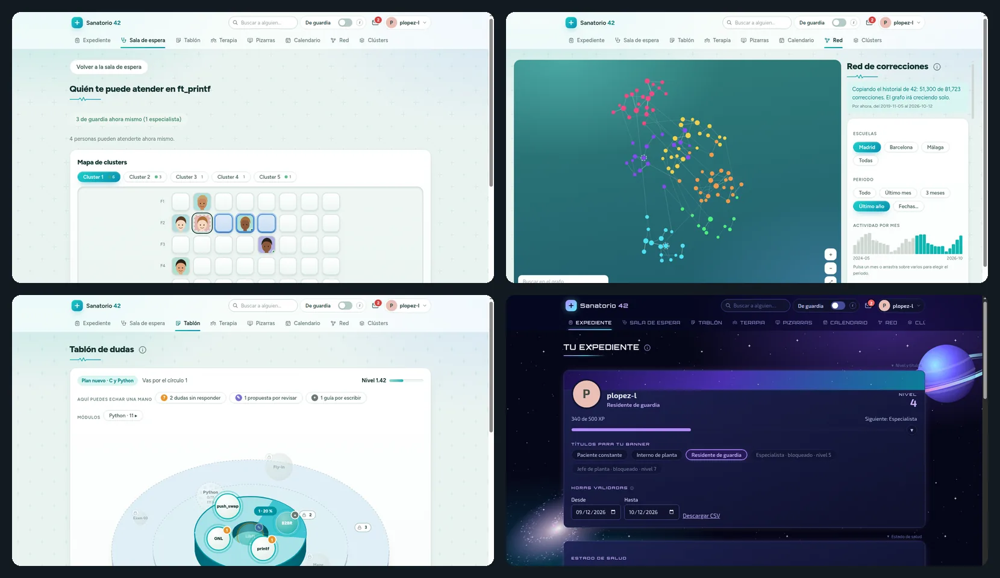

## En un minuto

42 es una escuela de programación sin profesores: se aprende preguntando a quien
tienes al lado. El problema es saber **a quién**. Peer4U lo resuelve con los
datos de la propia escuela y, alrededor, monta lo que hace falta para que la
ayuda ocurra: turnos de on-call, sprints en grupo, pizarras, dudas por proyecto,
un calendario, cursos y un Pomodoro.

Es un proyecto personal de [Alberto](https://github.com/ALRO-GM) (`albrodri` en
42), hecho de principio a fin: producto, diseño, código, despliegue y operación.

|                 |                                                                                                                                                      |
| --------------- | ---------------------------------------------------------------------------------------------------------------------------------------------------- |
| **Qué es**      | Aplicación web completa: API, web, base de datos y despliegue                                                                                        |
| **Tecnología**  | TypeScript de punta a punta · Node 22 y Fastify 5 · React 19 y Vite · SQLite (libSQL) · Docker y Caddy                                               |
| **Tamaño**      | 33 módulos de API con 248 rutas, 82 migraciones, 6 paquetes compartidos; 4 categorías con 17 secciones, 3 modos de interfaz, 7 estilos y 5 idiomas    |
| **Calidad**     | 3 329 tests en 231 ficheros (2 549 de la API y 780 de la web, con 62 ficheros de pantallas), cobertura mínima que solo sube, sin código muerto ni duplicado, y un despliegue que no sale sin la CI en verde |
| **Seguridad**   | Revisión completa documentada: permisos con doble cerradura, segundo factor en el panel, topes de intentos y un test que recorre todas las rutas con entradas imposibles |
| **Datos**       | Réplica propia de 5 campus de 42 (Madrid, Málaga, Urduliz, Barcelona y París) copiada con 1 200 peticiones por hora                                   |
| **Coste**       | 0 € al mes. La web y la máquina se cortan solas antes de pasar de la capa gratuita                                                                   |

Lo que este proyecto enseña de quien lo ha hecho:

- **Diseñar con una restricción dura.** La API de 42 da 1 200 peticiones por
  hora para toda la aplicación. La web copia los datos poco a poco a una base
  propia y nunca pregunta a 42 para pintar una pantalla.
- **Medir antes de afirmar.** Cada cifra de este documento dice si está medida,
  calculada o estimada, y de cuándo es.
- **Operar lo que se construye.** Despliegue con una orden que espera a la CI y
  se deshace solo, copias comprobadas, una guardia que corta el servicio antes
  de generar un céntimo de gasto y un panel con el consumo por persona y hora.
- **Cuidar el detalle.** Grafos interactivos en `<canvas>`, demostraciones
  animadas en vez de textos de ayuda, estilos intercambiables, tres niveles de
  detalle y todo usable en el móvil.

## Índice

- [Qué hace](#qué-hace)
- [Puesta en marcha](#puesta-en-marcha)
- [Probar](#probar)
- [Estructura del repositorio](#estructura-del-repositorio)
- [Cómo está hecho](#cómo-está-hecho)
- [Cómo se protege el código](#cómo-se-protege-el-código)
- [Seguridad](#seguridad)
- [Despliegue](#despliegue)
- [Coste cero garantizado](#coste-cero-garantizado)
- [Rendimiento y capacidad](#rendimiento-y-capacidad)
- [Problemas que surgieron y cómo se resolvieron](#problemas-que-surgieron-y-cómo-se-resolvieron)
- [Trabajo con asistentes y contexto entre sesiones](#trabajo-con-asistentes-y-contexto-entre-sesiones)
- [Estado y límites conocidos](#estado-y-límites-conocidos)
- [Documentación](#documentación)

## Qué hace

La lista completa, sección a sección, con el modo que la enseña y quién la ve,
está en **[docs/funcionalidades.md](docs/funcionalidades.md)**. En resumen:

Arriba hay cuatro categorías y, debajo, las secciones de la abierta
(`apps/web/src/app/sections.ts`). Cada cual elige cuánto enseña la web:
**simplificado** (lo justo para pedir y dar ayuda), **normal** o **loco por los
datos** (rankings, estadísticas y desgloses). El porqué de cada elemento en su
modo está en [docs/interfaz.md](docs/interfaz.md).

| Categoría    | Secciones                                                                | Para qué                                                                                                   |
| ------------ | ------------------------------------------------------------------------ | ---------------------------------------------------------------------------------------------------------- |
| **Yo**       | Perfil (la portada) · Agenda · Calendario                                | Nivel, XP y títulos; health check (pace y black hole); metas por proyecto; todo lo tuyo y lo de 42 en un calendario |
| **Ayuda**    | Peer to peer · Proyectos · Sprints · Pizarras · On-call                  | Quién te puede ayudar y dónde se sienta; dudas y guía por proyecto; quedar en grupo; explicar algo; ofrecerse |
| **Aprender** | Curso de git · Curso de shell · Not-games · Pomodoro                     | Cursos con terminal simulada; preguntas y ajedrez con más gente; concentrarse (y construir una startup)      |
| **Campus**   | Clústeres · Asientos · Avance · Red · Exámenes · Clasificaciones          | Plano del campus; con quién te sientas; tu avance frente a la media; red de correcciones; examen en vivo     |

Alrededor: el buscador de personas, el interruptor de disponibilidad, un buzón
con avisos y conversaciones, avisos de eventos que no se cierran sin contestar,
cuentas atrás, sugerencias arrastrando un bicho hasta el sitio, Personalizar
(orden, estilos y ajustes), un panel de gestión para quien administra, una
página para que el staff valide documentos, una versión para piscineros y un
juego secreto.

<details>
<summary>Capturas (de la demostración, con datos inventados)</summary>

| | |
| --- | --- |
| 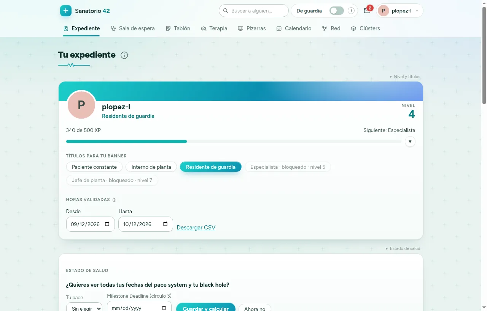 | 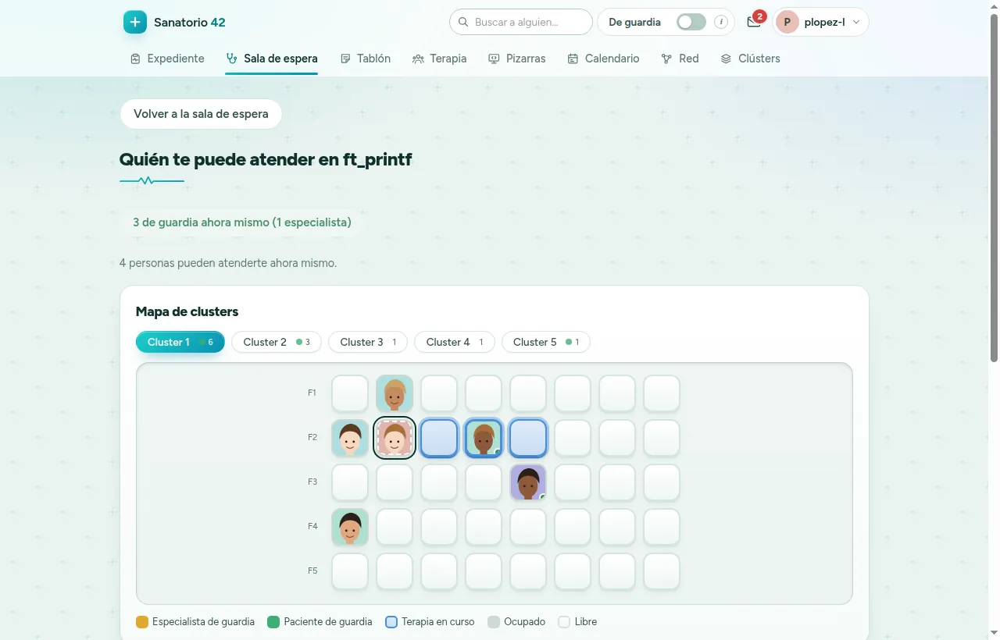 |
| 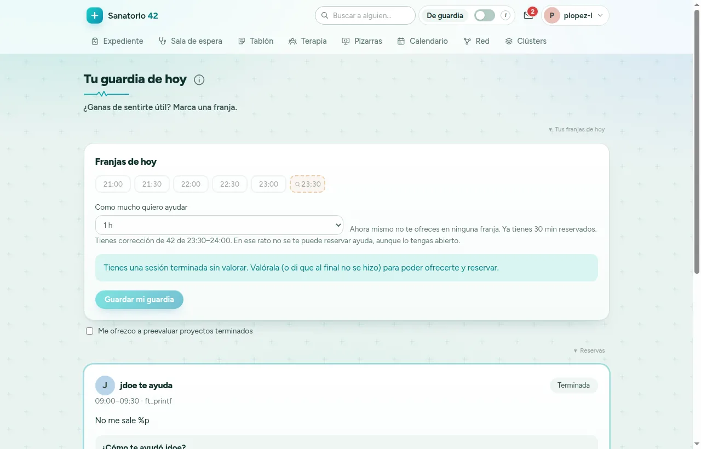 | 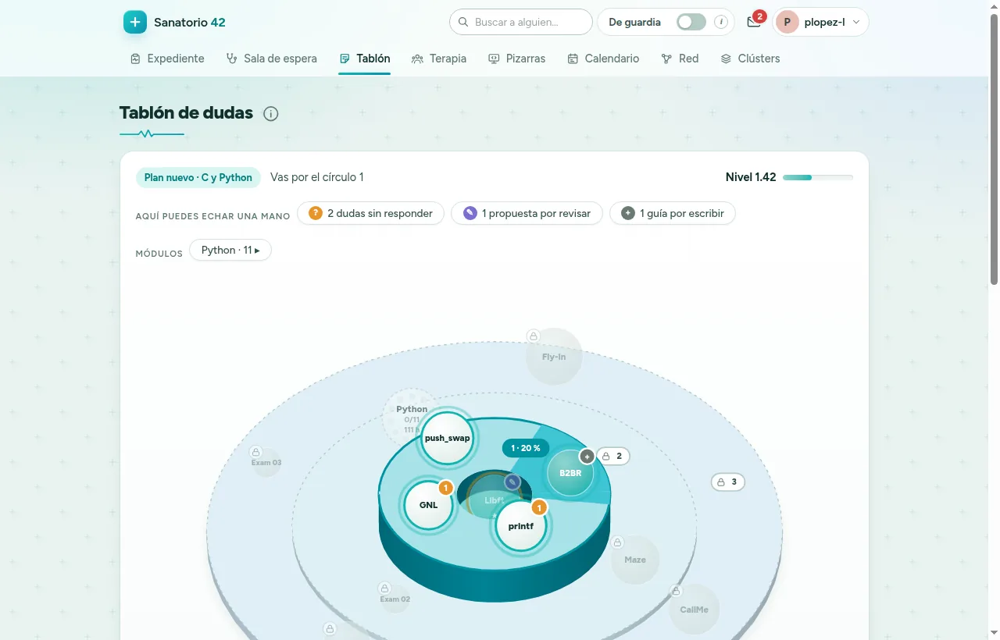 |
| 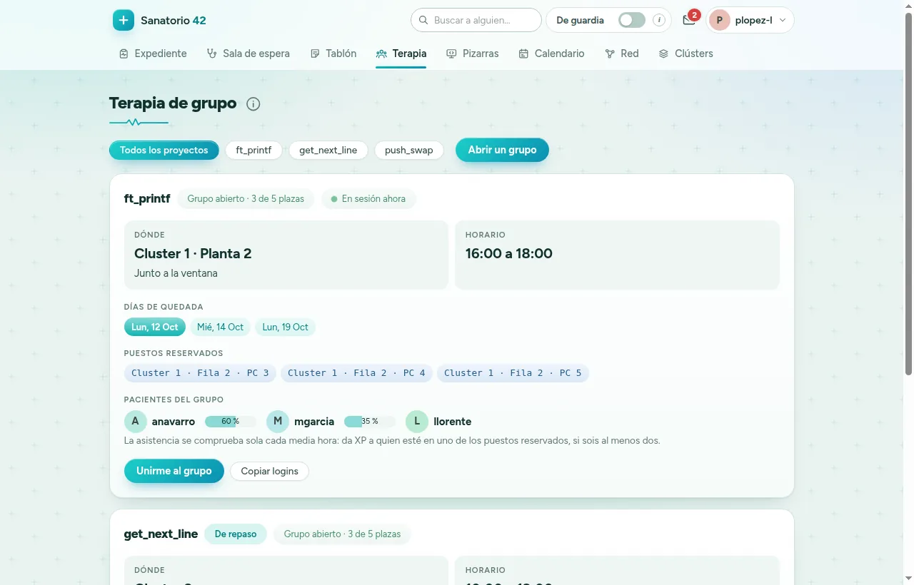 | 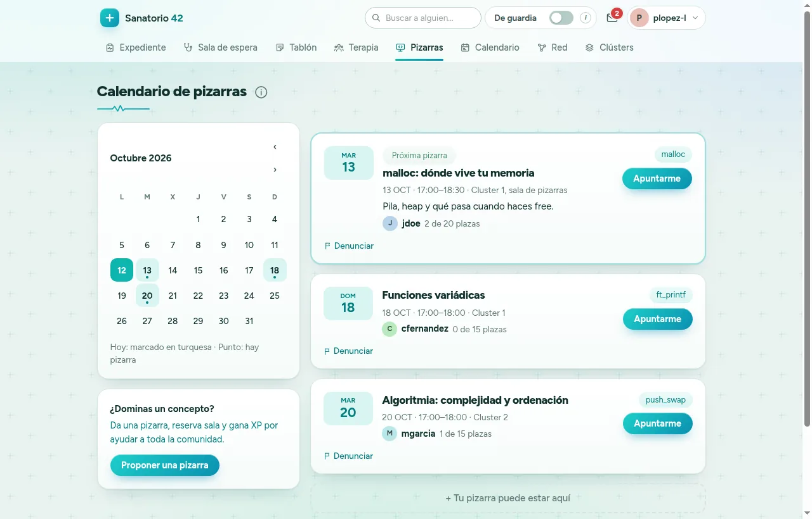 |
| 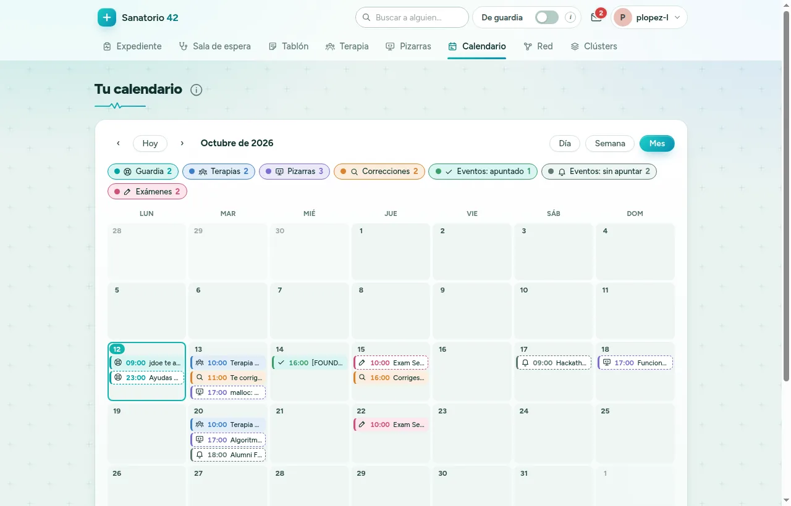 | 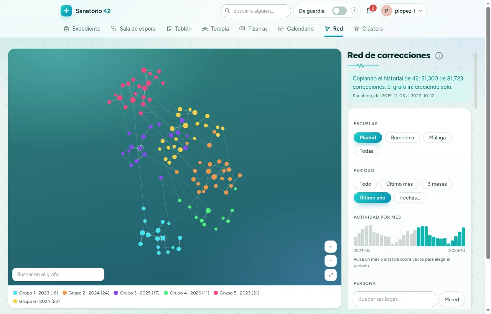 |
| 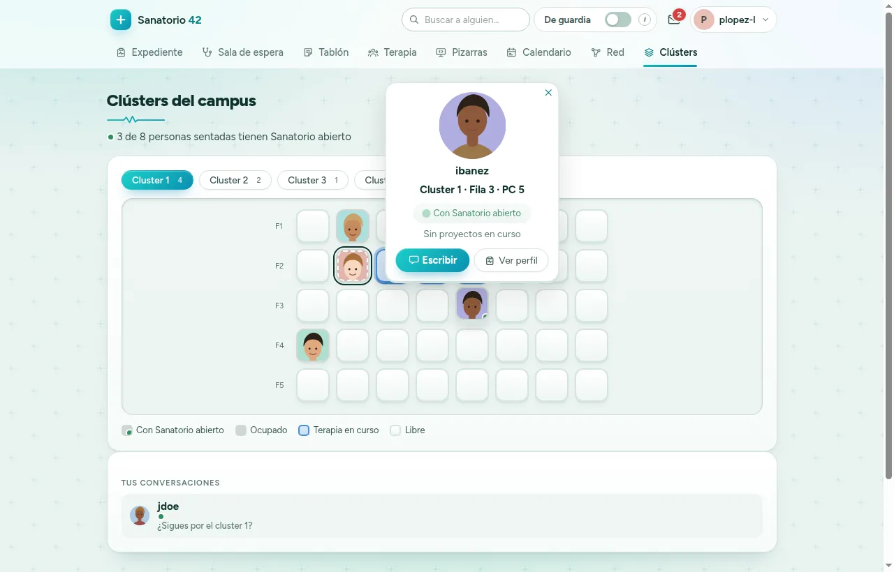 | 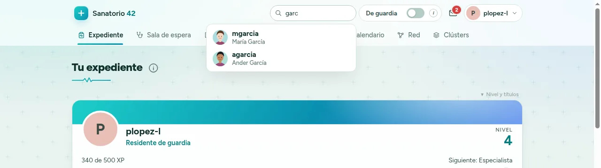 |
| 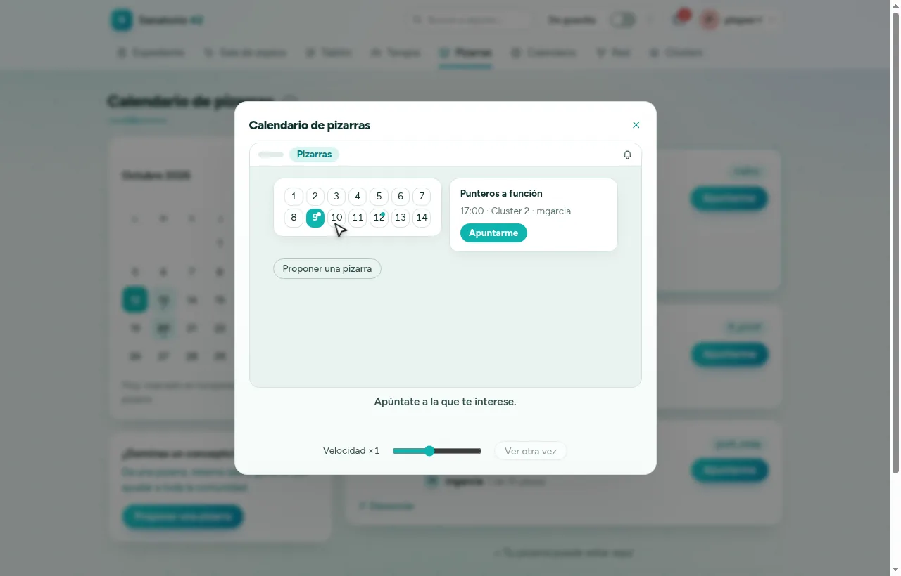 | 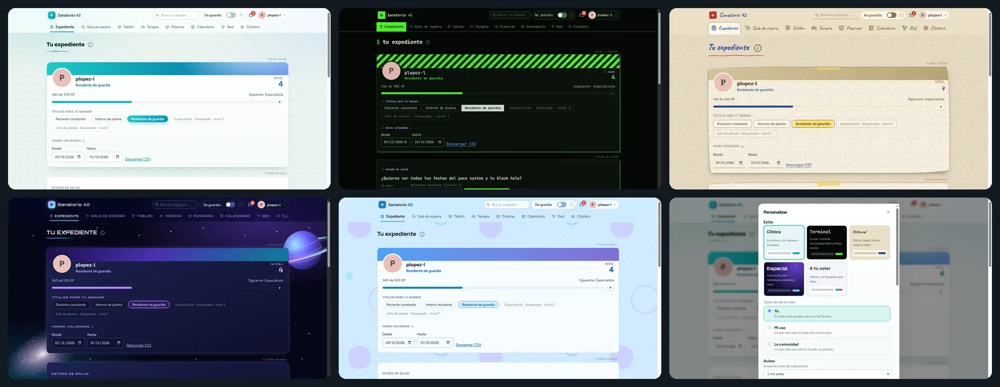 |
| 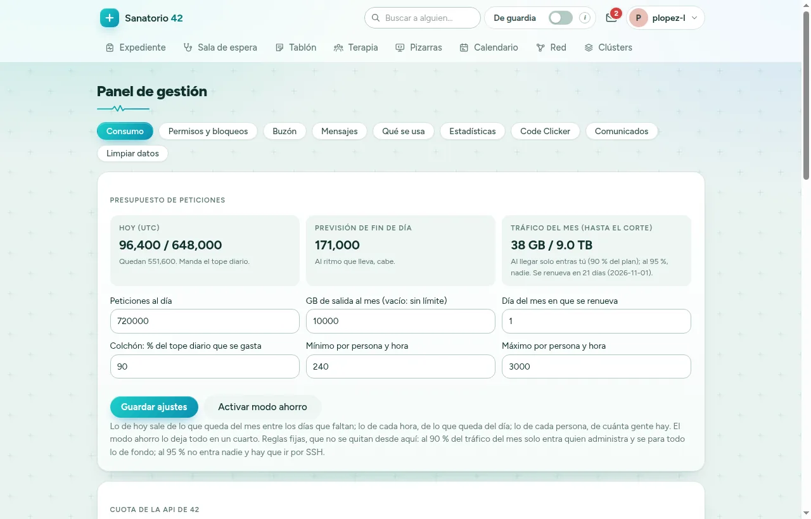 | 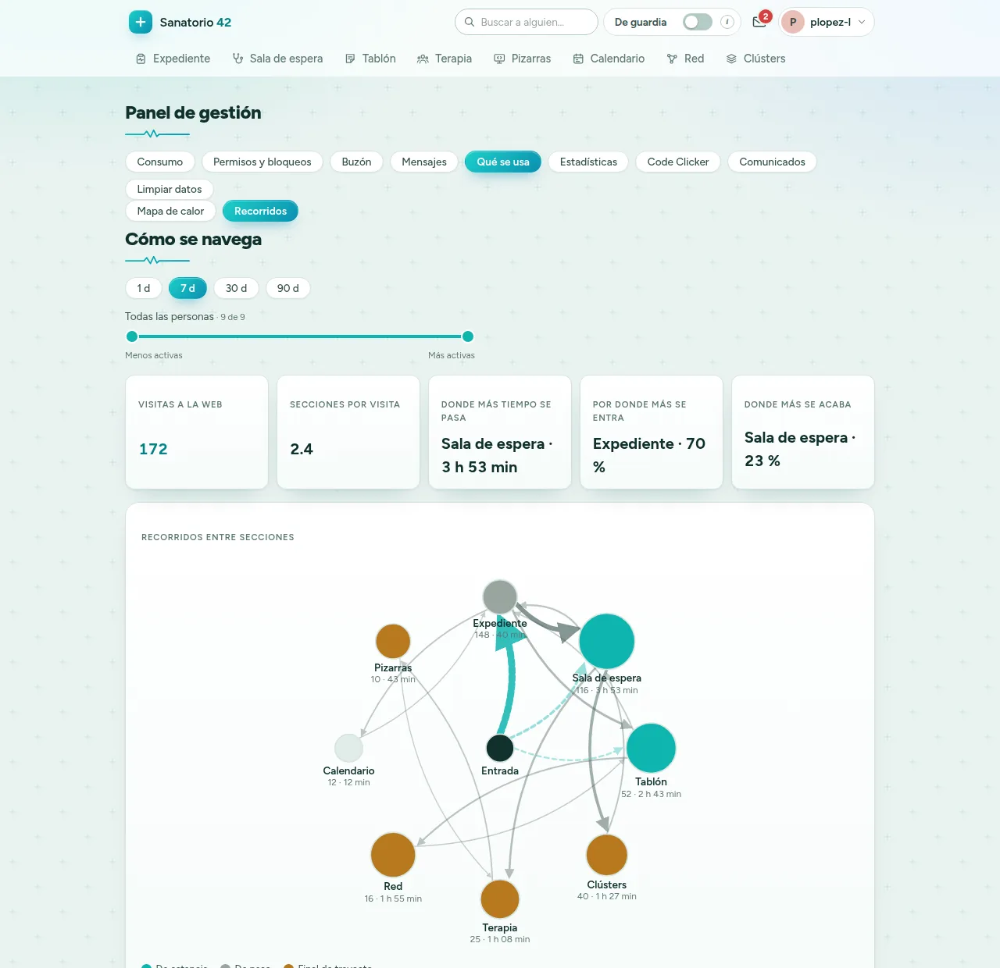 |
| 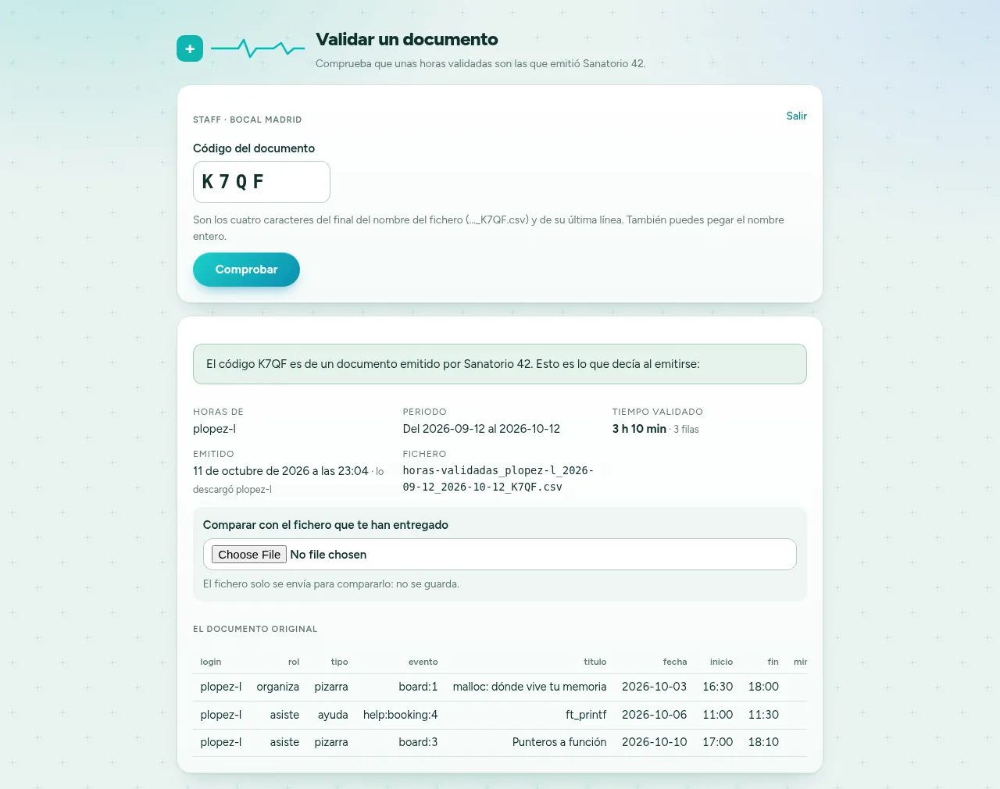 | 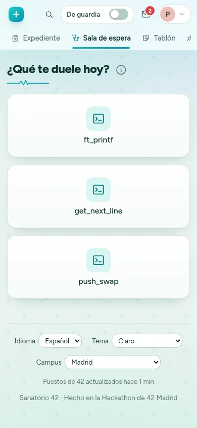 |

Algunas capturas son anteriores al cambio de nombre y a la reorganización en
cuatro categorías.

</details>

## Puesta en marcha

Hace falta Node 22 (`.nvmrc`).

```sh
npm ci
cp apps/api/.env.example apps/api/.env   # rellena las cinco obligatorias
npm run dev                              # API en :3000 y web en :5173
```

Las cinco obligatorias son `FORTY_TWO_UID`, `FORTY_TWO_SECRET`,
`FORTY_TWO_REDIRECT_URI`, `SESSION_SECRET` (32 caracteres o más) y
`FRONTEND_URL`; conviene poner también `FORTY_TWO_USER_AGENT` (sin él, 42
responde 403). El resto tiene valor de fábrica y está explicado en
`apps/api/.env.example`. La base se crea y se migra sola al arrancar. La web
llama a `/api` y Vite lo reenvía a la API local; en la app de 42, la URL de
retorno de desarrollo es `http://localhost:3000/auth/callback`.

Para trabajar solo en la web, sin API ni credenciales:

```sh
npm run dev:mock    # vite --mode mock: la web entera con la API de mentira
```

| Comando                         | Qué hace                                                                    |
| ------------------------------- | --------------------------------------------------------------------------- |
| `npm run dev`                   | API y web en modo desarrollo                                                |
| `npm run dev:mock`              | Solo la web, con la API de mentira en memoria (`apps/web/src/shared/api/mock`) |
| `npm run check`                 | Tipos, lint, formato, código sin uso, duplicados, textos y tests            |
| `npm run check:quick`           | Tipos, lint, formato y textos (sin tests)                                   |
| `npm test`                      | Tests de la API y de la web                                                 |
| `npm run test:coverage`         | Tests con los mínimos de cobertura, como la CI                              |
| `npm run build`                 | Compila los paquetes, la API, la web y la demostración (`/demo/`)           |
| `npm run textos -- --write`     | Comprueba las tablas de textos y reescribe `docs/textos/`                   |
| `npm run demo:new -- <nombre> <carpeta>` | Crea una demostración animada desde la plantilla                   |
| `npm run sync:status`           | Cuánto se ha copiado de 42 y de cuándo son los datos                        |
| `npm run sync:run`              | Avanza la copia de 42 sin levantar el servidor                              |
| `npm run db:migrate -w @sanatorio/api` | Aplica las migraciones pendientes                                    |
| `npm run hooks`                 | Activa los ganchos de git (`.githooks`: formato al hacer commit, `check` al subir) |

## Probar

- **Antes de dar algo por hecho, `npm run check`** (lo mismo que la CI salvo la
  cobertura; la CI corre `test:coverage`). Prettier formatea también el
  Markdown: `npm run format` lo arregla. Cómo leer cada fallo: la skill
  `comprobar` (`.claude/skills/comprobar`).
- **Con la API de mentira**: `npm run dev:mock` abre la web en
  `http://localhost:5173` con sesión y datos inventados. Es la misma API que usan
  la demostración pública y los tests de pantallas.
- **Tests**: `apps/api/tests/unit` (con base en memoria y reloj falso),
  `apps/api/tests/integration` (la app entera con 42 simulado) y `apps/web/tests`
  (funciones puras en Node y pantallas en jsdom contra la API de mentira,
  buscando por rol y nombre). Ningún test sale a la red. Qué cubre cada uno y
  las cinco familias de cada prueba: [docs/tests.md](docs/tests.md).

## Estructura del repositorio

```
apps/
  api/                 API (Node 22, Fastify 5, SQLite con libSQL, zod)
    src/
      main.ts          abre el puerto, arranca los trabajos y para
      app/             montaje: composición de módulos, CORS, errores, salud
      config/          variables de entorno, validadas al arrancar
      core/            base de datos y migraciones, sesión, actor, errores,
                       eventos, mundos (audience), validación, topes
      integrations/    cliente de la API de 42 (token, ritmo, reintentos) y Slack
      modules/         una carpeta por funcionalidad (33)
      cli/             migrar, estado y avance de la réplica, informe de uso
    tests/             unit/, integration/ y helpers/ (42 de mentira)
  web/                 web (React 19, Vite, TypeScript)
    src/
      app/             pantalla raíz, cabecera, navegación, secciones, Personalizar
      features/        una carpeta por funcionalidad (30)
      shared/          cliente de la API (real y de mentira), textos, modos,
                       orden y bloques, demostraciones, ventanitas, piezas comunes
      themes/          un estilo por carpeta: manifiesto, hoja e imágenes
      styles/          variables y hojas comunes a todos los estilos
    tools/             plugin y comprobación de textos, plantilla de demostraciones
    tests/             funciones puras, ui/ (pantallas) y unit/
packages/
  contracts/           tipos de cada respuesta de la API (solo tipos)
  course/              plantilla común de los cursos
  gitsim/  shellsim/   git y shell simulados (web y API)
  clicker/ startup/    motores de Code Clicker y de la startup del Pomodoro
infra/                 Dockerfile, compose, Caddyfile, Oracle y guiones
                       (despliegue, copias, restauración, guardia de límites)
docs/                  documentación (ver el final)
.claude/               skills y subagentes para trabajar con asistentes
```

## Cómo está hecho

Un monolito modular en una sola máquina. Un proceso de Node sirve la API, la web
compilada y la demostración; delante, Caddy pone HTTPS y las cabeceras de
seguridad. La base es un fichero de SQLite. Un bucle de fondo copia el campus de
42 a esa base y todas las pantallas leen de ahí.

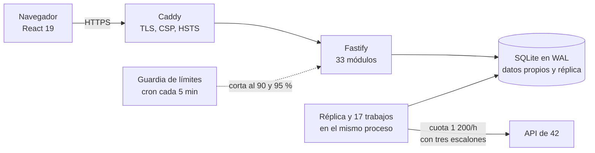

Cada módulo de la API tiene la misma forma (rutas que validan con zod, servicio
con las reglas, repositorio con el SQL, `*.rules.ts` puras) y solo se habla con
los demás por su `index.ts` o por eventos. La web tiene una carpeta por
funcionalidad, y solo `shared/api` habla con la API, con un cliente real y otro
de mentira del mismo tipo.

- **Cada componente por dentro** (barreras, OAuth y sesión, migraciones,
  mundos de estudiantes y piscineros, réplica y cuota de 42, eventos, trabajos,
  cada módulo, navegación, textos en CSV, modos, Personalizar, cliente y mock,
  pulso, demostraciones, paquetes, contenedores, CI, copias y guardia), con
  diagramas, pros y contras y alternativas, y el recorrido de una petición de
  punta a punta: **[docs/componentes.md](docs/componentes.md)**.
- Capas, réplica de 42 con sus tablas de ritmo y red de correcciones:
  [docs/architecture.md](docs/architecture.md).
- Contrato HTTP de cada ruta: [docs/api.md](docs/api.md).

Decisiones que lo definen:

- **Réplica local de 42.** Se copia lo que la web enseña y las lecturas salen
  de ahí; lo caro se copia una vez y despacio, con un cursor, y después solo lo
  que cambia. Lo que sobra de cada hora (de noche, en los últimos minutos) se
  aprovecha en vez de perderse.
- **Monolito modular y SQLite.** Una máquina, un proceso, un fichero: copias
  con un guion y nada más que mantener. Las fronteras entre módulos las vigila el
  linter.
- **XP que no se puede puentear.** Cada punto sale de un hecho comprobable (una
  sesión con sus dos códigos y valorada por los dos, una respuesta que resuelve),
  una sola vez por referencia y con topes.
- **El servidor manda en lo que importa.** Reloj de las partidas, estrellas de
  los cursos (la API vuelve a ejecutar el intento con el mismo simulador) y
  cuentas de los juegos.
- **Sin estado de más en el navegador.** Navegación en el hash, personalización
  en `localStorage`, cada sección descargada al abrirla y un solo pulso de fondo.
- **Textos y estilos como datos.** Los textos viven en tablas CSV con una
  columna por idioma; los estilos, en carpetas que solo dan valor a variables.
- **Privacidad.** No se guardan correos, teléfonos, tokens de 42 ni los
  comentarios de las correcciones. Cada cual descarga o anonimiza sus datos.
  Estudiantes y piscineros no se ven entre sí.

## Cómo se protege el código

Lo que impide que una funcionalidad nueva rompa otra, por orden de cuándo actúa:

1. **Contrato de tipos compartido** (`packages/contracts`): si la API cambia una
   respuesta y la web no, no compila.
2. **API de mentira obligatoria**: el tipo `Api` obliga a que todo lo que se
   añade al cliente real exista también en el de mentira.
3. **Fronteras que vigila el linter**: `core` e `integrations` no importan de
   los módulos; de otro módulo, solo su `index.ts`; en la web, una
   funcionalidad no importa de otra. Solo `replica`, `network` y `exams` reciben
   el cliente de 42 (lista cerrada en un test).
4. **Entradas validadas**: el entorno al arrancar y cada parámetro y cuerpo con
   zod en la ruta.
5. **Migraciones inmutables**, que se aplican solas y, en producción, aparte.
6. **Reglas en funciones puras** (`*.rules.ts`) con reloj falso en los tests.
7. **Tests de cinco familias** (normal, límite, vacío y enorme, imprevisible,
   permisos), pantallas probadas como las usa una persona y un test que recorre
   todas las rutas con entradas extremas: sin sesión, 401; `/admin`, 403 a quien
   no administra; nunca un error interno.
8. **Doble cerradura en los permisos**: lo de admin y lo de staff lo comprueba
   cada servicio y una barrera por la que pasan todas las peticiones.
9. **`npm run check`** y los ganchos de git, y la **CI** en cada subida
   (`.github/workflows/ci.yml`): todo lo anterior, la cobertura mínima, la
   compilación y la imagen de Docker.
10. **El despliegue se protege a sí mismo**: no sale sin la etiqueta
    `ci-ok/<sha>` de la CI, hace copia comprobada, migra aparte y vuelve solo a
    la versión anterior si la nueva no responde.
11. **Normas escritas** en [AGENTS.md](AGENTS.md) para personas y asistentes.

## Seguridad

En octubre de 2026 se revisó todo el código; cada hallazgo, su gravedad y su
arreglo están en [docs/revision-seguridad.md](docs/revision-seguridad.md).

| Quién            | Cómo entra                   | A qué llega                                         |
| ---------------- | ---------------------------- | --------------------------------------------------- |
| Sin sesión       | —                            | La entrada, la privacidad y la demostración         |
| Estudiante       | OAuth de 42 (42cursus)       | Todo menos `/admin` y `/staff`                      |
| Piscinero        | OAuth de 42 (piscina en curso), si está abierta | Solo lo que quien administra le permite, y solo a piscineros de su campus |
| Cuenta bloqueada | OAuth de 42                  | Solo a saber que lo está y a salir                  |
| Admin            | OAuth de 42 y el rol         | Lo de estudiante y `/admin`, tras un segundo factor |
| Staff            | Clave que crea un admin      | **Solo** a validar documentos y avisos del edificio |

En producción: contenedor sin root, sin capacidades ni escalada de privilegios,
con tope de memoria; política de contenido estricta (nada en línea ni de otros
dominios); HSTS y `frame-ancestors 'none'`; cookie de sesión firmada,
`HttpOnly`, `Secure` y `__Host-`; topes de intentos por IP para lo que no tiene
sesión y presupuesto de peticiones por persona para lo que sí; respuestas con
`no-store`; secretos fuera de git. La sección y la persona van en el hash
(`#/expediente/jdoe`), que no llega al servidor ni a otras webs.

## Despliegue

Una máquina de Oracle Cloud (ARM A1, 4 OCPU, 24 GB de memoria y 200 GB de
disco: el máximo gratuito) con Docker: la app en un contenedor y Caddy en otro,
con HTTPS automático.

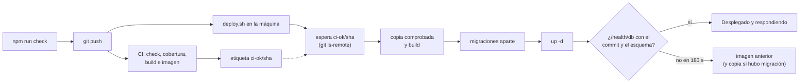

```sh
ssh ubuntu@<ip> 'cd /opt/sanatorio && git pull -q --ff-only && infra/scripts/deploy.sh'
```

Lo habitual es lanzarlo desacoplado del SSH y vigilar `infra/deploy.log` hasta
«Desplegado y respondiendo»: el procedimiento completo está en la skill
`desplegar` (`.claude/skills/desplegar`). Guía desde cero (máquina, red, DNS,
app de 42, copias, mantenimiento): [docs/deploy-oracle.md](docs/deploy-oracle.md).
Copias: `infra/scripts/backup.sh` cada noche y antes de cada despliegue
(`VACUUM INTO`, comprobada, 14 guardadas), `restore.sh` y `pull-backups.sh`
para bajarlas a otro ordenador.

## Coste cero garantizado

No se paga nada: ni máquina, ni dominio, ni base de datos, ni CI. Y está hecho
para que siga siendo así aunque la cuenta de Oracle sea de pago por uso.

| Qué                       | Dónde                                                             | Qué hace                                                                          |
| ------------------------- | ----------------------------------------------------------------- | --------------------------------------------------------------------------------- |
| Corte al 90 %             | `modules/admin/budget.rules.ts` e `infra/scripts/limits-guard.sh` | Solo entra quien administra, no corre nada de fondo y la máquina calla lo que habla con internet |
| Corte al 95 %             | Los mismos                                                        | No entra nadie; los contenedores se paran hasta el mes siguiente                   |
| Presupuesto de peticiones | `budget.rules.ts`                                                 | 720 000 al día, repartidas entre quien está conectado (de 240 a 3 000 por persona) |
| Tráfico de salida         | Guardia en la máquina, por cron cada 5 minutos                    | Cuenta los bytes de la tarjeta de red contra los 10 TB mensuales                  |
| Tamaño de la máquina      | La misma guardia                                                  | Avisa si pasa de 3 OCPU, 21 GB o 180 GB                                            |
| Cuota de 42               | `modules/replica`                                                 | Reserva horaria para lo crítico y cola con turno para lo demás                    |

Los cortes no son regulables y no tienen excepciones: es una norma del
proyecto.

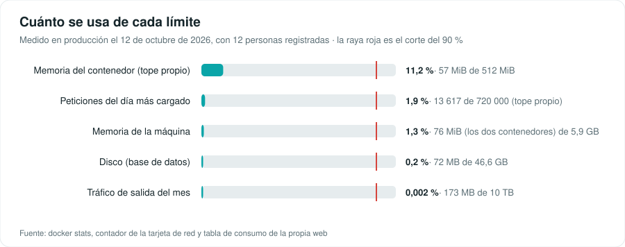

## Rendimiento y capacidad

Qué se cambió, cuánto mejoró y cómo se midió, punto por punto:
[docs/rendimiento.md](docs/rendimiento.md).

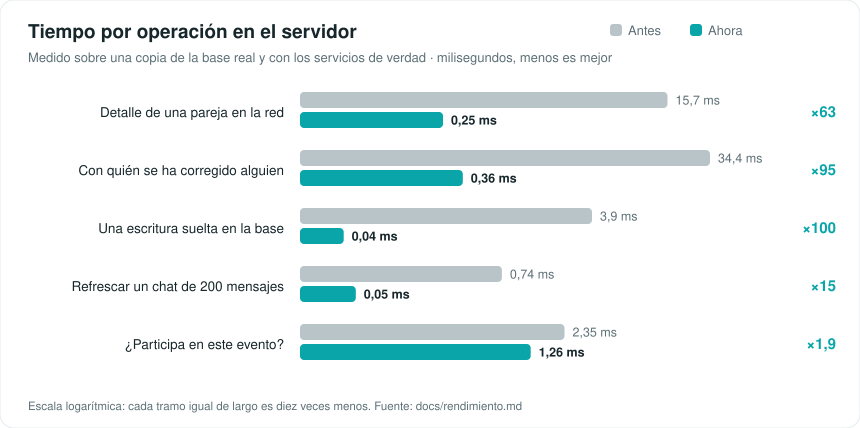

| Decisión                                           | Antes             | Ahora              | Mejora                  | Cifra     |
| -------------------------------------------------- | ----------------- | ------------------ | ----------------------- | --------- |
| Estadísticas de la base (`ANALYZE`): pareja        | 15,7 ms           | 0,25 ms            | 63 veces                | Medida    |
| Estadísticas de la base: con quién se ha corregido | 34,4 ms           | 0,36 ms            | 95 veces                | Medida    |
| WAL en vez del diario clásico: una escritura       | 3,9 ms            | 0,04 ms            | 100 veces               | Medida    |
| El chat solo pide lo nuevo                         | 42,4 kB y 0,74 ms | 15 bytes y 0,05 ms | 2 800 veces menos datos | Medida    |
| Un solo pulso de fondo; pestaña en reposo          | 60 peticiones/h   | 42 peticiones/h    | Un 30 % menos           | Calculada |
| Pestaña oculta con un chat abierto                 | 510 peticiones/h  | 12 peticiones/h    | 42 veces menos          | Calculada |

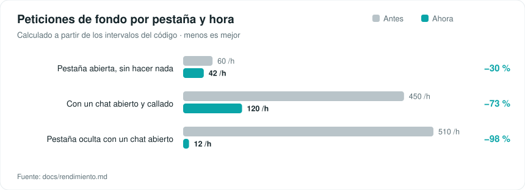

Otras decisiones que cuentan: cada sección se descarga al abrirla y la API de
mentira no entra en producción; el análisis de la red se guarda en caché por
combinación de filtros; los grafos se pintan en `<canvas>` sin pasar por React;
y sin nadie mirando (pestaña oculta o 30 s sin tocar nada) las animaciones se
paran (`shared/still.ts`).

**Cuánta gente aguanta.** Es una estimación hecha con el consumo de los dos
primeros días de uso real (11 y 12 de octubre de 2026: 12 personas, 554
peticiones y 10 MB por persona y día). El primer tope que se alcanza es el
presupuesto propio de peticiones, unas **1 170 personas al día**; el tráfico de
salida de Oracle daría para unas 25 veces más. La cuota de 42 no limita cuánta
gente entra, sino cuánta tiene su agenda de 42 recién actualizada: por encima de
unas 80 personas a la vez, las agendas van por turno y el resto de la web sigue
igual. **No se ha hecho una prueba de carga**: lo que aguantan la memoria y el
procesador no se sabe.

## Problemas que surgieron y cómo se resolvieron

| Problema                                                                                 | Qué se hizo                                                                                                                                  |
| ---------------------------------------------------------------------------------------- | -------------------------------------------------------------------------------------------------------------------------------------------- |
| La API de 42 da 1 200 peticiones por hora para toda la aplicación                         | Réplica local en SQLite. Cada petición a 42 pasa por una cuota con tres escalones; lo que puede esperar hace cola y enseña su turno           |
| La cuota de 42 se renueva a la hora en punto y lo que no se gasta se pierde               | De noche y en los últimos minutos de cada hora la copia gasta lo que sobra, por turnos y con una rampa que deja sitio al mantenimiento         |
| 42 marca «Ok» también en correcciones con un 0                                            | El veredicto sale de la nota y de la mínima del proyecto, que se deduce de cómo ha acabado la gente                                           |
| 42 no publica el _pace_, el plan de estudios ni la nota mínima                            | Se deducen de los datos: rangos y fechas de los proyectos y la fecha oficial de _black hole_                                                  |
| Consultas de la red que recorrían todas las correcciones del campus                       | `ANALYZE` al abrir la base y `PRAGMA optimize`: de 15,7 a 0,25 ms sin tocar una consulta                                                      |
| Mientras se copiaba de 42, las visitas esperaban                                          | Base en WAL: quien lee no espera a quien escribe                                                                                              |
| Un chat abierto pedía sus 200 mensajes cada 8 segundos                                    | Solo se pide lo nuevo, la espera crece si nadie escribe y con la pestaña oculta no se pregunta                                               |
| El grafo de París (miles de personas) bloqueaba la página                                 | Tope de personas y uniones, simulación que se para al enfriarse, capas guardadas y un modo ligero para grafos enormes                         |
| Oracle respondía «Out of host capacity» para las máquinas gratuitas                       | Cuenta de pago por uso con una guardia que impide gastar, y la máquina ampliada al máximo gratuito                                            |
| Pasar a pago por uso abre la puerta a una factura                                         | Cortes fijos al 90 % y al 95 % de cada límite gratuito, en la web y en la máquina, sin excepciones                                            |
| Dos despliegues murieron al cortarse el SSH                                               | `deploy.sh` se lanza desacoplado, con cerrojo, y se vigila su registro                                                                        |
| Esperar a la CI gastaba el cupo de 60 consultas/h de la API de GitHub                     | La CI deja su veredicto como etiqueta de git y `deploy.sh` la lee con `git ls-remote`                                                          |
| Se podían hacer trampas en los juegos y los cursos editando la petición                   | El servidor vuelve a ejecutar el intento o rehace las cuentas con el mismo motor que la web                                                   |
| Un CSV de horas se puede retocar antes de entregarlo                                      | Cada descarga lleva un código de verificación y la web guarda la copia: el staff la comprueba con una cuenta que solo sirve para eso           |
| Quien no es de 42 no podía ver la web                                                     | Demostración pública con datos inventados, que no habla con el servidor                                                                      |
| Un JSON mal escrito o una fecha imposible daban un error interno                          | Un test recorre todas las rutas con entradas extremas: encontró cinco casos y ya no queda ninguno                                             |
| La comprobación de admin estaba copiada en siete sitios                                   | Una sola función y una barrera global para todo `/admin`, con segundo factor                                                                  |
| Las copias nocturnas de producción no se estaban guardando, y nadie lo veía               | El guion comprueba que puede escribir, verifica la copia y limpia lo que deja a medias                                                        |
| Las ventanitas flotantes se tapaban entre sí y con la página                              | Un gestor común (`shared/dock`) da a cada una su hueco en una pila                                                                            |
| **Abierto**: en un ordenador de escritorio, trozos rectangulares de la página dejan de pintarse un instante | Sin resolver. Lo probado y lo que queda: [docs/bug-trozos-sin-pintar.md](docs/bug-trozos-sin-pintar.md)                     |

## Trabajo con asistentes y contexto entre sesiones

El proyecto se desarrolla con asistentes de código, a veces varios a la vez en
ramas separadas. Lo que hay que recordar vive en el repositorio:

| Fichero                                                        | Qué guarda                                                                                       |
| -------------------------------------------------------------- | ------------------------------------------------------------------------------------------------ |
| [AGENTS.md](AGENTS.md)                                         | Las normas: de código, de producto, de XP y de límites. Se leen siempre                          |
| `.claude/skills/` y `.claude/agents/`                          | Un procedimiento por tarea (nueva funcionalidad, traducir, migración, comprobar, revisar, desplegar, paralelo, retomar) y los subagentes que los usan |
| [docs/contexto.md](docs/contexto.md)                           | El porqué: estado, decisiones con su motivo y cómo está el despliegue                            |
| [docs/tareas-tras-compactar.md](docs/tareas-tras-compactar.md) | El qué: el plan vigente con casillas, en orden                                                   |
| [docs/flujo-de-trabajo.md](docs/flujo-de-trabajo.md)           | El camino de una idea a producción y el trabajo en paralelo                                      |

Antes de compactar se ponen al día el plan y el contexto; al retomar, «revisa y
ejecuta las tareas tras compactar» basta para seguir.

## Estado y límites conocidos

- En producción desde el 11 de octubre de 2026.
- Hay un [bug visual abierto](docs/bug-trozos-sin-pintar.md) en escritorio.
- Los avisos necesitan la web abierta: no hay notificaciones _push_ (sí una
  notificación del sistema si la pestaña está abierta pero oculta).
- La personalización y el modo de la interfaz viven en el navegador, no en la
  cuenta.
- La sesión dura 12 horas y no se puede revocar antes (bloquear sí corta).
- Las franjas que cada quien abre en 42 para corregir no se ven: haría falta un
  permiso que la aplicación no pide.
- Textos: 3 731 en las tablas, todos en español e inglés y 3 660 en catalán,
  euskera y francés (lo que falta es sobre todo del panel). Los mensajes de error
  de la API solo están en español; fuera de él se enseña uno genérico.
- No hay prueba de carga ni pruebas de extremo a extremo contra la API real.

Ideas para después: prueba de carga, notificaciones _push_, guardar la
personalización en la cuenta, reservar una preevaluación con su propia XP,
moderar desde la propia denuncia y aplicación instalable (PWA).

## Documentación

**Para entender el proyecto**

- [docs/funcionalidades.md](docs/funcionalidades.md): todo lo que hace la web, por sección, con su modo y quién la ve.
- [docs/componentes.md](docs/componentes.md): cada componente por dentro, con diagramas, pros, contras y alternativas.
- [docs/architecture.md](docs/architecture.md): capas, módulos, réplica de 42, red de correcciones y cómo ampliar.
- [docs/interfaz.md](docs/interfaz.md): categorías, modos, importancia de cada elemento, valoración de uso y dónde va algo nuevo.
- [docs/api.md](docs/api.md): contrato HTTP.

**Por funcionalidad**

- [docs/agenda.md](docs/agenda.md), [docs/asientos.md](docs/asientos.md), [docs/blackhole.md](docs/blackhole.md) (Avance), [docs/red-vistas.md](docs/red-vistas.md).
- [docs/curso-git.md](docs/curso-git.md), [docs/curso-shell.md](docs/curso-shell.md), [docs/curso-shell-investigacion.md](docs/curso-shell-investigacion.md), [docs/plantilla-cursos.md](docs/plantilla-cursos.md).
- [docs/pomodoro-startup.md](docs/pomodoro-startup.md), [docs/pomodoro-sonidos.md](docs/pomodoro-sonidos.md), [docs/code-clicker.md](docs/code-clicker.md).
- [docs/piscineros.md](docs/piscineros.md), [docs/personas-ocultas.md](docs/personas-ocultas.md), [docs/mantenimiento.md](docs/mantenimiento.md), [docs/avisos-cuenta-atras.md](docs/avisos-cuenta-atras.md), [docs/sugerencias.md](docs/sugerencias.md).
- [docs/demos.md](docs/demos.md): criterios y plantilla de las demostraciones animadas.
- [docs/textos.md](docs/textos.md) y [docs/textos/](docs/textos/README.md): tablas de textos e idiomas; [docs/glosario-frances.md](docs/glosario-frances.md).
- [apps/web/src/themes/README.md](apps/web/src/themes/README.md): cómo crear un estilo.

**Operación y calidad**

- [docs/deploy-oracle.md](docs/deploy-oracle.md): despliegue, copias, límites y mantenimiento de la máquina.
- [docs/consumo-api.md](docs/consumo-api.md): consumo de la API de 42.
- [docs/rendimiento.md](docs/rendimiento.md): cada mejora con su antes, su después y cómo se midió.
- [docs/tests.md](docs/tests.md): qué cubre cada test y cómo se protege producción.
- [docs/revision-seguridad.md](docs/revision-seguridad.md) y [docs/revision-2026-10/](docs/revision-2026-10/README.md): revisiones de seguridad y calidad.
- [docs/uso-informe.md](docs/uso-informe.md): informe de uso agregado, sin datos personales.
- [docs/bug-trozos-sin-pintar.md](docs/bug-trozos-sin-pintar.md): el bug abierto y su tabla de pruebas.

**Para trabajar en él**

- [AGENTS.md](AGENTS.md): normas del proyecto.
- [docs/flujo-de-trabajo.md](docs/flujo-de-trabajo.md): de la idea a producción.
- [docs/contexto.md](docs/contexto.md) y [docs/tareas-tras-compactar.md](docs/tareas-tras-compactar.md): estado, decisiones y plan.
- [docs/referencia/](docs/referencia/): notas y documentación oficial de la API de 42.
