# Sanatorio 42

[](https://github.com/ALRO-GM/sanatorio-42/actions/workflows/ci.yml)


**La web que le dice a un estudiante de 42 quién puede ayudarle ahora mismo con
su proyecto, y dónde está sentado.** En producción en
[sanatorio42.duckdns.org](https://sanatorio42.duckdns.org) (se entra con la
cuenta de 42).

**¿No tienes cuenta de 42?** Hay una
[demostración con datos inventados](https://sanatorio42.duckdns.org/demo/): la
web entera, sin registrarte y sin que salga nadie real.

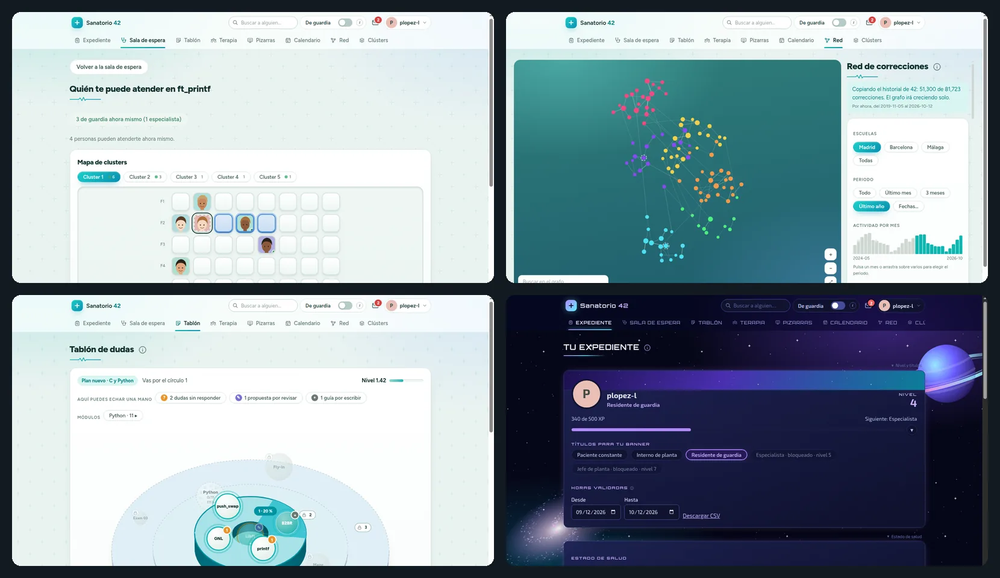

## En un minuto

42 es una escuela de programación sin profesores: se aprende preguntando a quien
tienes al lado. El problema es saber **a quién**. Sanatorio 42 lo resuelve con
los datos de la propia escuela y, alrededor, monta lo que hace falta para que la
ayuda ocurra: guardias, grupos de estudio, pizarras, un tablón de dudas y un
calendario.

Es un proyecto personal de [Alberto](https://github.com/ALRO-GM) (`albrodri` en 42),
hecho de principio a fin: producto, diseño, código, despliegue y operación.

|                         |                                                                                                       |
| ----------------------- | ----------------------------------------------------------------------------------------------------- |
| **Qué es**              | Aplicación web completa: API, web, base de datos y despliegue                                         |
| **Tecnología**          | TypeScript de punta a punta · Node 22 y Fastify · React 19 y Vite · SQLite · Docker y Caddy           |
| **Tamaño** | 20 módulos de API, 113 rutas, 33 migraciones, 15 secciones de web, 5 estilos visuales, 4 idiomas |
| **Calidad** | 608 tests automáticos (cobertura del 97 % en la API), tipos estrictos, lint con fronteras entre módulos y CI en cada subida |
| **Seguridad** | Revisión completa documentada: permisos con doble cerradura, topes de intentos y un test que recorre todas las rutas con entradas imposibles |
| **Datos**               | 193 784 correcciones y 15 032 personas de 4 campus copiadas de la API de 42                           |
| **Rendimiento**         | Consultas hasta 100 veces más rápidas tras la revisión; la portada llega en unos 33 ms                |
| **Coste**               | 0 € al mes. La web se corta sola antes de pasar de la capa gratuita                                   |
| **Recursos que ocupa**  | 57 MiB de memoria y un fichero de 72 MB                                                               |

Lo que este proyecto enseña de quien lo ha hecho:

- **Diseñar con una restricción dura.** La API de 42 da 1 200 peticiones por
  hora para toda la aplicación. La web copia los datos poco a poco a una base
  propia y nunca pregunta a 42 para pintar una pantalla.
- **Medir antes de afirmar.** Cada cifra de este documento dice si está medida,
  calculada o estimada, y cómo se obtuvo.
- **Operar lo que se construye.** Despliegue con una orden, copias de
  seguridad, una guardia que corta el servicio antes de generar un solo céntimo
  de gasto y un panel con el consumo por persona y por hora.
- **Cuidar el detalle.** Grafos interactivos en `<canvas>`, demostraciones
  animadas en vez de textos de ayuda, cinco estilos intercambiables y todo
  usable en el móvil.

## Índice

- [Funcionalidades](#funcionalidades)
  - [Expediente](#expediente)
  - [Sala de espera](#sala-de-espera)
  - [Guardia](#guardia)
  - [Tablón de dudas](#tablón-de-dudas)
  - [Terapia de grupo](#terapia-de-grupo)
  - [Pizarras](#pizarras)
  - [Calendario](#calendario)
  - [Avisos y sala del evento](#avisos-y-sala-del-evento)
  - [Red de correcciones](#red-de-correcciones)
  - [Clústers](#clústers)
  - [Buscador de personas](#buscador-de-personas)
  - [Demostraciones animadas](#demostraciones-animadas)
  - [Personalizar y estilos](#personalizar-y-estilos)
  - [En el móvil](#en-el-móvil)
  - [Panel de gestión](#panel-de-gestión)
  - [Validar documentos](#validar-documentos)
  - [Demostración sin cuenta](#demostración-sin-cuenta)
  - [Code Clicker](#code-clicker)
- [Problemas que surgieron y cómo se resolvieron](#problemas-que-surgieron-y-cómo-se-resolvieron)
- [Cómo está hecho](#cómo-está-hecho)
  - [Arquitectura](#arquitectura)
  - [Estructura del repositorio](#estructura-del-repositorio)
  - [Módulos de la API](#módulos-de-la-api)
  - [Decisiones de implementación](#decisiones-de-implementación)
- [Cómo se protege el código](#cómo-se-protege-el-código)
- [Revisión de seguridad](#revisión-de-seguridad)
- [Despliegue](#despliegue)
- [Coste cero garantizado](#coste-cero-garantizado)
- [Rendimiento](#rendimiento)
- [Cuánta gente aguanta sin pagar](#cuánta-gente-aguanta-sin-pagar)
- [Contexto entre sesiones de trabajo](#contexto-entre-sesiones-de-trabajo)
- [Puesta en marcha](#puesta-en-marcha)
- [Estado y límites conocidos](#estado-y-límites-conocidos)
- [Futuras mejoras](#futuras-mejoras)
- [Documentación](#documentación)

## Funcionalidades

Las capturas son del estado actual de la web, con los datos simulados de
`npm run dev:mock`: ninguna persona que aparece es real.

### Expediente

Es la portada. Nivel y títulos por XP, estado de salud (a qué _pace_ vas, cuándo
caerías al siguiente y cuándo te alcanza el _black hole_, con calculadora), las
horas validadas con descarga en CSV, tu red de correcciones, logros y ranking.
El expediente de otra persona se puede abrir en una versión pública recortada.

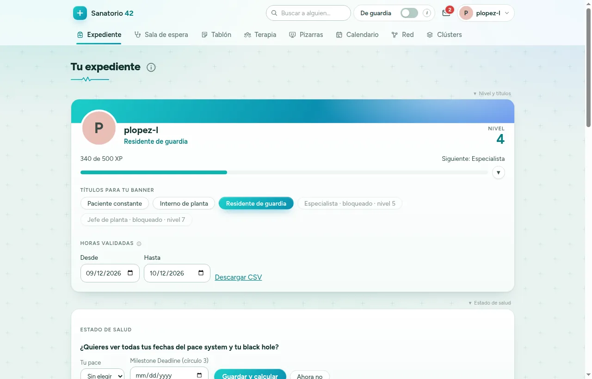

### Sala de espera

Eliges el proyecto que te duele y ves quién puede atenderte: quién lo está
haciendo (_paciente como tú_), quién ya lo aprobó (_especialista_, o _eminencia_
si fue con 125), en qué puesto está y si está de guardia. El mapa de clusters
lleva las fotos y un código de colores: dorado para especialistas de guardia,
verde para pacientes de guardia y azul para una terapia reunida. También dice si
ya os habéis corregido antes y quién se ofrece a preevaluar proyectos terminados.

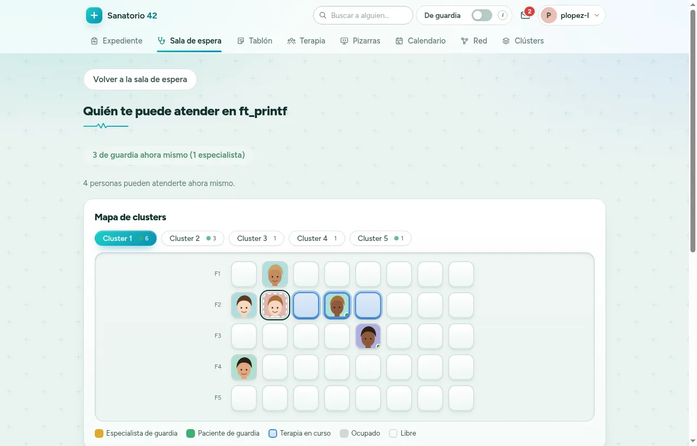

### Guardia

Marcas las medias horas de hoy en las que te ofreces y un tope de tiempo. Quien
lo necesita te reserva un rato y tú lo aceptas. La sesión solo da XP si se
validan los dos códigos (inicio y fin) y las dos partes la valoran. Se puede
bloquear a alguien.

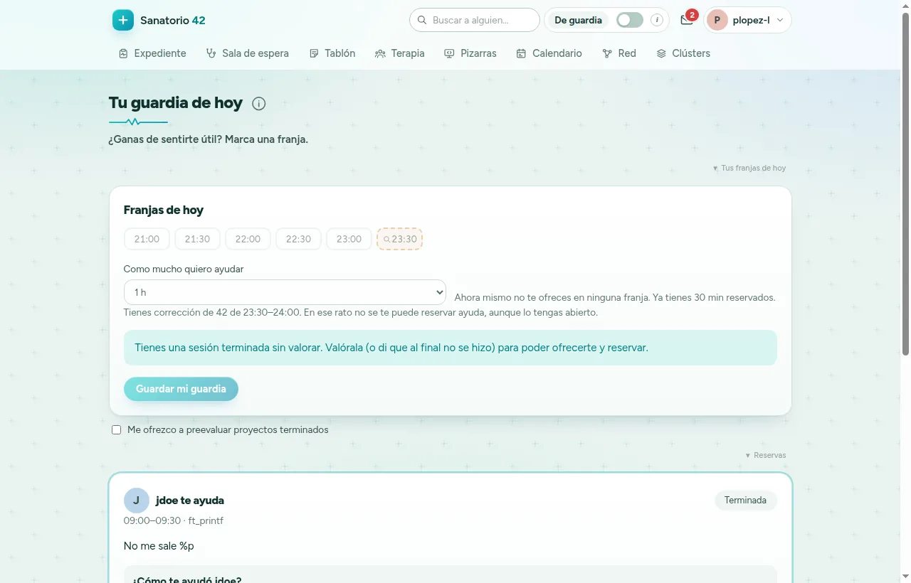

### Tablón de dudas

El plan de estudios de cada persona dibujado en perspectiva, un círculo por
bandeja: el clásico de C o el nuevo de C y Python, según su plan. Cada proyecto
ocupa lo que sus horas estimadas y enseña sus plazos por _pace_. Dentro, dudas
con respuestas y una guía que se edita por propuestas validadas.

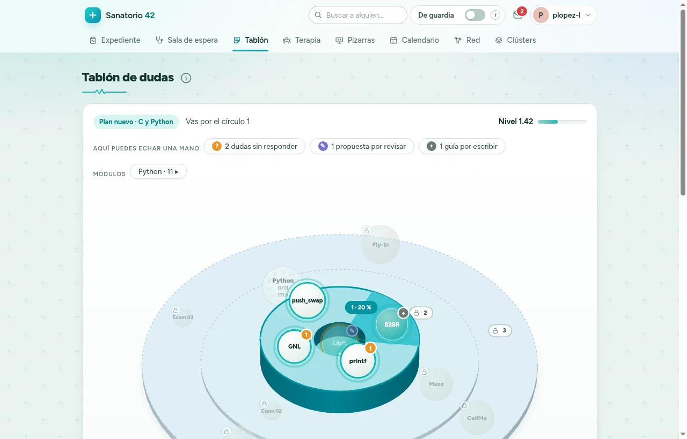

### Terapia de grupo

Grupos para días concretos, con puestos reservados en el cluster (de dos a seis,
que se tocan), cómo lleva el proyecto cada quien y chat del grupo. Dos tipos:
para avanzar o de repaso, con el proyecto terminado y antes de presentarlo.

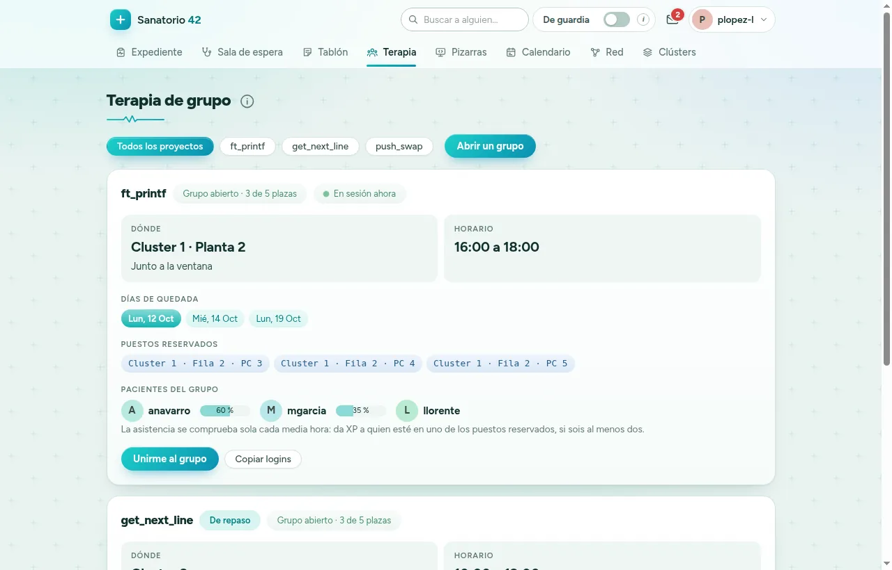

### Pizarras

Alguien explica algo a quien se apunte. Calendario propio y asistencia validada
con códigos. Una pizarra no se puede poner a más de 62 días vista, y si la fecha
queda lejos la web pide confirmarla.

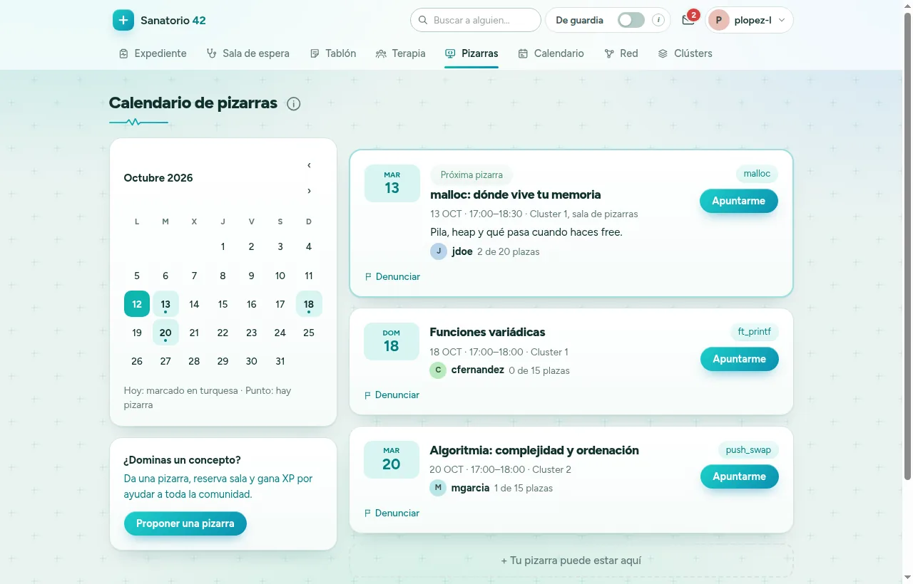

### Calendario

Todo lo tuyo en un sitio: guardia, reservas, terapias, pizarras y lo de 42
(correcciones, eventos, exámenes). Por día, semana o mes y filtrado por tipos.
Lo de Sanatorio va en tonos fríos y lo de 42 en cálidos.

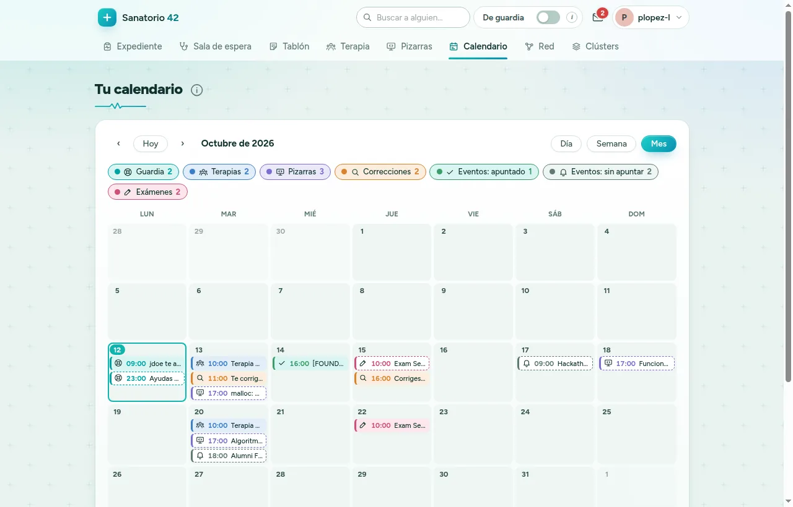

### Avisos y sala del evento

Unos minutos antes de cada evento salta una ventana con qué es, dónde y cuándo.
Si es con más gente no se puede cerrar sin contestar: «voy», «me retraso» o «no
puedo ir» con motivo. Cada evento tiene un chat que comparten todos. Pizarras y
sesiones de ayuda validan la asistencia con dos códigos, a mano o por QR. Lo que
le pasa a una persona por lo que hace otra llega a su buzón, con el número de
avisos sin leer en la cabecera.

### Red de correcciones

Quién ha corregido a quién, como un grafo de burbujas que se recoloca solo:
comunidades, endogamia, lo que cada quien aprueba como corrector y lo que le
aprueban como corregido, las personas más estrictas, parejas y proyectos. Se
puede elegir una escuela, varias o todas, filtrar por fecha, persona, proyecto y
veredicto, y buscar a alguien dentro del grafo. En escritorio el grafo se queda
anclado y solo se mueve la columna de opciones; en el móvil se amplía y se
desplaza con dos dedos.

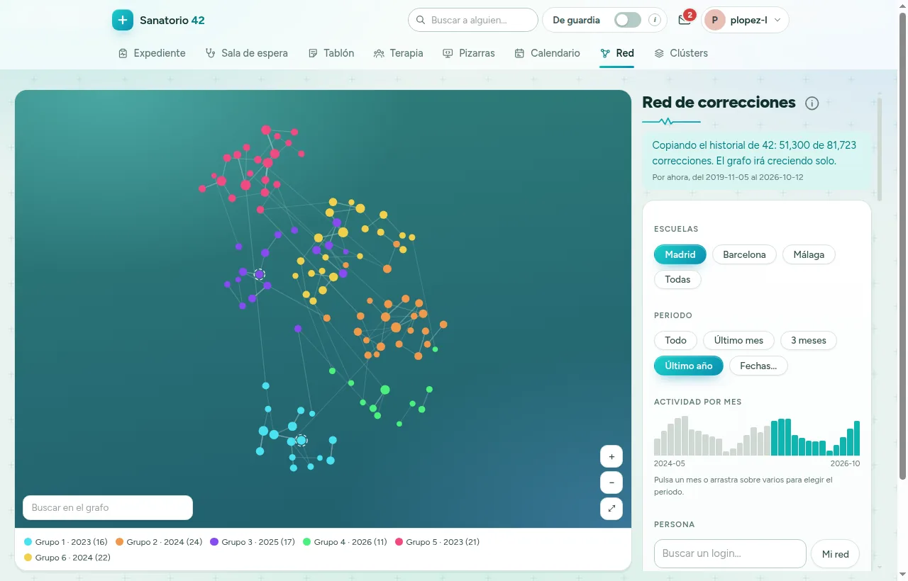

### Clústers

El mapa del campus entero. Al pulsar un puesto ocupado, la ficha de esa persona
se queda abierta con sus proyectos y los botones para escribirle o abrir su
expediente. Un punto verde marca a quien tiene Sanatorio abierto.

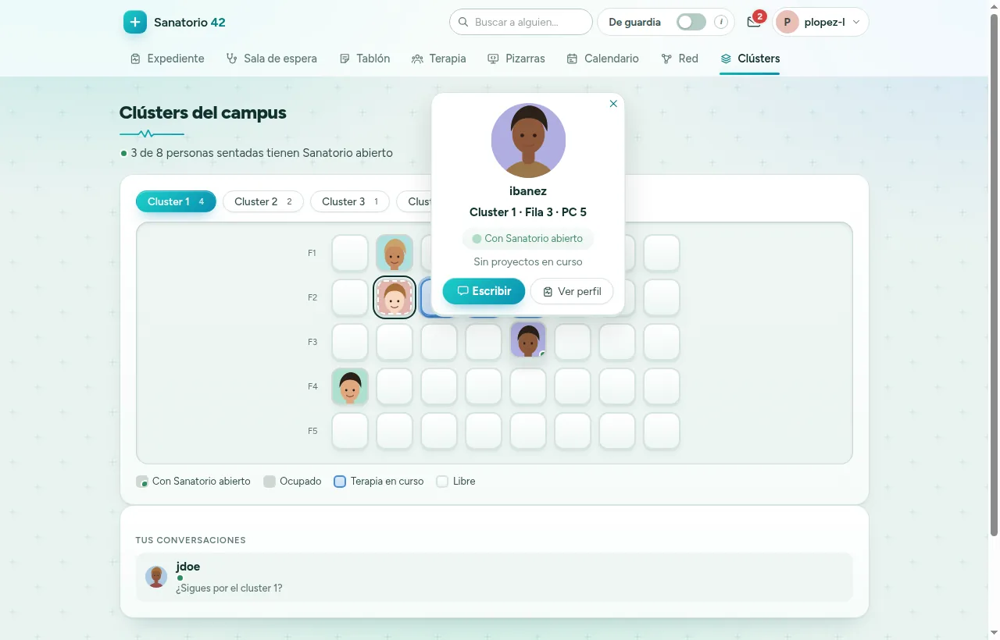

### Buscador de personas

En la cabecera. Busca por login o por nombre mientras escribes, sin distinguir
mayúsculas ni acentos, y enseña foto y nombre.

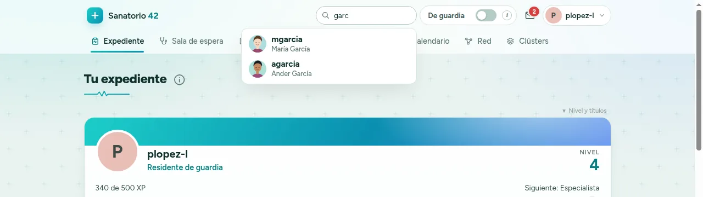

### Demostraciones animadas

La web no lleva párrafos de ayuda. Junto a cada título hay un icono de
información que abre una demostración: un ratón que hace lo que harías tú, con
una frase corta por acción. La velocidad se puede regular, y la que viene de
fábrica se ajusta sola con lo que elige la comunidad.

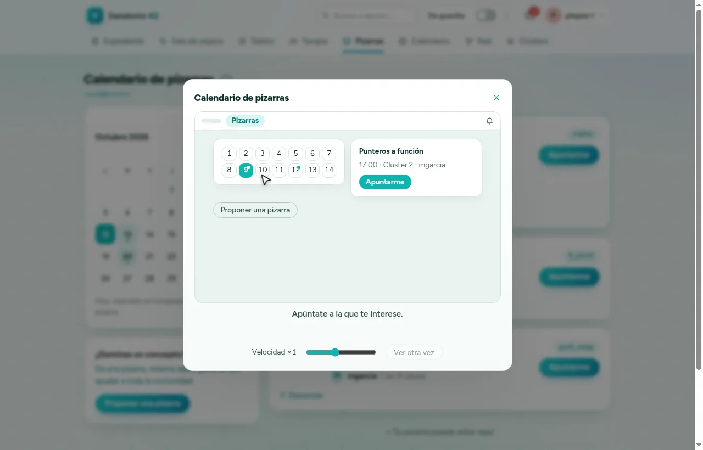

### Personalizar y estilos

Orden de pestañas y de bloques, qué sale plegado, con cuánta antelación avisar,
claro o nocturno y el estilo. Hay cinco: **Clínica**, **Terminal**,
**Historial**, **Espacial** y **A tu color**, con ocho paletas. Un estilo es una
carpeta con su manifiesto, su hoja y sus imágenes: para añadir uno no se toca
ningún componente (lo explica
[apps/web/src/themes/README.md](apps/web/src/themes/README.md)).

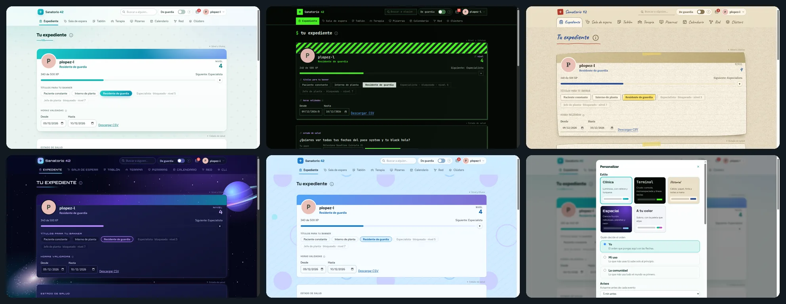

Idiomas: español e inglés completos; catalán y euskera en los textos de las
secciones (874 de 1 215; el resto cae al español).

### En el móvil

Todo cabe y todo se puede hacer con el dedo: la cabecera en una fila, las
pestañas deslizables y los grafos con pellizco.

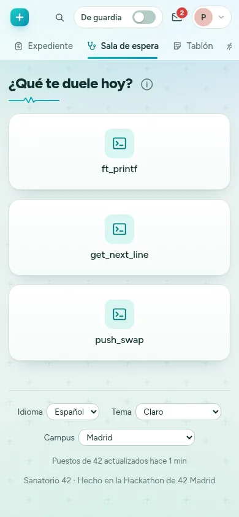

### Panel de gestión

Solo para quien administra. Nueve pestañas:

| Pestaña              | Qué enseña                                                                                             |
| -------------------- | ------------------------------------------------------------------------------------------------------ |
| Consumo              | Peticiones y datos por persona y por hora, avisos de exceso y el presupuesto que se reparte solo       |
| Permisos y bloqueos | Quién administra, quién no puede entrar y las cuentas de staff |
| Buzón                | Incidencias, sugerencias y denuncias, con respuesta                                                    |
| Mensajes             | Registro de lo que se escribe en los chats                                                             |
| Qué se usa           | Mapa de calor de cada elemento y grafo de recorridos entre secciones                                   |
| Estadísticas         | Tiempo de uso por persona, quién está conectado ahora y cuánto lleva                                   |
| Code Clicker         | Uso del juego, trampas detectadas con copia de la partida, indulto y avisos de saltos sospechosos      |
| Comunicados          | Mensajes para todo el mundo                                                                            |
| Limpiar datos        | Borrado a mano de cualquier dato, global o de una persona, entero o desde una fecha                    |

Nada se borra solo: lo único que elimina datos es «Limpiar datos», que antes
enseña en una ventana qué va a borrar y cuánto.

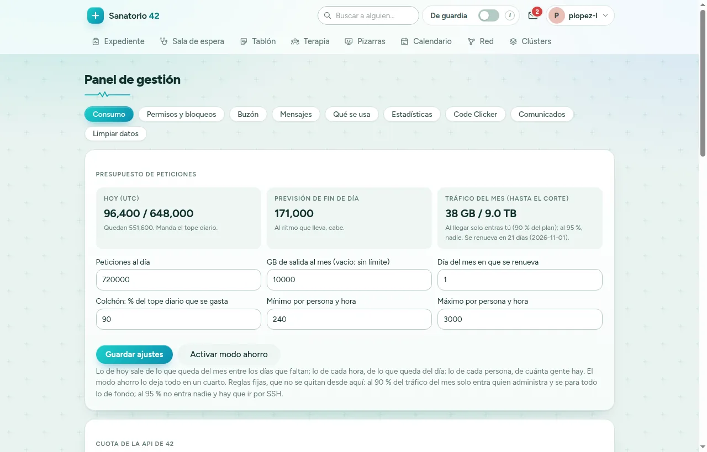

Las estadísticas y los recorridos se pueden acotar con un deslizador doble que
deja fuera a las personas más y menos activas, para que dos o tres no deformen
la media.

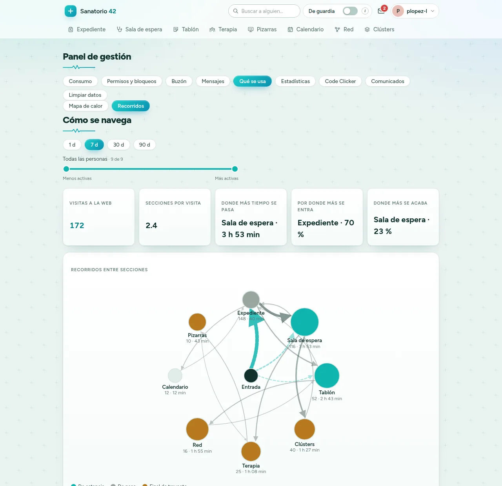

<details>
<summary>Más capturas del panel: estadísticas, juego y limpieza de datos</summary>

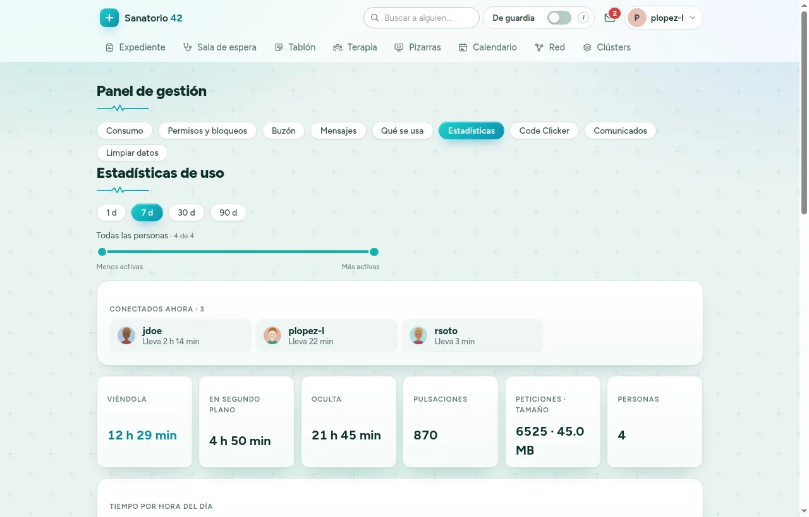

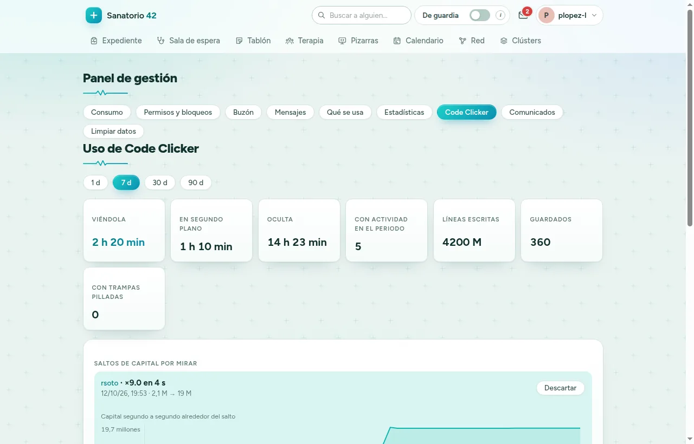

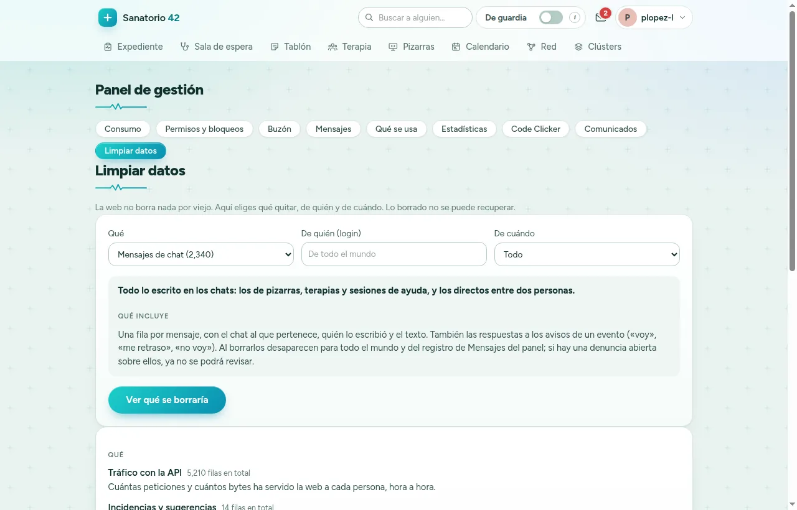

</details>

### Validar documentos

Las horas validadas se descargan en un CSV para enseñárselas al staff de 42. Un
CSV lo edita cualquiera, así que cada descarga lleva un **código de cuatro
caracteres** en el nombre del fichero (`horas-validadas_jdoe_…_K7QF.csv`) y la
web guarda la copia. El staff entra en `/#/validar` con una cuenta que solo
sirve para eso, escribe el código y ve el documento tal como se emitió; si sube
el fichero que le han dado, la web le dice si es idéntico.

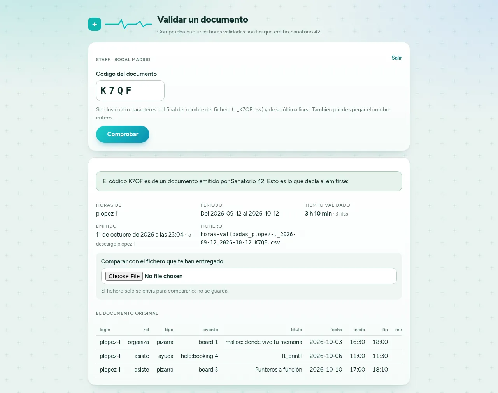

Las cuentas de staff las crea quien administra desde el panel. No son de 42, se
entra con una clave que se enseña una sola vez y no llegan a ninguna otra parte
de la web.

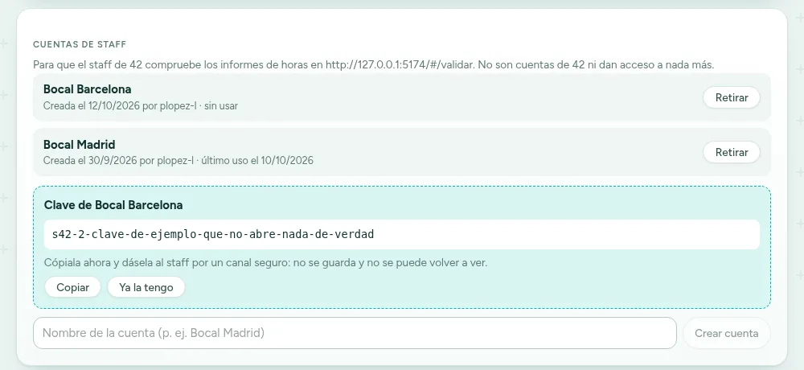

### Demostración sin cuenta

En [`/demo/`](https://sanatorio42.duckdns.org/demo/) está la web entera con
datos inventados: calendario, proyectos, gente, red de correcciones y panel de
gestión. No habla con el servidor y nada de lo que se hace se guarda. Una
cuenta de prueba dentro de la web de verdad enseñaría a la gente real; esto no.

### Code Clicker

<details>
<summary>Un secreto para quien lo encuentre (destripe)</summary>

Un juego incremental escondido en la web: se escribe código, se compran
edificios y mejoras, y llegan noticias según lo que vas consiguiendo. Está
pensado para que apetezca tener Sanatorio abierto: sigue contando en cualquier
sección, con una ventanita flotante que se puede cerrar.

La partida se guarda en el servidor, que revisa cada guardado. Si las cifras no
cuadran (más código del que se ha podido producir, un ritmo imposible, cuentas
que no suman), guarda una copia de la partida, vende los edificios, pone un
título de «hacker» y avisa. Las tres primeras veces dan un logro. Quien
administra puede ver la copia e indultar. El detalle, en
[docs/code-clicker.md](docs/code-clicker.md).

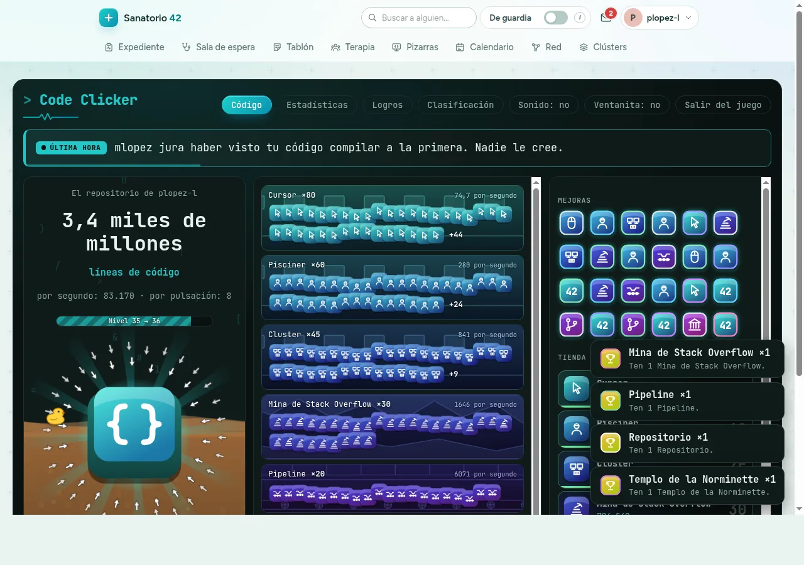

</details>

## Problemas que surgieron y cómo se resolvieron

| Problema                                                                                                            | Qué se hizo                                                                                                                                                                 |
| ------------------------------------------------------------------------------------------------------------------- | --------------------------------------------------------------------------------------------------------------------------------------------------------------------------- |
| La API de 42 da 1 200 peticiones por hora para toda la aplicación                                                    | Réplica local en SQLite. Las pantallas leen de ahí. Cada petición a 42 pasa por una cuota con tres escalones; lo que puede esperar hace cola y enseña su turno              |
| 42 marca «Ok» también en correcciones con un 0                                                                       | El veredicto sale de la nota y de la mínima del proyecto, que se deduce de cómo ha acabado la gente                                                                         |
| 42 no publica el _pace_, el plan de estudios ni la nota mínima                                                       | Se deducen de los datos: rangos y fechas de los proyectos y la fecha oficial de _black hole_                                                                                |
| Consultas de la red que recorrían todas las correcciones del campus                                                  | `ANALYZE` al abrir la base y `PRAGMA optimize`: de 15,7 a 0,25 ms sin tocar una consulta                                                                                    |
| Mientras se copiaba de 42, las visitas esperaban                                                                     | Base en WAL: quien lee no espera a quien escribe, y cada escritura cuesta 100 veces menos                                                                                   |
| Un chat abierto pedía sus 200 mensajes cada 8 segundos                                                               | Solo se pide lo posterior al último mensaje, la espera crece si nadie escribe y con la pestaña oculta no se pregunta                                                        |
| Oracle respondía «Out of host capacity» para las máquinas gratuitas                                                  | Un guion que reintentaba cada cinco minutos alternando ARM y x86; después, cuenta de pago por uso con una guardia que impide gastar                                         |
| Pasar a pago por uso abre la puerta a una factura                                                                    | Cortes fijos al 90 % y al 95 % de cada límite gratuito, en la web y en la máquina, sin excepciones ni ajustes                                                               |
| Una pizarra creada por error para dentro de años ya no se podía abrir                                                | Tope de 62 días en todos los eventos y confirmación si la fecha queda lejos                                                                                                 |
| Al estrechar la ventana desaparecían botones de la cabecera                                                          | La cabecera cabe en una fila a cualquier ancho; lo que no es esencial va al menú de la cuenta                                                                               |
| El grafo de la red no se leía en los modos claros                                                                    | El lienzo toma sus colores de las variables del estilo puesto, en vez de llevarlos escritos                                                                                 |
| Al anclar el grafo, las opciones de la derecha se superponían                                                        | La columna de opciones pasó a ser una pila con su propio deslizamiento                                                                                                      |
| En el móvil, pellizcar sobre dos nodos los arrastraba                                                                | Dos dedos siempre amplían o desplazan, se toque lo que se toque                                                                                                             |
| Buscar sin acentos con funciones anidadas de SQL reventaba el analizador («parser stack overflow»)                   | La comparación se hace en el servidor con el texto normalizado (NFD, sin marcas)                                                                                            |
| Una división con un parámetro se enlazaba como decimal y agrupaba mal                                                | `CAST(? AS INTEGER)` y un test que lo fija                                                                                                                                  |
| Se podían hacer trampas en el juego editando la partida                                                              | El servidor comprueba cada guardado contra lo que se ha podido producir, guarda copia y deja indultar                                                                       |
| El historial de capital del juego crecía sin fin                                                                     | Se guarda para siempre, pero a escalones: todo el último día, un punto por hora la última semana y uno por día de ahí atrás                                                 |
| Los mensajes se borraban solos al cabo de un tiempo                                                                  | Ya no se borra nada de forma automática; el borrado es una acción de quien administra, con vista previa                                                                     |
| El juego se paraba al cambiar de sección                                                                             | Sigue corriendo en toda la web para quien lo ha encontrado, con una ventanita que se puede cerrar                                                                           |
| Las ruedas del tablón en perspectiva no terminaban de leerse bien                                                    | Menos solape entre bandejas, subida más suave y los círculos aún no alcanzados quedan quietos y con candado                                                                     |
| La textura de papel era un filtro SVG que el navegador recalculaba en cada repintado                                 | Imagen PNG ya hecha y fondos que se mueven con la página                                                                                                                    |
| Un CSV de horas se puede retocar antes de entregarlo | Cada descarga lleva un código de verificación y la web guarda la copia: el staff la ve con una cuenta que solo sirve para eso |
| Quien no es de 42 no podía ver la web | Demostración pública con datos inventados, que no habla con el servidor |
| Un JSON mal escrito o una fecha imposible daban un error interno | Un test recorre todas las rutas con entradas extremas: encontró cinco casos y ya no queda ninguno |
| La comprobación de admin estaba copiada en siete sitios | Una sola función y una barrera global para todo `/admin` |
| La vuelta del login no tenía tope y se podía usar para machacar a 42 | Tope de intentos por IP |
| Las copias nocturnas de producción no se estaban guardando, y nadie lo veía | Apareció al hacer una copia a mano antes de un despliegue. El guion comprueba ahora que puede escribir y limpia lo que deja a medias |
| **Abierto**: en un ordenador de escritorio, trozos rectangulares de la página dejan de pintarse durante un instante  | Sin resolver. En el móvil no pasa y no se reproduce sin tarjeta gráfica. Lo probado y lo que queda por probar, en [docs/bug-trozos-sin-pintar.md](docs/bug-trozos-sin-pintar.md) |

## Cómo está hecho

### Arquitectura

Un monolito modular en una sola máquina. Un proceso de Node sirve la API y los
ficheros de la web; delante, Caddy pone el HTTPS y las cabeceras de seguridad.
La base es un fichero de SQLite.

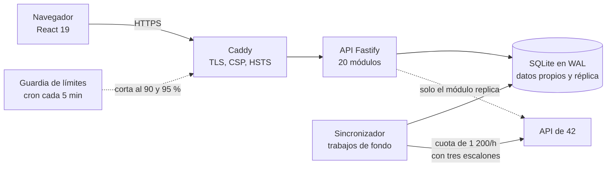

Por dentro, cada módulo tiene la misma forma, y solo se habla con los demás por
su `index.ts`:

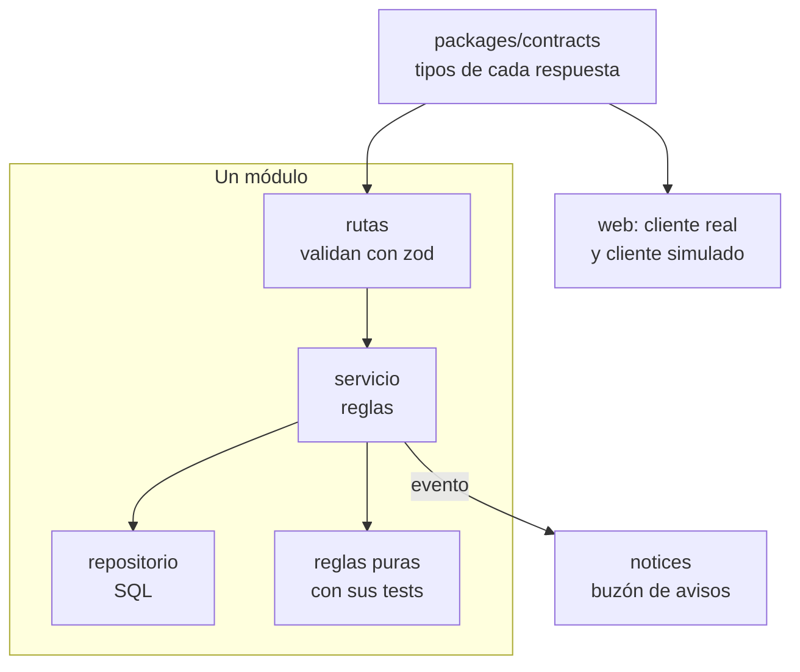

### Estructura del repositorio

```
apps/
  api/                 API (Node 22, Fastify, SQLite con libSQL)
    src/
      main.ts          punto de entrada: abre el puerto y arranca la sincronización
      app/             montaje: composición de módulos, CORS, errores, salud
      config/          variables de entorno, validadas al arrancar
      core/            lo que no es de ninguna funcionalidad: base de datos y
                       migraciones, errores, eventos, sesión, contrato de módulo
      integrations/    cliente de la API de 42 (token, límite de peticiones, tipos)
      modules/         una carpeta por funcionalidad (ver abajo)
      cli/             comandos: migrar, estado y avance de la réplica
    tests/             unit/ e integration/
  web/                 web (React 19, Vite, TypeScript)
    src/
      app/             pantalla raíz, secciones y navegación
      features/        una carpeta por funcionalidad
      shared/          cliente de la API (real y simulado), idiomas, hooks, piezas comunes
      themes/          un estilo por carpeta: manifiesto, hoja e imágenes
      styles/          variables y hojas comunes a todos los estilos
packages/
  contracts/           tipos de cada respuesta de la API; los usan api y web
infra/                 Docker, Caddy, scripts de despliegue, copia y guardia de límites
docs/                  arquitectura, contrato de la API, despliegue, rendimiento y contexto
```

Tamaño a 12 de octubre de 2026 (líneas en `src` y en `tests`):

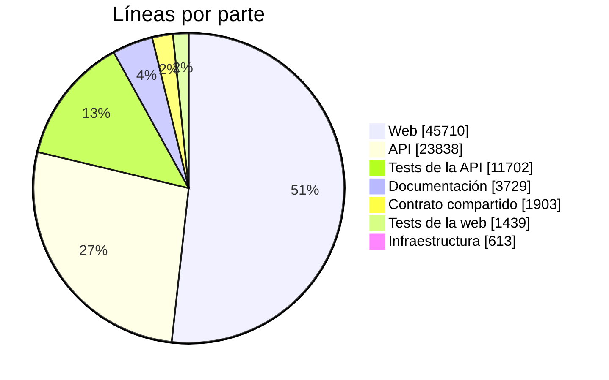

### Módulos de la API

| Módulo       | Qué hace                                                                          |
| ------------ | --------------------------------------------------------------------------------- |
| `auth`       | Login con OAuth de 42, cookie de sesión firmada                                   |
| `replica`    | Copia local de 42, sincronizador, cuota y cola de turnos; catálogo de campus      |
| `peers`      | Tus proyectos, quién puede ayudarte, tu guardia                                   |
| `profile`    | Expediente, XP, títulos, logros, ranking y buscador de personas                   |
| `therapy`    | Terapias de grupo                                                                 |
| `doubts`     | Tablón de dudas y guía de cada proyecto                                           |
| `boards`     | Calendario de pizarras                                                            |
| `calendar`   | Calendario personal: lo de Sanatorio y lo de 42                                   |
| `help`       | Guardia: franjas, reservas, valoraciones y bloqueos                               |
| `map`        | Mapa de clusters: ocupación, gente de guardia y puestos reservados                |
| `network`    | Red de correcciones: quién ha corregido a quién, comunidades y endogamia          |
| `usage`      | Qué se usa: orden automático, mapa de calor, recorridos y tiempo de uso           |
| `meet`       | Avisos y chat de cada evento                                                      |
| `notices`    | Buzón de avisos de cada persona y el pulso que la web pregunta de fondo           |
| `attendance` | Códigos de inicio y fin, tiempo validado, registro de intentos e informe de horas |
| `broadcasts` | Comunicados de quien administra para todo el mundo                                |
| `tours`      | Velocidad de las demostraciones: la de cada persona y la que vota la comunidad    |
| `clicker`    | Partidas del juego, comprobación de trampas e historial de capital                |
| `staff` | Documentos con código de verificación y las cuentas de staff que los comprueban |
| `admin`      | Permisos, bloqueos, buzón, consumo, presupuesto de peticiones y limpieza de datos |

Cómo encajan las piezas y cómo añadir una funcionalidad:
[docs/architecture.md](docs/architecture.md).

### Decisiones de implementación

- **Réplica local de 42.** En vez de preguntar a 42 en cada pantalla, se copia a
  SQLite lo que hace falta y las lecturas salen de ahí. Solo se guarda lo que la
  web enseña.
- **Lo caro, una vez y despacio.** El histórico (proyectos, correcciones) se
  copia con un cursor guardado, sin tocar una reserva horaria; después solo se
  pide lo que cambia. El repaso completo corre cuando nadie usa la web.
- **Monolito modular.** Una carpeta por funcionalidad, con su repositorio (SQL),
  su servicio (reglas) y sus rutas. Sin microservicios: una máquina, un proceso.
- **SQLite y una sola máquina.** Sin servicios que mantener: un fichero, copias
  con un script y Caddy delante. Cabe de sobra en la capa gratuita.
- **XP que no se puede puentear.** Cada punto sale de un hecho comprobable (una
  respuesta que resuelve, una sesión con sus dos códigos y valorada por los
  dos), una sola vez por referencia y con topes.
- **Sin estado de más en el navegador.** La navegación va en el hash, la
  personalización en `localStorage`, y cada sección se descarga al abrirla.
- **Los grafos, en `<canvas>`.** Con miles de burbujas el SVG no da abasto; la
  física es `d3-force` y lo que cambia a cada fotograma no pasa por React.
- **Estilos como datos.** Los componentes solo conocen variables; cada estilo
  les da valor desde su carpeta.
- **Privacidad.** No se guardan correos, teléfonos ni los comentarios de las
  correcciones. El expediente ajeno es una versión recortada. Las estadísticas
  de uso solo las ve quien administra.

## Cómo se protege el código

Lo que impide que una funcionalidad nueva rompa otra, por orden de cuándo actúa:

1. **Un contrato de tipos compartido** (`packages/contracts`). La forma de cada
   respuesta se escribe una vez y la usan la API y la web. Si la API cambia una
   respuesta y la web no, no compila.
2. **Cliente simulado obligatorio.** El tipo `Api` obliga a que todo lo que se
   añade al cliente real exista también en el simulado. Por eso la web entera se
   puede probar con `npm run dev:mock`, sin API ni credenciales.
3. **Fronteras que vigila el linter.** `core` e `integrations` no importan de
   los módulos, y de otro módulo solo se importa su `index.ts`
   (`no-restricted-imports` en `eslint.config.js`). Solo `replica` habla con 42.
4. **Entradas validadas.** Las variables de entorno se validan al arrancar y el
   cuerpo de cada petición, con zod en la ruta.
5. **Migraciones inmutables.** Un cambio de esquema es un fichero nuevo; los 33
   existentes no se editan. Se aplican solas al arrancar.
6. **Reglas en funciones puras.** Lo delicado (XP, asistencia, presupuesto,
   trampas, recorridos) vive en ficheros `*.rules.ts` sin base de datos ni
   reloj, con sus tests. Los tests usan un reloj falso: no dependen de la hora.
7. **Tests.** 483 de la API (unidad e integración sobre SQLite en memoria, con
   la API de 42 simulada; cubren el 97 % de las sentencias) y 125 de la web.
   Prueban lo esperado y después el borde: el valor justo en el límite y el
   siguiente, lo vacío, lo enorme y lo que no es del tipo que toca.
8. **Un test que recorre todas las rutas.** Saca la lista de la propia app, así
   que una ruta nueva entra sola: sin sesión tiene que dar 401, lo de `/admin`
   403 a quien no administra, y ninguna entrada puede acabar en un error interno.
9. **Doble cerradura en los permisos.** Lo de admin y lo de staff lo comprueba
   cada servicio y, además, una barrera por la que pasan todas las peticiones.
10. **`npm run check`** antes de dar nada por terminado: tipos, lint, formato y
   tests. Es lo mismo que pasa la CI.
11. **CI en cada subida** (`.github/workflows/ci.yml`): tipos, lint, formato,
   tests, compilación y que la imagen de Docker construye.
12. **El despliegue se comprueba a sí mismo.** `deploy.sh` no da el despliegue
    por bueno hasta que la app contesta a `/health/db`.
13. **Normas escritas** en [AGENTS.md](AGENTS.md): reglas de código y de
    producto que cualquier persona o asistente lee antes de tocar nada.

Y en producción:

- Contenedor sin root, sin capacidades del sistema y sin escalada de
  privilegios, con tope de 512 MiB y comprobación de salud.
- Política de contenido estricta: ni scripts en línea ni recursos de otros
  dominios, salvo imágenes por HTTPS. HSTS y `frame-ancestors 'none'`.
- Cookie de sesión firmada, `HttpOnly`, `Secure` y `__Host-`. Secretos fuera de
  git, en ficheros con permisos 600.
- Topes de intentos para lo que no tiene sesión (login, clave de staff) y
  presupuesto de peticiones para lo que sí.
- Las respuestas de la API no se guardan en ningún navegador ni caché
  (`no-store`).
- Copias de la base con `VACUUM INTO` (`infra/scripts/backup.sh`) y guion de
  restauración.

## Revisión de seguridad

En octubre de 2026 se revisó todo el código: quién puede entrar a qué, qué pasa
con entradas imposibles, qué código sobraba y si la arquitectura era la adecuada
(lo era, y se dejó). El detalle, con cada hallazgo, su gravedad y su arreglo,
está en [docs/revision-seguridad.md](docs/revision-seguridad.md).

| Qué | Antes | Ahora |
| --- | --- | --- |
| Formas encontradas de provocar un error interno | 5 | 0 |
| Copias de la comprobación de admin | 7 | 1, más una barrera global |
| Sitios donde se validaba una fecha, cada uno a su manera | 5 | 1 |
| Topes para lo que no tiene sesión | ninguno | login y clave de staff, por IP |
| Tests automáticos | 497 | 608 |
| Código duplicado (bloques de 12 líneas o más) | 0,14 % | 0,05 % |
| Vulnerabilidades conocidas en dependencias | 0 | 0 |

Quién llega a qué:

| Quién | Cómo entra | A qué llega |
| --- | --- | --- |
| Sin sesión | — | La web, la demostración y empezar un login |
| Estudiante | OAuth de 42 | Todo menos `/admin` y `/staff` |
| Cuenta bloqueada | OAuth de 42 | Solo a saber que lo está y a salir |
| Admin | OAuth de 42 y el rol | Lo de estudiante y `/admin` |
| Staff | Clave que crea un admin | **Solo** a validar documentos |

Sobre las direcciones: la sección y la persona van en el hash (`#/expediente/jdoe`),
que el navegador no manda al servidor ni a otras webs. Los logins no se cifran
porque en 42 son públicos; se codifican siempre, para que un valor raro no
pueda cambiar la ruta.

## Despliegue

Una máquina de Oracle Cloud (ARM, 1 OCPU, 6 GB de memoria, 46,6 GB de disco) con
Docker: la app en un contenedor y Caddy en otro, con HTTPS automático.

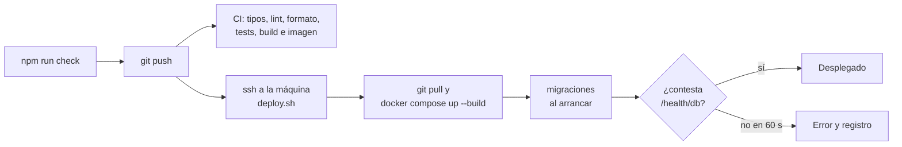

Actualizar es una orden:

```sh
ssh ubuntu@<ip> 'cd /opt/sanatorio && sh infra/scripts/deploy.sh'
```

La imagen se construye en varias etapas sobre `node:22-slim` y ocupa 415 MB.
También hay un flujo manual (`.github/workflows/deploy.yml`) que publica la
imagen y la despliega por SSH. Guía paso a paso desde cero:
[docs/deploy-oracle.md](docs/deploy-oracle.md).

## Coste cero garantizado

No se paga nada: ni máquina, ni dominio, ni base de datos, ni CI. Y está hecho
para que siga siendo así aunque la cuenta de Oracle sea de pago por uso.

| Qué                          | Dónde                                                        | Qué hace                                                                         |
| ---------------------------- | ------------------------------------------------------------ | -------------------------------------------------------------------------------- |
| Corte al 90 %                | `modules/admin/budget.rules.ts` e `infra/scripts/limits-guard.sh` | Solo entra quien administra y se para todo lo automático                         |
| Corte al 95 %                | Los mismos                                                   | No entra nadie; hay que ir por SSH                                               |
| Presupuesto de peticiones    | `budget.rules.ts`                                            | 720 000 al día, repartidas entre quien está conectado (de 240 a 3 000 por persona) |
| Tráfico de salida            | Guardia en la máquina, por cron cada 5 minutos               | Cuenta los bytes de la tarjeta de red contra los 10 TB mensuales                 |
| Cuota de 42                  | `modules/replica`                                            | Reserva horaria para lo crítico y cola con turno para lo demás                   |

Los dos cortes no son regulables y no tienen excepciones: es una norma del
proyecto.

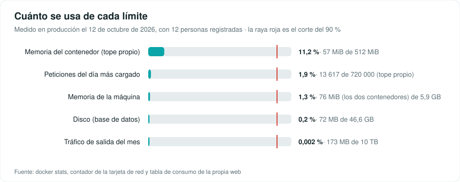

## Rendimiento

Qué se cambió, cuánto mejoró y cómo se midió. El detalle de cada punto, con el
antes y el porqué, está en [docs/rendimiento.md](docs/rendimiento.md).

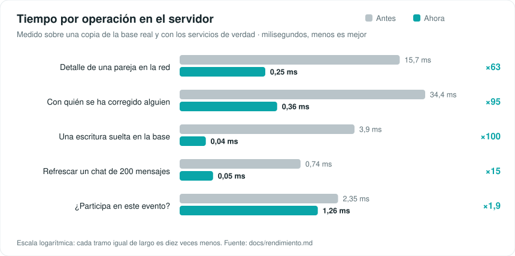

| Decisión                                           | Antes               | Ahora              | Mejora                    | Cifra     |
| -------------------------------------------------- | ------------------- | ------------------ | ------------------------- | --------- |
| Estadísticas de la base (`ANALYZE`): pareja        | 15,7 ms             | 0,25 ms            | 63 veces                  | Medida    |
| Estadísticas de la base: con quién se ha corregido | 34,4 ms             | 0,36 ms            | 95 veces                  | Medida    |
| WAL en vez del diario clásico: una escritura       | 3,9 ms              | 0,04 ms            | 100 veces                 | Medida    |
| El chat solo pide lo nuevo                         | 42,4 kB y 0,74 ms   | 15 bytes y 0,05 ms | 2 800 veces menos datos   | Medida    |
| La participación se pregunta a su módulo           | 2,35 ms y 2,2 a 42  | 1,26 ms y ninguna  | Sin gasto de cuota de 42  | Medida    |
| Avisos calculados en el navegador                  | 60 peticiones/h     | 12 peticiones/h    | 5 veces menos             | Calculada |
| Un solo pulso de fondo; pestaña en reposo          | 60 peticiones/h     | 42 peticiones/h    | Un 30 % menos             | Calculada |
| Chat abierto y callado                             | 450 peticiones/h    | unas 120           | 3,7 veces menos           | Calculada |
| Pestaña oculta con un chat abierto                 | 510 peticiones/h    | 12 peticiones/h    | 42 veces menos            | Calculada |

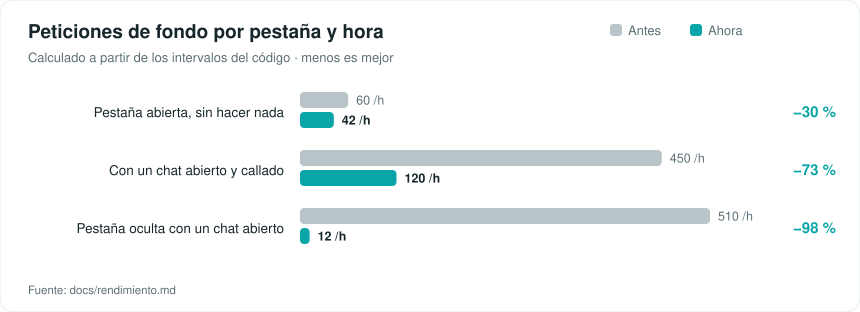

Otras decisiones que cuentan:

- **Cada sección, en su trozo.** Al entrar se descargan 97 kB de JavaScript y
  27 kB de estilos (comprimidos). La red (17 kB), el juego (14 kB), el panel
  (12 kB) y el tablón (9 kB) solo bajan cuando se abren. Los datos simulados no
  entran en producción.
- **El análisis de la red se guarda un minuto** por combinación de filtros, y
  las cuentas las hace la API una vez, no cada navegador.
- **El historial que crece, a escalones.** Un trabajo cada hora deja un punto
  por hora pasado un día y uno por día pasada una semana.
- **Canvas y `ref`.** En los grafos, lo que cambia a cada fotograma no provoca
  repintados de React.

Medido en producción el 12 de octubre de 2026, desde fuera de la máquina:

| Qué                                      | Valor                             |
| ---------------------------------------- | --------------------------------- |
| Primera respuesta de la portada          | 31 a 35 ms (145 ms en frío)       |
| Primera respuesta de `/api/health`       | 45 ms                             |
| Memoria de la app                        | 57 MiB (Caddy, 19 MiB)            |
| Carga media de la máquina                | 0,1                               |
| Tamaño medio de una respuesta            | 12,6 kB                           |
| Base de datos                            | 72 MB con 193 784 correcciones    |

**Lo que no está medido.** No se ha hecho una prueba de carga con muchas
personas a la vez. Las cifras de la base son de una sola conexión, y las de
peticiones por pestaña salen de los intervalos del código, no de tráfico real.

## Cuánta gente aguanta sin pagar

**Es una estimación.** Sale de dividir cada límite entre el consumo medido en
los dos primeros días de uso real (11 y 12 de octubre de 2026: 12 personas,
16 225 peticiones y 204 MB). Con tan poca gente, la media puede moverse mucho.

Consumo medido por persona y día: **554 peticiones y 10 MB** de media (la que
más, 6 189 peticiones y 124 MB).

| Límite                                | Tope               | Corte (90 %)  | Consumo por persona        | Aguanta, aproximadamente               |
| ------------------------------------- | ------------------ | ------------- | -------------------------- | -------------------------------------- |
| Tráfico de salida de Oracle           | 10 TB al mes       | 300 GB al día | 10 MB al día               | 30 000 personas al día                 |
| Presupuesto de peticiones (propio)    | 720 000 al día     | 648 000       | 554 al día                 | **1 170 personas al día**              |
| Cuota de la API de 42                 | 1 200 a la hora    | 900 sin la reserva | 12 a la hora con agenda al día | Unas 75 a 80 personas a la vez    |
| Memoria y procesador                  | 6 GB y 1 OCPU      |               | 57 MiB con 12 personas     | Sin prueba de carga: no se sabe        |

Cómo leerlo:

- El primer tope que se alcanza es el **presupuesto de peticiones, unas 1 170
  personas al día**. Es un tope propio, puesto en el código con margen, no un
  límite de Oracle: el tráfico de salida da para unas 25 veces más.
- La **cuota de 42** no limita cuánta gente entra, sino cuánta tiene su agenda
  de 42 recién actualizada (tres peticiones por persona cada 15 minutos). Por
  encima de unas 80 personas a la vez, las agendas se actualizan por turno y el
  resto de la web sigue igual, porque lee de la réplica.
- Para pasar de ahí bastaría subir el tope propio, y el tráfico de salida lo
  permitiría. No se ha subido porque no hace falta y porque falta la prueba de
  carga que diga cuánto aguantan la memoria y el procesador.
- Coste por persona: **0 €**, con 12 personas o con 1 170.

## Contexto entre sesiones de trabajo

El proyecto se desarrolla con un asistente de código, cuyo contexto se vacía o
se resume (se «compacta») cada cierto tiempo. Para que eso no cueste decisiones
ni trabajo repetido, lo que hay que recordar vive en el repositorio y no en la
conversación:

| Fichero                                                        | Qué guarda                                                                                         |
| -------------------------------------------------------------- | -------------------------------------------------------------------------------------------------- |
| [AGENTS.md](AGENTS.md)                                         | Las normas: de código, de producto, de XP y de límites. Se leen siempre                            |
| [docs/contexto.md](docs/contexto.md)                           | El porqué: estado, decisiones tomadas con su motivo, cómo está el despliegue y qué conviene saber  |
| [docs/tareas-tras-compactar.md](docs/tareas-tras-compactar.md) | El qué: el plan vigente con casillas, en orden. Lo hecho se tacha; lo que ya no aplica se borra    |
| `docs/*.md`                                                    | Lo que no cabe en el código: contrato HTTP, arquitectura, rendimiento, despliegue y bugs abiertos  |

El procedimiento es siempre el mismo. Antes de compactar se ponen al día el plan
y el contexto. Al retomar, la orden «revisa y ejecuta las tareas tras compactar»
basta para seguir: se lee el plan y se ejecuta de arriba abajo, marcando cada
tarea. Los comentarios del código explican el porqué y no el qué, así que quien
llega sin contexto entiende también lo que no debe cambiar.

## Puesta en marcha

Hace falta Node 22.

```sh
npm install
cp apps/api/.env.example apps/api/.env     # y rellena las cinco obligatorias
npm run dev                                # API en :3000 y web en :5173
```

La web llama a `/api` y Vite lo reenvía a la API local. En la app de 42 la URL de
retorno para desarrollo es `http://localhost:3000/auth/callback`.

Para trabajar solo en la web, sin API ni credenciales:

```sh
npm run dev:mock
```

| Comando               | Qué hace                                              |
| --------------------- | ----------------------------------------------------- |
| `npm run dev`         | API y web en modo desarrollo                          |
| `npm run dev:mock`    | Solo la web, con datos simulados en memoria           |
| `npm run check`       | Tipos, lint, formato y tests: lo mismo que pasa la CI |
| `npm test`            | Tests de la API y de la web                           |
| `npm run build`       | Compila la API y la web                               |
| `npm run sync:status` | Cuánto se ha copiado de 42 y de cuándo son los datos  |
| `npm run sync:run`    | Avanza la copia de 42 sin levantar el servidor        |

## Estado y límites conocidos

- En producción desde el 11 de octubre de 2026, con las primeras personas.
- Hay un [bug visual abierto](docs/bug-trozos-sin-pintar.md) en escritorio,
  pendiente de probar en más equipos y navegadores.
- Los avisos necesitan la web abierta: no hay notificaciones _push_.
- La personalización vive en el navegador, no en la cuenta.
- El consumo se mide por peticiones a esta web; el de la API de 42 solo en total.
- Las franjas que cada quien abre en 42 para corregir no se ven: haría falta el
  permiso `projects`, que la aplicación no pide.
- De la red solo se copian las correcciones del 42cursus, no las de la piscina.
- La web tiene tests de sus funciones puras; los componentes se prueban a mano
  con el cliente simulado y un navegador sin ventana.
- Catalán y euskera no cubren todavía todos los textos (874 de 1 215).
- Los mensajes de error de la API solo están en español.

## Futuras mejoras

- Prueba de carga, para cambiar la estimación de capacidad por una medida.
- Reservar una preevaluación como tal, con su propia XP.
- Notificaciones _push_ y recordatorios por correo.
- Guardar la personalización en la cuenta, para llevarla entre dispositivos.
- Desglose del gasto de la API de 42 por funcionalidad.
- Moderación: retirar un mensaje o cerrar una pizarra desde la propia denuncia.
- Aplicación instalable (PWA).
- Tests de componentes y de extremo a extremo.

## Documentación

- [docs/architecture.md](docs/architecture.md): capas, módulos, réplica de 42 y cómo ampliar.
- [docs/api.md](docs/api.md): contrato HTTP.
- [docs/revision-seguridad.md](docs/revision-seguridad.md): la revisión de seguridad, con cada hallazgo y su arreglo.
- [docs/rendimiento.md](docs/rendimiento.md): cada mejora con su antes, su después y cómo se midió.
- [docs/deploy-oracle.md](docs/deploy-oracle.md): despliegue, copias, límites y mantenimiento.
- [docs/code-clicker.md](docs/code-clicker.md): el juego y sus reglas.
- [docs/bug-trozos-sin-pintar.md](docs/bug-trozos-sin-pintar.md): el bug abierto y su tabla de pruebas.
- [apps/web/src/themes/README.md](apps/web/src/themes/README.md): cómo crear un estilo.
- [AGENTS.md](AGENTS.md): normas del proyecto para asistentes de código.
- [docs/contexto.md](docs/contexto.md): estado del trabajo y decisiones tomadas, para retomarlo.
- [docs/tareas-tras-compactar.md](docs/tareas-tras-compactar.md): lo que hay que hacer al retomar, en orden.
