# Componentes: cómo funciona cada pieza y por qué está hecha así

Para cada componente de Peer4U (antes Sanatorio 42): qué hace, cómo está
hecho, un diagrama y una tabla con lo bueno y lo malo de hacerlo así, y qué
otras formas había. Está sacado del código a 2026-11-01; lo que no se ve en el
código no está aquí. Las reglas que no se pueden saltar están en
[AGENTS.md](../AGENTS.md); el contrato HTTP, en [api.md](api.md); las capas y
la réplica con más detalle, en [architecture.md](architecture.md); qué se ve en
cada modo, en [interfaz.md](interfaz.md); y la lista de lo que hace la web, en
[funcionalidades.md](funcionalidades.md).

Las rutas de fichero son relativas a `apps/api/src/` (API) o `apps/web/src/`
(web) salvo que se diga otra cosa.

## Índice

- [Vista general](#vista-general)
- [Una petición de punta a punta](#una-petición-de-punta-a-punta)
- API
  - [Arranque y capa HTTP](#arranque-y-capa-http)
  - [Barreras globales](#barreras-globales)
  - [Login con OAuth de 42 y sesión](#login-con-oauth-de-42-y-sesión)
  - [Base de datos y migraciones](#base-de-datos-y-migraciones)
  - [Mundos: estudiantes, piscineros y personas ocultas](#mundos-estudiantes-piscineros-y-personas-ocultas)
  - [Réplica de 42 y su cuota](#réplica-de-42-y-su-cuota)
  - [Comunicación entre módulos: eventos y dependencias](#comunicación-entre-módulos-eventos-y-dependencias)
  - [Trabajos periódicos](#trabajos-periódicos)
  - [Módulos uno a uno](#módulos-uno-a-uno)
- Web
  - [Arranque, cabecera y navegación](#arranque-cabecera-y-navegación)
  - [Textos e idiomas (CSV)](#textos-e-idiomas-csv)
  - [Modos simplificado, normal y datos](#modos-simplificado-normal-y-datos)
  - [Personalizar: orden, bloques y estilos](#personalizar-orden-bloques-y-estilos)
  - [Cliente de la API, API de mentira y demostración](#cliente-de-la-api-api-de-mentira-y-demostración)
  - [Pulso y sondeos](#pulso-y-sondeos)
  - [Demostraciones animadas (tours)](#demostraciones-animadas-tours)
  - [Ventanitas de la esquina y reposo](#ventanitas-de-la-esquina-y-reposo)
  - [Funcionalidades de la web una a una](#funcionalidades-de-la-web-una-a-una)
- [Paquetes compartidos](#paquetes-compartidos)
- Operación
  - [Contenedores y Caddy](#contenedores-y-caddy)
  - [CI y despliegue](#ci-y-despliegue)
  - [Copias de seguridad](#copias-de-seguridad)
  - [Guardia de límites de Oracle](#guardia-de-límites-de-oracle)
  - [Calidad: check, tests y fronteras](#calidad-check-tests-y-fronteras)

## Vista general

Un monolito modular: un solo proceso de Node sirve la API y la web compilada,
con una base SQLite en un volumen. Delante, Caddy pone HTTPS y las cabeceras de
seguridad. La web nunca habla con 42: lo hace la réplica, a su ritmo.

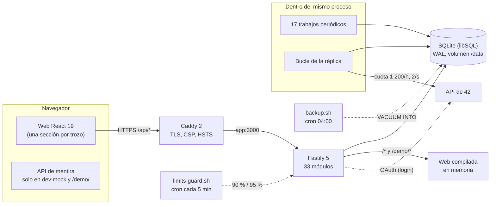

| Pros                                                                 | Contras                                                         |
| -------------------------------------------------------------------- | --------------------------------------------------------------- |
| Una máquina, un proceso, un fichero: nada más que mantener ni pagar  | No escala en horizontal: todo depende de una máquina            |
| Los módulos se separan por carpeta y el linter guarda las fronteras  | Un fallo grave del proceso tumba la API, la web y la réplica    |
| La réplica desacopla las pantallas de la cuota de 42                 | Los datos de 42 llegan con minutos de retraso                   |
| Despliegue y copia triviales (una imagen, un fichero)                | Los trabajos de fondo comparten CPU con las peticiones          |

**Alternativas.** Microservicios (API, sincronizador y web por separado):
aíslan fallos, pero piden orquestación y más memoria de la que da la capa
gratuita. PostgreSQL gestionado: más concurrencia de escritura, pero cuesta
dinero o un servicio más. Web servida por un CDN: más rápida lejos de Madrid,
pero otra pieza y otra política de contenido.

## Una petición de punta a punta

Ejemplo: abrir Peer to peer (`#/consulta`) y elegir un proyecto.

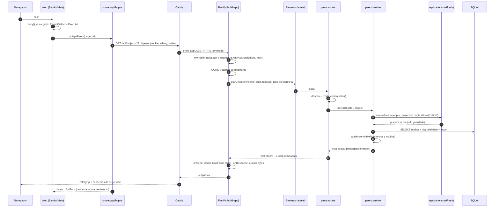

Lo que conviene ver en el diagrama: la petición nunca espera a 42 salvo que
`ensureFresh` lo considere crítico y haya cuota; el filtrado de quién ve a quién
se hace en el servicio, no en la web; y el consumo (de la web y de 42) se cuenta
por persona y por sección sin que el módulo lo sepa.

| Pros                                                            | Contras                                                              |
| --------------------------------------------------------------- | -------------------------------------------------------------------- |
| Cada capa tiene un solo trabajo (ruta valida, servicio decide)   | Muchos saltos para algo sencillo                                     |
| Las barreras globales se aplican a toda ruta, también a las nuevas | Una barrera mal ordenada afecta a todo (por eso tienen tests propios) |
| El tipo de la respuesta es el mismo en API, cliente y mock      | Cambiar una respuesta obliga a tocar tres sitios                      |

## Arranque y capa HTTP

`main.ts` carga el entorno, construye la app (`app/build-app.ts`), abre el
puerto y después arranca los trabajos; con `SIGINT`/`SIGTERM` lo cierra todo en
orden (temporizadores, `stop()` de cada módulo, Fastify y la base).

`buildApp`:

1. `loadEnv()` (`config/env.ts`, zod): cinco obligatorias (`FORTY_TWO_UID`,
   `FORTY_TWO_SECRET`, `FORTY_TWO_REDIRECT_URI`, `SESSION_SECRET` de 32
   caracteres o más y `FRONTEND_URL`); el resto con valor de fábrica.
2. `openDatabase()` (que migra) y `assertSchemaIsCurrent`.
3. `compose(db, client42)` (`app/composition.ts`): construye los módulos con
   sus dependencias. Auth se monta aparte, delante, con *callbacks* hacia la
   réplica, el panel, la piscina y el staff.
4. Fastify con registro pino (sin cookies ni cabeceras de autorización),
   `x-request-id` de 9 bytes, `trustProxy`, cuerpo de 64 KB como mucho y
   `rewriteUrl` que quita el prefijo `/api`.
5. Ganchos y rutas: CORS, manejador de errores (`core/http/errors.ts` traduce
   `DomainError` a 400/401/403/404/409/429; un 429 de 42 sale como 503; lo
   demás, 500 sin detalles), salud (`/health` y `/health/db` con commit y
   versión del esquema, que es lo que mira `deploy.sh`), barrera de piscineros,
   las rutas de cada módulo y, al final, la web estática.

Cada módulo es un `AppModule` (`core/module.ts`): `name`, `routes(app,
{session})`, `jobs`, `stores` (para borrar datos), `personal` (para exportar y
anonimizar) y `start`/`stop`. La web se sirve desde `core/http/static.ts`: se
lee a memoria al arrancar; `assets/` y `sounds/` con caché de un año, el resto
con ETag, 304 y `Range`; toda ruta sin extensión devuelve el `index.html` (y
`/demo/…` el de la demostración).

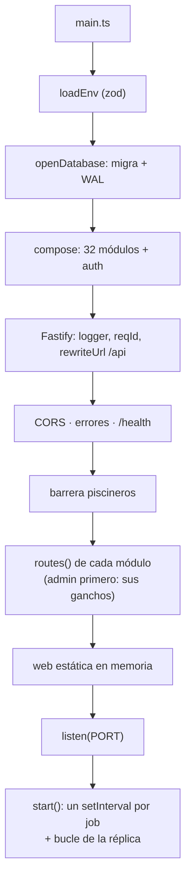

| Pros                                                                    | Contras                                                                  |
| ----------------------------------------------------------------------- | ------------------------------------------------------------------------ |
| `createX(deps)` en todo: los tests pasan base, reloj y 42 de mentira    | Sin contenedor de dependencias, `composition.ts` es largo                 |
| Un `AppModule` declara rutas, trabajos y datos personales en un sitio   | Lo que olvida declarar `personal` no sale en la exportación (hay test)   |
| La web va en memoria: sin disco por petición, con ETag                  | La memoria crece con el tamaño de la web compilada                        |
| `/api` se quita en la API: Vite y Caddy no reescriben nada              | La web y la API comparten espacio de rutas (la web es el «no encontrado») |

**Alternativas.** NestJS (decoradores e inyección): más convención, más magia y
arranque más lento. Express: más conocido, pero sin el esquema por ruta ni el
rendimiento de Fastify. Servir la web desde Caddy: quitaría trabajo a Node, a
cambio de dos sitios donde configurar cachés y la demostración.

## Barreras globales

Todo lo que no depende de una ruta concreta se comprueba una vez, en un
`onRequest` que registra el módulo `admin` (por eso va el primero) y en la
barrera de piscineros de `build-app.ts`. Miran la plantilla de la ruta o la URL
descodificada, para que `/%61dmin` no se cuele.

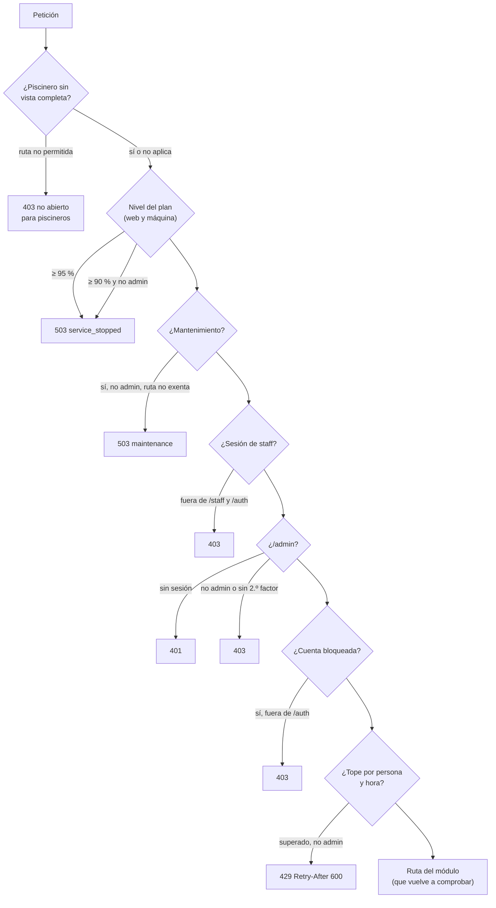

Los cortes del plan (`STOP_SHARE` 0,9 y `HARD_STOP_SHARE` 0,95 en
`modules/admin/budget.rules.ts`) no son regulables. Lo de admins se comprueba
dos veces: aquí y con `assertAdmin(actor)` en el servicio. Las rutas de
`/admin/*` piden además un segundo factor TOTP (cookie de 12 h, SameSite
Strict). Al responder, un `onSend` pone `Cache-Control: private, no-store` y un
`onResponse` suma los bytes al consumo de la persona.

| Pros                                                                 | Contras                                                                   |
| -------------------------------------------------------------------- | ------------------------------------------------------------------------- |
| Doble cerradura: un olvido en un servicio no abre `/admin`           | El orden de los ganchos importa y no se ve en cada ruta                   |
| Una ruta nueva queda protegida sin hacer nada (y `routes.test.ts` lo comprueba) | Las excepciones (rutas exentas) son listas a mano que hay que mantener |
| Cortes de coste en el propio proceso, además de en la máquina        | Un corte al 95 % deja fuera también a quien administra: hay que ir por SSH |

**Alternativas.** Un plugin de autorización por ruta (`preHandler` con roles):
más explícito, pero cada ruta nueva podría olvidarlo. Un proxy delante con las
reglas (Caddy, Nginx): no sabría de sesiones ni de niveles del plan.

## Login con OAuth de 42 y sesión

`modules/auth`. Código de autorización con PKCE (S256) y `state` firmado en una
cookie; el token de la persona se usa una sola vez para leer `/v2/me` y se tira.

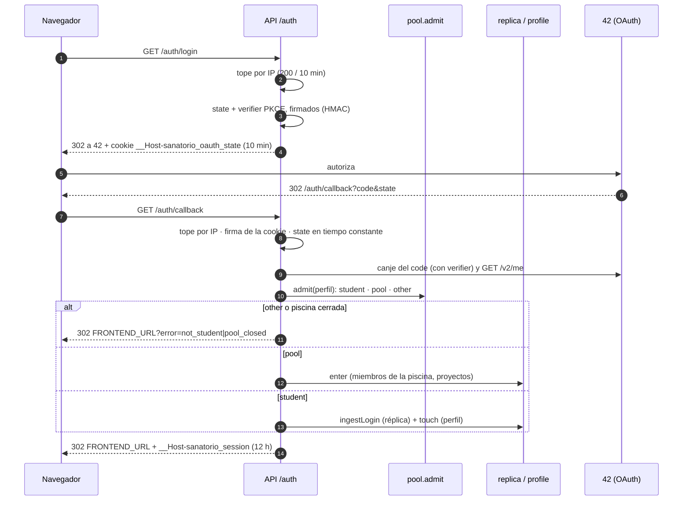

La sesión es una cookie `__Host-` con `{id, login, name, image, campusId, role,
aud, exp}` en base64url y su HMAC-SHA256 (`SESSION_SECRET`), comprobado con
`timingSafeEqual`. `session.user()` la lee, `session.actor()` añade el campus
elegido, si administra y si está bloqueada; `session.staff()` es la única que
acepta el rol `staff`. El staff entra con una clave (`POST /auth/staff`, 10
fallos cada 15 min por IP) y su cookie dura 2 h. Las condiciones legales no se
piden en el login: las pide la web (`LegalGate`) contra `GET /me/legal`.

| Pros                                                                        | Contras                                                                 |
| --------------------------------------------------------------------------- | ----------------------------------------------------------------------- |
| Sin tabla de sesiones: ninguna lectura de base para saber quién eres        | Una sesión no se puede revocar antes de sus 12 h (bloquear sí corta)    |
| PKCE y `state` firmado: sin almacenamiento en el servidor durante el login  | Si se filtra `SESSION_SECRET` hay que cambiarlo y echar a todo el mundo |
| No se guarda el token de 42 de nadie: nada que robar                        | Lo que hace falta de la persona se copia en el login o lo pide la réplica |
| Cookie `__Host-`, `HttpOnly`, `Secure`, `SameSite=Lax`                      | Sin login, la demostración es la única forma de ver la web              |

**Alternativas.** Sesiones en base (revocables, una consulta por petición).
JWT en `localStorage` (expuesto a XSS). Guardar el token de 42 de cada persona
para pedir en su nombre: más cuota (cada token tiene la suya), pero obliga a
custodiar credenciales ajenas.

## Base de datos y migraciones

`core/db`. SQLite a través de `@libsql/client`, un fichero en `/data` (o una
base libSQL remota si `DATABASE_URL` no es `file:`, con su token).

- Al abrir: crea la carpeta, **migra** y, si es un fichero, `journal_mode=WAL`,
  `synchronous=NORMAL` y `ANALYZE` si nunca se hizo. Cada 6 h, `PRAGMA
  optimize` (trabajo de la réplica).
- Migraciones: un fichero por versión en `core/db/migrations/` (hoy 82, de
  `0001-replica.ts` a `0082-startup.ts`), ordenadas en `index.ts`. Cada una se
  aplica en un `db.batch` atómico junto con la fila de `schema_version` (no se
  usa `user_version` porque libSQL remoto no deja escribirlo). Las desplegadas
  no se editan.
- En producción las aplica `deploy.sh` aparte, antes de cambiar el contenedor
  (`node dist/cli/migrate.js`), para que un fallo deje viva la versión vieja.
- Los repositorios escriben SQL a mano; las restricciones únicas de las tablas
  son las que impiden apuntarse o cobrar dos veces.

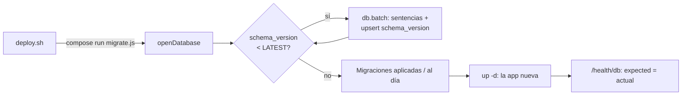

| Pros                                                                  | Contras                                                                 |
| --------------------------------------------------------------------- | ----------------------------------------------------------------------- |
| Un fichero: copia con `VACUUM INTO`, restauración copiando             | Un solo escritor a la vez (WAL deja leer mientras se escribe)           |
| WAL: quien lee no espera a la réplica; escrituras 100 veces más baratas | Sin réplicas de lectura ni conmutación por error                        |
| Migraciones en TypeScript, atómicas, comprobadas por un test           | Sin vuelta atrás automática del esquema: se vuelve con la copia         |
| SQL a mano: se ve lo que se pide y se mide con `EXPLAIN`               | Sin ORM, los tipos de las filas se escriben a mano (`core/db/rows.ts`)  |

**Alternativas.** PostgreSQL (concurrencia, tipos ricos; otro servicio). Un ORM
como Drizzle o Prisma (tipos generados; capa más y migraciones a su manera).
Turso remoto (ya soportado por libSQL; latencia de red en cada consulta).

## Mundos: estudiantes, piscineros y personas ocultas

`core/audience.ts` y `modules/pool`. Hay dos mundos que no se ven entre sí: un
estudiante no ve a ningún piscinero y un piscinero solo ve a los de su campus.
Además, quien administra puede ocultar a una persona a uno de los dos grupos (o
a los dos): para ese grupo deja de existir, y ella sigue usando la web.

- `pool.rules.ts` (`audienceOf`) decide en el login: 42cursus (21) → estudiante;
  sin él y con una piscina (cursus 9) que empezó hace menos de 60 días o empieza
  en menos de 30 → piscinero; el resto, fuera. Quien administra entra siempre
  como estudiante.
- `pool.keys.ts`: qué puede abrir un piscinero, por claves (`POOL_ROUTES`:
  clave → rutas; `POOL_BASE`, siempre abiertas). Un permiso hijo solo vale si
  su pestaña padre está abierta. Lo marca quien administra en Gestión ›
  Piscina, y la barrera de `build-app.ts` corta la ruta en la API, no solo en
  la web.
- `audience.seesFor`/`visibleTo` filtran cualquier lista de personas (mapa,
  buscador, sala de espera, red, calendario, clasificaciones, grupos, salas…);
  las listas de piscineros y de ocultos van en caché de 60 y 30 s, y
  `audienceKey` separa las cachés de vistas ya filtradas.
- «Ver como piscinero»: quien administra vuelve a firmar su cookie con
  `preview` (y el dueño, con `unrestricted`, sin límites).

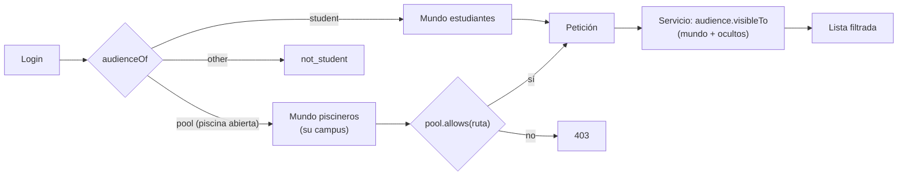

| Pros                                                                  | Contras                                                                   |
| --------------------------------------------------------------------- | ------------------------------------------------------------------------- |
| El filtro está en la API: la web no puede enseñar lo que no recibe    | Cada servicio que lista personas tiene que acordarse de filtrar          |
| Permisos por clave, uno por pestaña y bloque, regulables desde el panel | Dos listas paralelas (rutas en la API y bloques en la web) que casan a mano |
| Ver como piscinero comprueba lo marcado sin otra cuenta               | Las cachés de 30-60 s retrasan un poco ocultar a alguien                  |

**Alternativas.** Dos despliegues (uno por mundo): aislamiento total, el doble
de máquina. Filtrar en SQL con una vista por audiencia: más rápido, pero
repetido en cada consulta y más difícil de probar que una función.

## Réplica de 42 y su cuota

`modules/replica` e `integrations/forty-two`. La API de 42 da 1 200 peticiones
por hora (y 2 por segundo) a toda la aplicación. Por eso las pantallas leen de
una copia local que un bucle de fondo mantiene, y **cualquier** petición a 42
pregunta antes a la cuota con su escalón.

- **Bucle** (`syncer.ts`), por prioridad: puestos ocupados (cada 2 min con gente
  en la web, 5 sin ella), proyectos pendientes, cambios desde la última vez
  (`range[updated_at]`), catálogo de campus semanal y, con lo que sobra, la
  copia inicial. Fuera de él: 42cursus, historial de asientos, piscineros,
  logtime, puntos, agenda de 42 (bajo demanda, 15 min por persona) y plan de
  estudios deducido (`curriculum.ts`, sin API: de rangos y fechas).
- **Cuota** (`quota.ts`): `critical` (entrar, puestos; para con 40 libres),
  `deferrable` (lo de una persona que puede esperar; respeta la reserva de día
  de 300) y `background` (copias). `quota.defer(login, tarea)` da turno en la
  cola `quota_queue` si no hay cuota: la web enseña el número (`A-042`) y un
  trabajo cada 20 s atiende cinco turnos por pasada.
- **Ritmo por la hora** (`budget.ts`): día, «gastar lo que sobra» en los
  últimos 10 minutos (la cuota se renueva a la hora en punto y lo no gastado se
  pierde) y noche (02:00-06:00 en Madrid sin nadie en la web). Fuera del día,
  las tareas de volumen van por turnos (copia inicial, 42cursus, correcciones,
  asientos, repaso).
- **Cliente** (`integrations/forty-two`): token de aplicación
  (`client_credentials`) en memoria; nunca más de 2 peticiones en 1,1 s ni a
  menos de 250 ms; lee las cabeceras de cuota de 42; reintenta 408/429/5xx con
  `Retry-After` o espera exponencial. Un medidor (`api-usage.ts`) cuenta por
  función y persona y aplica topes por hora del panel.
- `ensureFresh(campus, proyecto)`: dentro de una petición, y solo si hay cuota
  crítica, refresca lo que esa pantalla necesita y aún no está.
- Solo `replica`, `network` y `exams` reciben el cliente de 42 (lista cerrada en
  `tests/unit/forty-two-callers.test.ts`).

Tablas y cifras de cada tarea: [architecture.md](architecture.md) («Réplica de
42») y [consumo-api.md](consumo-api.md).

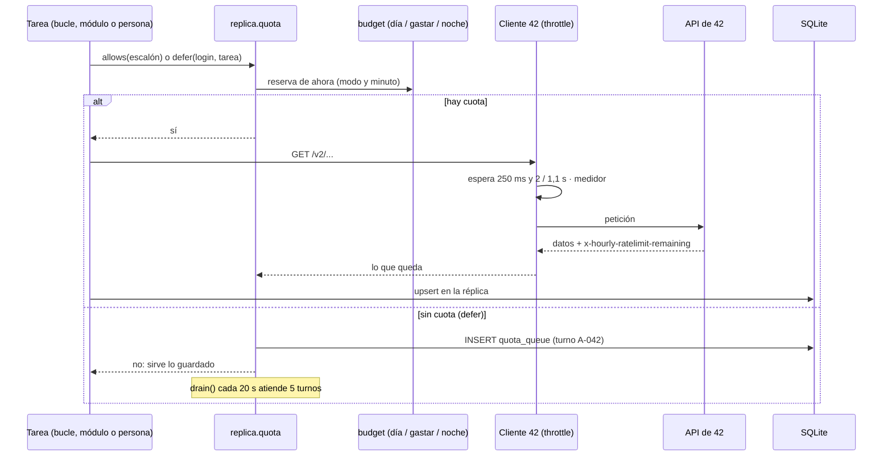

| Pros                                                                   | Contras                                                                    |
| ---------------------------------------------------------------------- | -------------------------------------------------------------------------- |
| Ninguna pantalla depende de la cuota: la web va igual con 42 lento     | Los datos van con retraso (puestos, minutos; histórico, días la primera vez) |
| Un solo sitio decide quién gasta: nada se come la hora por su cuenta   | Lógica de reparto compleja (modos, turnos, rampa): mucha prueba unitaria   |
| Gasta lo que se perdería (noche, final de la hora) sin quitar a nadie  | La copia inicial de un campus grande (París) tarda días                    |
| Cola con turno visible en vez de error cuando no hay cuota             | Lo copiado ocupa disco y es responsabilidad propia (privacidad)            |

**Alternativas.** Preguntar a 42 en cada pantalla con caché corta: sencillo,
pero con 80 personas la hora se acaba en minutos. Usar el token de cada persona
(cada uno con su cuota): obligaría a guardar tokens ajenos. Webhooks de 42: no
cubren lo que hace falta (puestos, correcciones).

## Comunicación entre módulos: eventos y dependencias

Dos formas (`core/events.ts`, `app/composition.ts`):

1. **Dependencia directa** cuando un módulo necesita el resultado de otro: se
   pasa por parámetro el servicio (o su `index.ts`). Las que crearían un ciclo
   se conectan al final con `late.wire` (`core/late.ts`).
2. **Eventos** cuando solo se avisa. El bus es síncrono y tipado (`AppEvents`):
   - `duty.started` (peers → profile: primer logro de guardia).
   - `profile.viewed` (profile → boards: reparte la XP pendiente al leer).
   - `notice` (therapy, doubts, boards, help, meet, admin y clicker, con
     `notify` → notices: escribe en el buzón).
   - `notice.settled` (admin → notices: cierra avisos resueltos).

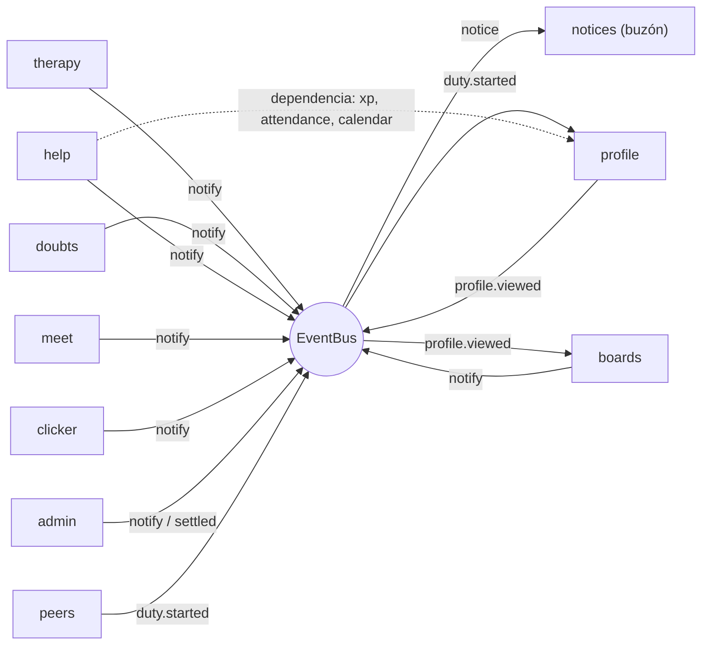

| Pros                                                              | Contras                                                         |
| ----------------------------------------------------------------- | --------------------------------------------------------------- |
| Quien avisa no sabe quién escucha: el buzón no se toca desde fuera | Con eventos, seguir el flujo pide buscar quién escucha          |
| Síncrono: el aviso queda escrito antes de responder               | Un oyente lento retrasa la petición que emitió                  |
| Tipado: un evento mal formado no compila                          | `late.wire` es una costura a mano para romper ciclos            |

**Alternativas.** Una cola de mensajes (Redis, NATS): asíncrona y duradera,
pero otra pieza. Eventos en una tabla (patrón *outbox*): sobrevive a un
reinicio, pero innecesario con un solo proceso.

## Trabajos periódicos

Un módulo declara `jobs: [{name, everyMs, run}]`; `build-app.ts` lanza un
`setInterval` por trabajo con un cerrojo para que no se solapen, cada uno dentro
de `withApiUse('job:…')` para contar su gasto de 42. Con el corte del 90 % solo
corren los de `admin`. Hoy son 17:

| Módulo   | Trabajo                                        | Cada  |
| -------- | ---------------------------------------------- | ----- |
| replica  | Cola de la cuota de 42                         | 20 s  |
| replica  | Volcado del consumo de 42                      | 60 s  |
| replica  | Copia de piscineros                            | 60 s  |
| replica  | Copia del 42cursus                             | 60 s  |
| replica  | Historial de asientos                          | 60 s  |
| replica  | Estadísticas de la base (`PRAGMA optimize`)    | 6 h   |
| network  | Copia de correcciones                          | 20 s  |
| network  | Copia de correcciones de la piscina            | 20 s  |
| exams    | Intentos de examen antiguos                    | 60 s  |
| exams    | Examen en vivo                                 | 60 s  |
| therapy  | Asistencia a terapias (puestos)                | 60 s  |
| meet     | Recordatorios de conversaciones                | 60 s  |
| admin    | Volcado del consumo de la web                  | 60 s  |
| stats    | Avance precalculado                            | 25 min |
| clicker  | Aligerado del historial de capital             | 1 h   |
| quiz     | Limpieza de salas de Not-games                 | 1 h   |
| gitcourse | Limpieza de salas del curso de git            | 1 h   |

Además, el bucle continuo del sincronizador (`replica.start()`).

| Pros                                                       | Contras                                                        |
| ---------------------------------------------------------- | -------------------------------------------------------------- |
| Sin cron ni procesos aparte: se paran con la app y con el corte | Si el proceso muere, no corren hasta que vuelve              |
| Un fallo se registra y se reintenta en la siguiente vuelta | Sin historial de ejecuciones (solo el registro)                |
| Casi todos no hacen nada la mayoría de las veces           | Comparten CPU con las peticiones                               |

**Alternativas.** Cron del sistema llamando a una CLI (aislado, pero fuera del
corte del plan). Una cola de trabajos (BullMQ): reintentos y panel, con Redis.

## Módulos uno a uno

Cada módulo tiene la forma `index.ts` (lo único que se importa desde fuera),
rutas, servicio, repositorio y, cuando hay reglas delicadas, `*.rules.ts` puras.
Nº de rutas contadas en el código (con método; 248 en total contando `/health`).

| Módulo        | Qué hace                                                                                               | Rutas | Notas                                                         |
| ------------- | ------------------------------------------------------------------------------------------------------ | ----: | ------------------------------------------------------------- |
| `auth`        | OAuth de 42, sesión, staff, ver como piscinero                                                          |     8 | Se monta antes que todos                                      |
| `admin`       | Barreras, permisos, bloqueos, incidencias, consumo, presupuesto, crecimiento, mantenimiento, TOTP, borrado | 26 | Un trabajo; ganchos globales                                  |
| `replica`     | Copia de 42, cuota y cola, campus, fotos, consumo de 42                                                |     8 | Cliente de 42; seis trabajos y el bucle                       |
| `peers`       | Tus proyectos, quién ayuda, disponibilidad                                                             |     4 | Emite `duty.started`                                          |
| `profile`     | Perfil, XP, títulos, logros, ajustes, health check, buscador, clasificación                            |     7 | Escucha `duty.started`, emite `profile.viewed`                |
| `therapy`     | Sprints (grupos) con puestos y asistencia                                                              |     7 | Trabajo de asistencia cada minuto                             |
| `doubts`      | Proyectos: grafo, dudas, guía por propuestas                                                           |    13 | Topes y XP en el servicio                                     |
| `boards`      | Pizarras                                                                                               |     6 | XP al leer (`settle`)                                         |
| `help`        | On-call: franjas, reservas, valoraciones, bloqueos                                                     |    13 | Topes pareja/día/semana                                       |
| `attendance`  | Código de asistencia y tiempo validado                                                                 |     0 | Lo usan meet, help, boards                                    |
| `calendar`    | Calendario personal: lo de Peer4U y lo de 42                                                           |     1 | Sin tablas propias                                            |
| `map`         | Plano de clústeres, ficha de persona, puestos rotos                                                    |     5 | Usa `ensureFresh`                                             |
| `network`     | Red de correcciones y de asientos (grafo, endogamia, comunidades)                                      |     7 | Cliente de 42; dos trabajos                                   |
| `exams`       | Examen en vivo y estadísticas de exámenes                                                              |     3 | Cliente de 42; dos trabajos                                   |
| `stats`       | Clasificaciones de Ayuda y Avance (también de la piscina)                                              |     5 | Avance precalculado cada 25 min                               |
| `usage`       | Uso de cada elemento, recorridos, clics, conectados                                                    |     8 | Orden automático de la web                                    |
| `meet`        | Avisos y chat de eventos, conversaciones, asistencia                                                   |    12 | Recordatorios cada minuto                                     |
| `notices`     | Buzón de avisos y `GET /pulse`                                                                         |     5 | Escucha `notice` y `notice.settled`                           |
| `broadcasts`  | Comunicados de quien administra                                                                        |     5 |                                                               |
| `countdowns`  | Avisos con cuenta atrás                                                                                |     7 |                                                               |
| `agenda`      | Scrum individual por proyecto y tablero del sprint                                                     |     9 |                                                               |
| `focus`       | Pomodoro: sesiones y estadísticas                                                                      |     6 |                                                               |
| `startup`     | Startup del Pomodoro y su clasificación                                                                |     3 | Motor en `packages/startup`                                   |
| `quiz`        | Not-games (salas de preguntas) y juegos por turnos (ajedrez)                                           |    17 | Banco en es/en/fr; limpieza cada hora                         |
| `gitcourse`   | Curso de git: niveles, test previo, salas de grupo                                                     |    12 | Vuelve a ejecutar con `packages/gitsim`                       |
| `shellcourse` | Curso de shell: unidades, jefes, certificados, tiempos                                                 |     3 | Vuelve a ejecutar con `packages/shellsim`                     |
| `clicker`     | Code Clicker: partidas, trampas, historial de capital                                                  |    18 | Rehace las cuentas con `packages/clicker`                     |
| `tours`       | Velocidad de las demostraciones                                                                        |     3 |                                                               |
| `facility`    | Avisos del edificio al staff (y a Slack)                                                               |     5 |                                                               |
| `staff`       | Documentos con código y cuentas de staff                                                               |     6 |                                                               |
| `legal`       | Condiciones, exportar y anonimizar datos                                                               |     5 | Usa el `personal` de cada módulo                              |
| `pool`        | Piscina: acceso, aviso, permisos, personas ocultas                                                     |     8 |                                                               |
| `client-errors` | Fallos de la web al registro (sin tabla)                                                            |     1 | Sin sesión, con tope por IP                                   |
| `presence`    | Quién tiene la web abierta y dónde se sienta (no es `AppModule`)                                       |     0 | Lo usan map, meet, usage, notices                             |

A continuación, los que tienen más mecánica propia.

### Peer to peer (`peers`) y on-call (`help`)

`peers` cruza los proyectos de la réplica con la disponibilidad
(`availability.repository`): «peer como tú» lo está haciendo, «senior» lo
aprobó y «guru» con 125. Alguien está disponible solo con `available: true` y
un puesto. `help` lleva las franjas de media hora de cada día, las reservas
(pedir, aceptar, rechazar, cancelar), la valoración descriptiva y los bloqueos;
la XP solo sale con el código de `attendance` y las dos valoraciones.

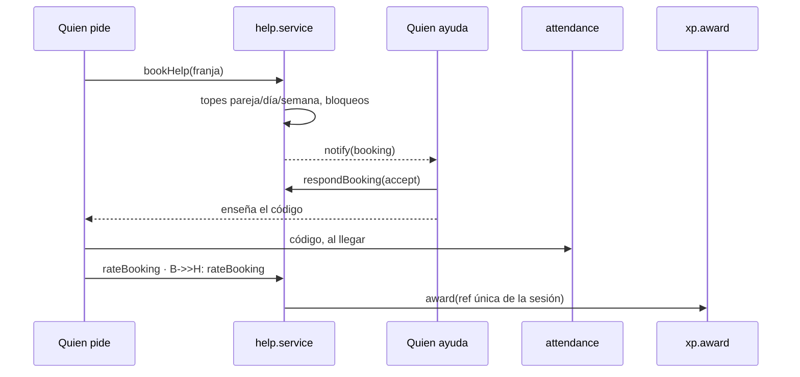

| Pros                                                        | Contras                                                         |
| ----------------------------------------------------------- | --------------------------------------------------------------- |
| La XP no se puede conseguir con un clic                      | Más pasos para quien ayuda de verdad                            |
| Referencia única por hecho: nada se cobra dos veces          | Si un código falla (no se valida a tiempo), se pierde la XP     |
| Valoraciones descriptivas, no notas                          | Menos señal para ordenar a quien ayuda mejor                    |

**Alternativa**: XP por «gracias» con un clic (más uso, trampa trivial).

### Proyectos (`doubts`)

Grafo del plan de cada persona (no un catálogo), dudas con respuestas y una
guía corta por proyecto que se cambia por propuestas que otra persona valida (o
marca). El plan y el círculo de cada proyecto salen de `replica/curriculum.ts`.

| Pros                                         | Contras                                                   |
| -------------------------------------------- | --------------------------------------------------------- |
| Cada cual ve solo lo que puede hacer          | El grafo depende de deducir el plan (puede fallar en casos raros) |
| La guía mejora sin moderación central         | Sin nadie que valide, una propuesta se queda esperando     |

### Red de correcciones y de asientos (`network`)

Copia de las correcciones del 42cursus (histórico con cursor, novedades cada 10
min, repaso diario sin nadie en la web) y de la piscina. El veredicto se deduce
de la marca y de la nota mínima de cada proyecto (`passMarkOf`), porque 42 pone
«Ok» también con un 0. `network.analysis.ts` (funciones puras) calcula
endogamia y comunidades (Louvain sin azar), con caché de 10 min por filtros. La
red de asientos sale del historial de puestos (`seat_sessions`). Detalle:
[architecture.md](architecture.md) («Red de correcciones»), [asientos.md](asientos.md).

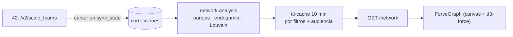

| Pros                                                          | Contras                                                             |
| ------------------------------------------------------------- | ------------------------------------------------------------------- |
| Las cuentas se hacen una vez en la API, no en cada navegador  | La caché de 10 min hace que lo nuevo tarde en verse                 |
| Funciones puras: se prueban sin base                          | Con París entero el grafo se recorta a las personas más activas     |
| Canvas en la web: miles de burbujas a 60 fps                  | Canvas no es accesible por sí mismo (por eso hay listas y fichas)   |

**Alternativas**: base de grafos (Neo4j), cálculo en el navegador (WebWorker),
SVG (no aguanta miles de nodos).

### Not-games y juegos por turnos (`quiz`)

Salas en las que el servidor lleva el reloj y la partida: nadie contesta tarde
ni ve la buena antes. El banco de preguntas (`quiz/bank`, es/en/fr) se filtra
por lo que ha hecho cada cual (`curriculum.circlesOf`). Los juegos por turnos
(`quiz/games`, ajedrez con `chess.js`) separan la mecánica de «pregunta entre
jugadas» del juego. La dificultad se reajusta con lo que falla la gente.

| Pros                                          | Contras                                                  |
| --------------------------------------------- | -------------------------------------------------------- |
| Autoridad en el servidor: sin trampas de reloj | Cada jugada es una petición; la web sondea la sala       |
| Banco versionado en el código, revisable       | Traducir el banco es trabajo aparte (catalán y euskera no) |

**Alternativa**: WebSockets (menos latencia; conexiones abiertas y más
memoria).

### Cursos (`gitcourse`, `shellcourse`) y juegos con motor (`clicker`, `startup`)

La web ejecuta el simulador para responder al momento y manda el intento; la
API **vuelve a ejecutarlo** con el mismo paquete (`gitsim`, `shellsim`) y
calcula las estrellas, o rehace las cuentas de la partida (`clicker`, `startup`)
para ver si cuadran. El curso de git exige estar sentado en un puesto del
clúster (`peers.locationOf`) y tiene salas de grupo.

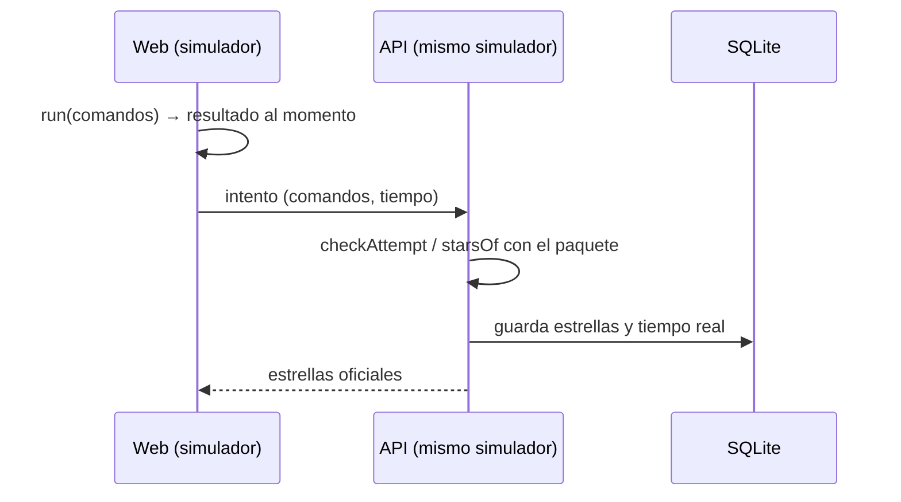

| Pros                                                   | Contras                                                     |
| ------------------------------------------------------ | ----------------------------------------------------------- |
| El mismo código en los dos lados: sin desacuerdos      | Los paquetes hay que compilarlos para la imagen             |
| Nadie se pone estrellas editando la petición           | La API paga CPU por reejecutar (con `LIMITS` contra abusos)  |
| Sin máquinas reales: nada que asegurar                 | Un simulador nunca es git ni bash enteros                   |

**Alternativas**: contenedores reales por persona (fiel, caro e inseguro);
confiar en la web (trampa trivial).

### Panel, consumo y cortes (`admin`)

Además de las barreras: permisos y bloqueos, el buzón de incidencias y
sugerencias, el consumo por persona y hora con su presupuesto repartido solo
(720 000 peticiones al día, entre 240 y 3 000 por persona), el crecimiento por
campus, el mantenimiento con hora de vuelta, el segundo factor TOTP y el borrado
a mano con vista previa (lo único que borra datos).

| Pros                                                     | Contras                                                |
| -------------------------------------------------------- | ------------------------------------------------------ |
| Los cortes de coste viven en el código y en la máquina   | Un módulo grande (26 rutas), con mucho distinto dentro |
| Nada se borra solo: todo borrado es una decisión visible | La base crece sin límite si nadie limpia               |

## Arranque, cabecera y navegación

`main.tsx` carga el idioma antes de pintar, vigila errores (`watchErrors`, que
manda a `POST /client-errors`) y el reposo, aplica las hojas comunes y después
los estilos, y registra `sw.js` en producción. `App.tsx` decide la pantalla:
`#/validar` → página del staff; si no, cargando → servidor caído (con
reintento) → mantenimiento → privacidad sin sesión → login (con el motivo de un
rechazo: `not_student`, `pool_closed`…) → la web (`Clinic.tsx`).

`Clinic.tsx` monta la franja de «ver como piscinero», la cabecera, la pila de la
esquina (Pomodoro, cuentas atrás), las ventanas obligatorias en cola (legal,
comunicados, revisión de trampas, peticiones de ayuda, bienvenida, avisos de
eventos), Personalizar, la sección abierta dentro de un `ErrorBoundary`, el pie
y los dos buzones.

La navegación va en el hash (`#/<sección>[/<param>][?opciones]`,
`app/useRoute.ts`; sin router). `app/sections.ts` define 21 secciones con su
categoría (Yo, Ayuda, Aprender, Campus) y su `from`; `Nav.tsx` pinta la fila de
categorías y, debajo, la de secciones, filtrando por modo, permiso de piscinero
y Pomodoro. Cada sección es un `lazy()` en `SectionView.tsx` (salvo la sala de
espera).

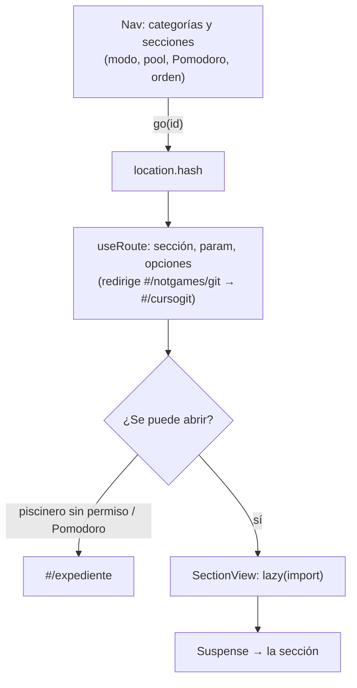

| Pros                                                     | Contras                                                         |
| -------------------------------------------------------- | --------------------------------------------------------------- |
| Sin router: nada que configurar ni actualizar            | Rutas anidadas y parámetros a mano (`decodePart`, `links.ts`)   |
| El hash no llega al servidor ni a terceros               | URLs menos limpias para compartir                               |
| Cada sección baja solo al abrirla                        | La primera vez, un instante de «cargando sección»               |

**Alternativas**: React Router o TanStack Router (rutas tipadas, cargadores de
datos; dependencia y más peso), un *framework* con rutas en el servidor (Next):
no hace falta SSR para una web con sesión.

## Textos e idiomas (CSV)

`shared/i18n`. Todos los textos viven en 22 tablas CSV (`shared/i18n/textos/*.csv`
y el grupo `textos/juego/`), con `clave, contexto, es, en, ca, eu, fr`. Un
plugin de Vite (`tools/textos.ts`) las convierte en módulos virtuales
(`virtual:textos/<lang>`): el español viaja con la web y el resto se descarga al
elegirlo; el francés cae al inglés y todo al español. `t(clave, huecos)`,
`tn(clave, n)` con plurales (`.one`/`.many`), `useFormat` para fechas y
números. `npm run textos` (en el `check`) falla si falta una clave, sobra otra,
se pierde un hueco, falta inglés o francés, no hay contexto o `docs/textos/` no
está al día. Reglas de redacción: [textos.md](textos.md).

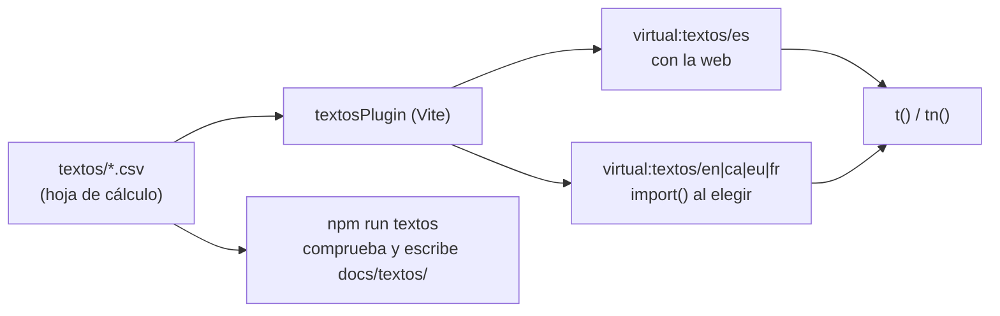

| Pros                                                          | Contras                                                    |
| ------------------------------------------------------------- | ---------------------------------------------------------- |
| Se edita como una hoja de cálculo, con el contexto al lado    | CSV con comas y saltos de línea: hay que escaparlos bien    |
| Ningún texto en los componentes: el linter de textos lo vigila | Las claves heredan nombres viejos (`consulta`, `terapia`)  |
| Cada idioma se descarga solo si se usa                        | Sin herramienta de traducción online (Crowdin, Weblate)    |

**Alternativas**: i18next con JSON por idioma (estándar, sin contexto junto a
cada texto), ICU MessageFormat (plurales y género más ricos), una plataforma de
traducción.

## Modos simplificado, normal y datos

`shared/detail.tsx`. Tres modos (`simple`, `normal`, `datos`) guardados en el
navegador (`sanatorio_detail`, de fábrica `normal`) y escritos en `<html
data-detail>`. Cada elemento dice desde cuál sale: las secciones con `from` en
`sections.ts`, los bloques con `from` en `shared/layout/registry.ts` y lo demás
envuelto en `<Show from="…">`. Una sección que no toca deja de salir en las
pestañas, pero se abre por su dirección. Qué sale en cada uno:
[interfaz.md](interfaz.md) y [funcionalidades.md](funcionalidades.md).

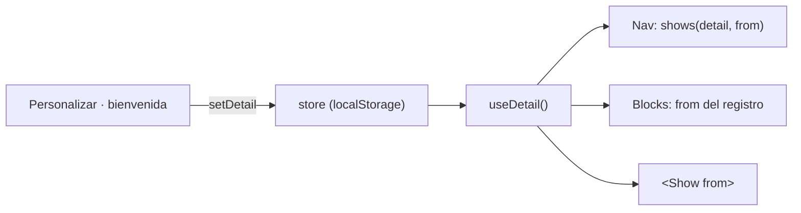

| Pros                                                    | Contras                                                         |
| ------------------------------------------------------- | --------------------------------------------------------------- |
| Una sola web para quien se pierde y para quien quiere cifras | Cada elemento nuevo pide decidir su modo (regla en AGENTS.md) |
| El modo se lee en cualquier componente sin props        | Vive en el navegador: no viaja entre dispositivos               |
| Esconder no rompe enlaces                               | Lo escondido sigue descargándose en su sección                  |

**Alternativas**: permisos por rol (no es una cuestión de permisos),
«divulgación progresiva» solo con plegables (sin modos), o dos webs.

## Personalizar: orden, bloques y estilos

`shared/layout` y `app/studio`. El orden de categorías, pestañas y bloques, y
qué sale plegado, es manual o automático (por tu uso o el de la comunidad,
`order.ts`). El uso se cuenta en cada clic (`track`) y se manda cada minuto a
`usage`, que devuelve el de la comunidad; el tiempo por sección se mide con
`view-clock.ts`. El estudio (`Studio.tsx`) enseña la web en pequeño para
arrastrar (`sortable.ts`, también con teclado y anunciado al lector de
pantalla) y tres pestañas: Estilo, Orden y Ajustes.

Estilos (`themes/`): Peer4U (de fábrica), Clean code, Terminal (con paletas de
VS Code), Cuaderno, Espacial, A tu color y uno exclusivo. Cada uno es una
carpeta con su manifiesto, su hoja bajo `:root[data-style]` y sus imágenes; los
componentes solo usan variables (`styles/theme.css`). Claro, oscuro o como el
sistema (`shared/theme`); `public/theme.js` lo aplica antes de pintar. Cómo
crear uno: [apps/web/src/themes/README.md](../apps/web/src/themes/README.md).

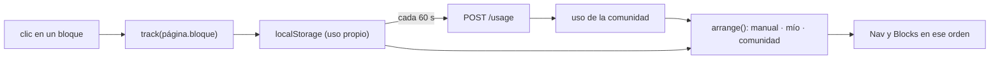

| Pros                                                        | Contras                                                    |
| ----------------------------------------------------------- | ---------------------------------------------------------- |
| La web se ordena sola hacia lo que se usa                   | Lo automático puede mover cosas (se congela al abrir la web) |
| Estilos como datos: uno nuevo no toca ningún componente     | Cada componente nuevo tiene que verse bien en todos         |
| El uso agregado sirve también al panel (mapa de calor)      | La personalización no viaja entre dispositivos              |

## Cliente de la API, API de mentira y demostración

`shared/api`. Solo esta carpeta habla con la API. `types.ts` declara la
interfaz `Api` (unos 235 métodos); la cumplen `client.ts` (real, sobre
`http.ts`: `fetch` con cookie, 15 s de tope, cabeceras `x-lang` y `x-idle`, y
errores como `ApiError` de red, de estado o de mantenimiento) y `mock/` (unas
30 partes en memoria, con datos inventados). `index.ts` elige con
`VITE_USE_MOCK`; el *mock* se importa dinámicamente y no viaja en la web real.

- `npm run dev:mock` = `vite --mode mock` (lee `apps/web/.env.mock`): la web
  entera sin API ni credenciales.
- `npm run build` compila también la demostración: `vite build --mode demo
  --base /demo/ --outDir dist/demo`. La API la sirve en `/demo/`.

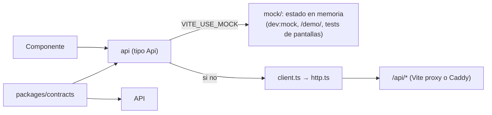

| Pros                                                                 | Contras                                                         |
| -------------------------------------------------------------------- | --------------------------------------------------------------- |
| El tipo obliga a que real y mentira tengan lo mismo                  | Mantener el mock es casi otra API (unas 11 000 líneas)          |
| Demostración pública sin servidor ni datos reales                    | El mock puede comportarse distinto que la API real              |
| Tests de pantallas sin red, contra el mock                           | Lo que el mock no simula bien no se prueba en pantalla          |

**Alternativas**: MSW (interceptar `fetch`, mismo cliente), un servidor de
pruebas con una base sembrada, o generar el cliente desde OpenAPI.

## Pulso y sondeos

Lo que hay que preguntar de fondo va todo en una sola petición, `GET /pulse`
(`hooks/usePulse.ts`): avisos sin leer, cuota de 42 y turno, mantenimiento,
examen en vivo, cuentas atrás, comunicados, revisiones del juego y peticiones de
ayuda. Va cada 20 s si se espera turno, 60 s si la cuota va justa y 120 s si va
bien, y nada con la pestaña oculta. Lo que una pantalla refresca mientras se
mira (salas, mapa, conectados) va por `usePolling`, que también se para con la
pestaña oculta o el Pomodoro a pantalla completa.

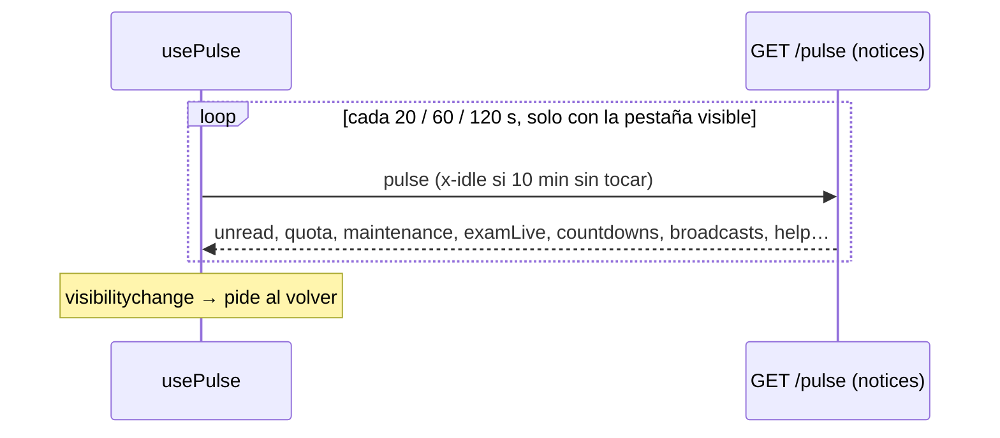

| Pros                                                    | Contras                                                    |
| ------------------------------------------------------- | ---------------------------------------------------------- |
| Una petición en vez de ocho sondeos                     | Hasta dos minutos de retraso en un aviso                   |
| Con la pestaña oculta no se gasta nada                  | `/pulse` depende de muchos módulos                         |

**Alternativas**: WebSockets o Server-Sent Events (avisos al instante;
conexiones abiertas, más memoria y más complejidad detrás de Caddy), Web Push
(necesita servicio y permisos del navegador).

## Demostraciones animadas (tours)

En vez de párrafos de ayuda, cada sección lleva un `InfoTip` que abre una
demostración: un decorado con un ratón falso que no llama a la API
(`shared/tour/Tour.tsx`). Un guion se escribe con `defineTour` (marcas de tiempo
y cambios); las frases van en `textos/demos.csv`. Hay 21. `npm run demo:new`
crea una desde la plantilla; `tests/tours.test.ts` comprueba nombres únicos,
duración, frases en los idiomas y 70 caracteres como mucho, y
`tests/ui/tours.test.tsx`, que el ratón solo va a cosas que existen. La
velocidad de fábrica sale de lo que elige la comunidad (`tours`). El
interrogante de la cabecera abre la demo del sitio donde se suelta. Criterios:
[demos.md](demos.md).

| Pros                                                    | Contras                                                    |
| ------------------------------------------------------- | ---------------------------------------------------------- |
| Enseña haciendo, sin texto que nadie lee                | Cada cambio de pantalla puede dejar la demo desfasada      |
| Los tests vigilan duración, textos y destinos           | Más trabajo que un párrafo                                 |
| Con movimiento reducido, los pasos salen como lista     | Un decorado no es la pantalla real                         |

**Alternativas**: vídeos o GIF (no se traducen ni siguen al estilo),
recorridos sobre la pantalla real (Shepherd, Intro.js: frágiles con el orden
personalizable).

## Ventanitas de la esquina y reposo

`shared/dock`: un gestor común da hueco a cada ventanita flotante (Pomodoro,
cuenta atrás, Code Clicker, etiqueta de la demo) en una pila abajo a la
izquierda; se reordenan, se sacan a flotar y se pliegan, y se recuerda en el
navegador. `shared/still.ts`: con 30 s sin tocar nada, la pestaña oculta o sin
foco, pone `data-still` y el CSS pausa las animaciones; Code Clicker baja de 10
a 1 refresco por segundo. Detalle: [interfaz.md](interfaz.md) («Ventanitas de
la esquina») y [rendimiento.md](rendimiento.md).

| Pros                                              | Contras                                                    |
| ------------------------------------------------- | ---------------------------------------------------------- |
| Nada se tapa; cada ventanita no sabe de las demás | Una pieza más que todo lo flotante tiene que usar          |
| La CPU descansa cuando nadie mira                 | Algo que debería animarse en reposo tiene que pedirlo      |

## Funcionalidades de la web una a una

Cada carpeta de `features/` es una funcionalidad; no importa de otra (lo
compartido va a `shared/`; las pocas excepciones, con su porqué, en
`eslint.config.js`). La lista de lo que hace cada una, con su modo y quién la
ve, está en [funcionalidades.md](funcionalidades.md). Aquí, cómo están hechas
las que tienen técnica propia:

| Carpeta       | Cómo está hecha                                                                                                    |
| ------------- | ------------------------------------------------------------------------------------------------------------------ |
| `peers`       | Sala de espera: lista y mapa del proyecto; el interruptor de disponibilidad de la cabecera                         |
| `profile`     | Perfil con `<Blocks page="expediente">`; perfil público; buscador de la cabecera; descarga de horas (CSV por POST) |
| `doubts`      | Grafo en perspectiva en SVG (`iso.ts`, `layout.ts`, `requestAnimationFrame`); grafo de piscina aparte              |
| `therapy`     | Sprints: tarjetas, formulario, elección de puestos con `map/SeatPicker`                                             |
| `boards`      | Pizarras: mes, formulario y próximas con plaza                                                                     |
| `help`        | On-call con `<Blocks page="guardia">`, editor de franjas, reservas; `HelpGate` obliga a contestar                  |
| `calendar`    | Día/semana/mes (`DayTimeline`), sala de cada evento con chat, asistencia con QR (`qrcode-generator`)                |
| `alerts`      | Avisos de eventos que no se cierran sin contestar; turno de la cola de 42                                           |
| `notices`     | Buzón de avisos y conversaciones (`openChat`)                                                                      |
| `map`         | Plano de clústeres que se ajusta al ancho (`fit.ts`), mapa de calor de puestos, avisar de un puesto roto           |
| `network`     | `ForceGraph` en `<canvas>` con `d3-force` y `d3-quadtree`; lo de cada fotograma en `ref`; red de asientos           |
| `stats`       | Clasificaciones; Avance en SVG propio (series, zoom, comparar); Avance de la piscina                               |
| `exams`       | Examen en vivo (sondeo) y estadísticas por plan y kickoff                                                          |
| `notgames`    | Salas con la hora del servidor; ajedrez con `chess.js`; repaso; sonidos con Web Audio                              |
| `gitcourse`   | Camino por mundos, teoría, terminal con `gitsim`, grafo de commits en SVG, test previo y salas de grupo            |
| `shellcourse` | Camino por niveles, unidades con terminal `shellsim`, jefes contrarreloj                                           |
| `focus`       | Pomodoro: temporizador en la pila, pantalla completa (`cover`), sonido ambiente (`AudioContext`), *wake lock*, estadísticas y startup en *pixel art* sobre canvas |
| `agenda`      | Metas por proyecto con checkpoints, dailies y weeklies; tablero del sprint (`shared/agenda`)                        |
| `countdowns`  | Ventanita de cuentas atrás y fijar una desde el calendario o una meta                                              |
| `clicker`     | Juego incremental (motor en `packages/clicker`), lluvia de pastillas en canvas, revisión de trampas obligatoria    |
| `suggest`     | Bicho que se arrastra hasta un sitio (`detect.ts`) y abre el panel; interrogante que abre la demo del sitio        |
| `admin`       | Panel con 15 pestañas tras segundo factor (QR TOTP); gráficas en SVG a mano                                        |
| `staff`       | Página aparte en `#/validar`: clave, comprobar documentos, avisos del edificio                                     |
| `legal`, `welcome`, `maintenance`, `campus`, `settings`, `facility`, `auth` | Ventanas y pantallas pequeñas: condiciones, bienvenida, mantenimiento, aviso de otro campus, pie, avisos del edificio, login |

## Paquetes compartidos

`packages/*`, privados y ESM.

| Paquete     | Qué es                                          | Lo usa       | Se compila | Por qué en los dos lados                         |
| ----------- | ----------------------------------------------- | ------------ | ---------- | ------------------------------------------------ |
| `contracts` | Tipos de cada respuesta de la API, por módulo   | API y web    | No (solo tipos) | Un cambio de forma que no se propague no compila |
| `course`    | Plantilla de los cursos: estrellas, tiempos, textos | Web (y API a través de los simuladores) | Sí | Estimaciones y estrellas iguales en los dos lados |
| `gitsim`    | git simulado en memoria, niveles y misiones     | API y web    | Sí         | La API vuelve a ejecutar los retos y lleva las salas |
| `shellsim`  | Shell de Linux simulada, unidades y jefes       | API y web    | Sí         | La API vuelve a ejecutar cada intento            |
| `clicker`   | Motor de Code Clicker                           | API y web    | Sí         | La API rehace las cuentas para detectar trampas  |
| `startup`   | Motor de la startup del Pomodoro                | API y web    | Sí         | La API hace cumplir las reglas                   |

En desarrollo nadie compila nada: la web y la API resuelven la condición
`source` (fuente TypeScript). Para la imagen, `npm run build` compila los cinco
a `dist/` antes que la API. Los motores se prueban desde los tests de la API y
de la web.

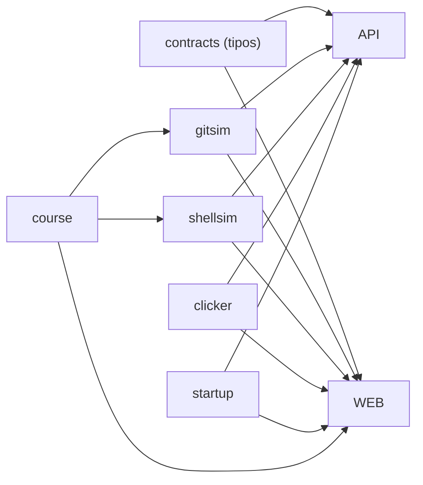

| Pros                                                | Contras                                                   |
| --------------------------------------------------- | --------------------------------------------------------- |
| Una sola verdad para tipos y reglas de juego        | Un cambio en un motor afecta a la vez a la API y a la web |
| Sin publicar paquetes: workspaces de npm             | La imagen tiene que copiar cada `dist`                   |

**Alternativas**: OpenAPI generado (tipos desde el esquema; otra herramienta),
tRPC (tipos de punta a punta sin contrato escrito; ata la web a la API).

## Contenedores y Caddy

`infra/`. Imagen en tres etapas sobre `node:22-slim` (`infra/docker/Dockerfile`):
compilar, dependencias de producción y final con la API, la web y los paquetes,
como usuario `node`, con `/data` como volumen y comprobación de salud a
`/health`. `infra/compose.yml`: `app` (sin puertos publicados, 2 GB de memoria,
sin capacidades, `no-new-privileges`, 256 procesos, registros rotados) y
`caddy:2` (80, 443 y 443/udp, HTTPS automático). El `Caddyfile` comprime, pone
HSTS, `nosniff`, `X-Frame-Options DENY`, `Permissions-Policy` y una CSP estricta
(solo `'self'`; imágenes también `data:`), y sirve `security.txt`.

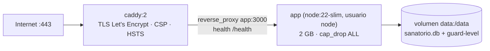

| Pros                                                     | Contras                                                    |
| -------------------------------------------------------- | ---------------------------------------------------------- |
| HTTPS sin tocar nada; cabeceras en un solo sitio         | Una sola máquina: sin redundancia                          |
| La app no escucha fuera de la red de Docker              | Construir la imagen en la propia máquina gasta su CPU      |
| Imagen multi-arquitectura (no compila nada nativo)       | 415 MB de imagen                                           |

**Alternativas**: Nginx con certbot (más configuración), Traefik (etiquetas en
compose), una plataforma gestionada (Fly, Render: coste o límites).

## CI y despliegue

`.github/workflows/ci.yml` corre en cada subida a `main` y en cada PR: `npm ci`,
tipos, lint, formato, código sin uso, duplicados, textos, tests con cobertura y
compilación; aparte, construye la imagen. El trabajo `veredicto` deja una
etiqueta de git `ci-ok/<sha>` o `ci-ko/<sha>` (y borra las de más de 30 días).

`infra/scripts/deploy.sh`, en la máquina (se lanza desacoplado del SSH; la
skill `desplegar` dice cómo):

```mermaid
flowchart TB
  A["flock /tmp/sanatorio-deploy.lock"] --> B["git pull --ff-only"]
  B --> C{"git ls-remote:<br/>¿ci-ok/sha?"}
  C -->|"ci-ko o main avanzó"| X["para y avisa"]
  C -->|"espera cada 30 s, hasta 20 min"| C
  C -->|ci-ok| D["copia comprobada<br/>(backup.sh si la última tiene &gt; 10 min)"]
  D --> E["etiqueta la imagen actual previous<br/>build con GIT_SHA"]
  E --> F["migraciones aparte<br/>compose run migrate.js"]
  F -->|falla| X2["sigue la versión vieja, avisa"]
  F --> G["up -d"]
  G --> H{"/health/db en 180 s:<br/>commit y esquema"}
  H -->|sí| OK["Desplegado y respondiendo"]
  H -->|no| RB["vuelve a previous<br/>(y restore.sh si hubo migración)"]
```

Cada paso avisa a Slack si hay webhook. La espera usa `git ls-remote` por SSH
y no la API de GitHub (60 consultas por hora a la IP del servidor). También hay
un flujo manual (`deploy.yml`) que publica la imagen en GHCR y despliega por
SSH. Guía desde cero: [deploy-oracle.md](deploy-oracle.md).

| Pros                                                              | Contras                                                         |
| ----------------------------------------------------------------- | --------------------------------------------------------------- |
| No sale nada sin la CI en verde, sin gastar cupo de GitHub        | Se construye en producción (minutos de CPU de la máquina)       |
| Copia comprobada y vuelta atrás automática                        | Unos segundos sin servicio al cambiar el contenedor             |
| Migraciones aparte: un fallo no tumba la versión que funciona     | Vuelta atrás del esquema = restaurar la copia (se pierde lo de esos minutos) |

**Alternativas**: imagen de GHCR y `pull` (ya existe en `deploy.yml`; depende
del registro), despliegue azul-verde con dos contenedores (sin corte; el doble
de memoria durante el cambio), Watchtower (sin la espera a la CI ni copia).

## Copias de seguridad

- `backup.sh` (cron a las 04:00 y antes de cada despliegue): `VACUUM INTO`
  dentro del contenedor, `PRAGMA integrity_check`, `gzip` y `gzip -t`; guarda
  las 14 últimas y apunta la ruta en `backups/ultima`. Con `BACKUP_REMOTE`, la
  cifra (gpg AES256) y la sube con rclone, salvo con la guardia al 90 %. No
  copia con la guardia al 95 %.
- `restore.sh [--yes] <copia>`: para la app, sustituye el fichero (y sus `-wal`
  y `-shm`) y la levanta.
- `pull-backups.sh` (en el ordenador de Alberto): baja la última por `rsync`,
  la comprueba y guarda 30; `--instalar` crea un temporizador diario.

```mermaid
flowchart LR
  CR["cron 04:00 / deploy.sh"] --> V["VACUUM INTO /data/backup.db"]
  V --> IC["integrity_check"]
  IC --> GZ["gzip + gzip -t → backups/ (14)"]
  GZ --> RM["opcional: gpg + rclone"]
  GZ --> PL["pull-backups.sh (portátil, 30)"]
  GZ --> RS["restore.sh"]
```

| Pros                                                  | Contras                                                  |
| ----------------------------------------------------- | -------------------------------------------------------- |
| Copia coherente sin parar la web                      | Se puede perder hasta un día de datos                    |
| Comprobada antes de darla por buena                   | La copia fuera de la máquina depende del portátil o de rclone |

**Alternativas**: Litestream (réplica continua del WAL a un almacenamiento de
objetos; otra pieza y almacenamiento), instantáneas del volumen de Oracle
(cuentan contra la capa gratuita).

## Guardia de límites de Oracle

La cuenta de Oracle es de pago por uso; la guardia impide pasar de lo gratuito.
`infra/scripts/limits-guard.sh` corre como root cada 5 minutos: cuenta los
bytes de salida del mes (10 TB gratuitos, teniendo en cuenta reinicios del
contador) y escribe el nivel en el volumen (`guard-level`), que la API lee.

- **90 %**: la API solo deja entrar a quien administra y no corre ningún
  trabajo; la máquina enmascara lo que habla con internet (`QUIET_UNITS`:
  actualizaciones, snap, agente de Oracle…).
- **95 %**: para los contenedores y la hora del sistema. Con el mes nuevo lo
  levanta todo.
- Avisa (sin parar nada) si la máquina pasa de 3 OCPU, 21 GB o 180 GB.

La web hace lo mismo con su propio presupuesto de peticiones
(`admin/budget.rules.ts`).

```mermaid
flowchart LR
  CR["cron */5 root"] --> TX["tx_bytes del mes"]
  TX --> LV{"% de 10 TB"}
  LV -->|"&lt; 90"| OK["nada"]
  LV -->|"≥ 90"| Q["mask QUIET_UNITS<br/>guard-level = 90"]
  LV -->|"≥ 95"| ST["compose stop<br/>guard-level = 95"]
  Q --> API["API: solo admins, sin trabajos"]
  ST --> OFF["nadie entra (SSH)"]
```

| Pros                                                   | Contras                                                        |
| ------------------------------------------------------ | -------------------------------------------------------------- |
| Imposible generar gasto sin que se corte antes         | Un pico (o un ataque) puede dejar la web cerrada hasta fin de mes |
| Dos capas: la app y la máquina, independientes          | Cortes fijos, a propósito no regulables                        |

**Alternativas**: alertas de presupuesto de Oracle (avisan, no cortan),
quedarse en la cuenta gratuita sin pago por uso (la capacidad ARM no estaba
disponible).

## Calidad: check, tests y fronteras

- `npm run check` (lo mismo que la CI salvo la cobertura): tipos, ESLint
  (estricto con tipos; fronteras con `no-restricted-imports`), Prettier
  (también Markdown), `knip` (código sin uso), `jscpd` (duplicados, máximo 1 %),
  textos y tests. `.githooks` (con `npm run hooks`): formato y lint en el
  commit, `check` entero antes del push.
- Fronteras: `core` e `integrations` no importan de `modules` ni de `app`; un
  módulo solo importa el `index.js` de otro; `app` solo los `index.js`; en la
  web, una funcionalidad no importa de otra.
- Tests: 117 ficheros en la API (96 de unidad con base en memoria y reloj
  falso, 21 de integración con la app entera y 42 de mentira,
  `tests/helpers/fake-42.ts`), y 114 en la web (funciones puras en Node y 62
  de pantallas en jsdom contra el mock, buscando por rol y nombre). Mínimos de
  cobertura que solo suben (API 96/96/96/89; web 64/64/51/79). Un test recorre
  todas las rutas con entradas extremas (`tests/integration/routes.test.ts`).
  Las cinco familias de cada prueba: [tests.md](tests.md).

```mermaid
flowchart LR
  E["editar"] --> PC["pre-commit:<br/>prettier + eslint + textos"]
  PC --> CK["npm run check"]
  CK --> PP["pre-push: check"]
  PP --> CI["CI: check + cobertura + build + imagen"]
  CI --> TAG["ci-ok/sha"]
  TAG --> DP["deploy.sh"]
```

| Pros                                                   | Contras                                                    |
| ------------------------------------------------------ | ---------------------------------------------------------- |
| Lo que no pasa el check no llega a producción          | Un check entero tarda minutos                              |
| Las reglas de arquitectura las vigila una máquina      | Las excepciones del linter hay que justificarlas a mano     |
| Tests de pantallas sin navegador real                  | Sin pruebas de extremo a extremo contra la API real ni de carga |
