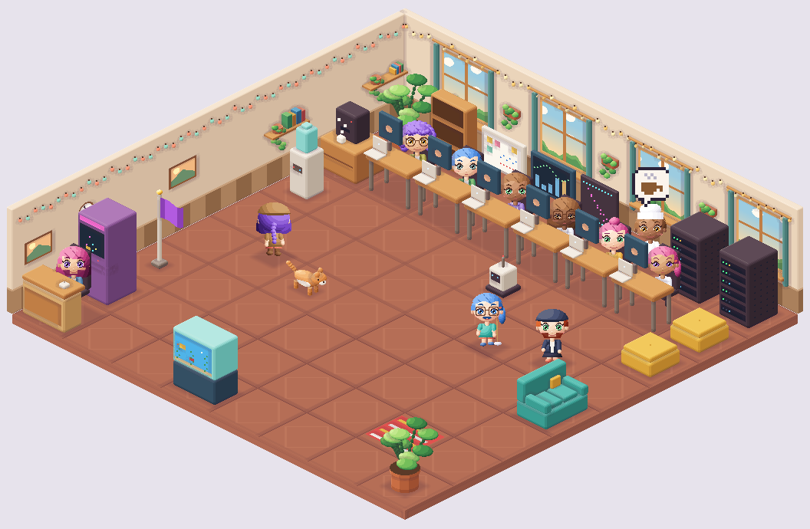

# Startup del Pomodoro

Pedido por Alberto el 2026-10-27: como los Pomodoros en los que se planta un
bosque, aquí cada minuto de concentración sirve para construir una startup,
desde aprender a programar en un garaje hasta el control global, y compararla
con la de los demás.

**Dónde está**: pestaña «Startup» de la ventana del Pomodoro (menú de la
cuenta → Modo concentración), desde el modo normal; y la escena en pequeño
abajo del Pomodoro a pantalla completa. Es parte del Pomodoro, no una sección:
no añade pestañas a la navegación (`docs/interfaz.md`).

## Reglas

- **Moneda**: los minutos de concentración de las sesiones del Pomodoro
  (`focus_sessions`, como en tus estadísticas: la acabada hasta su final, la que
  sigue hasta ahora). Los cuenta la API: el navegador no puede inventarlos.
  Gastar no resta horas del ranking.
- **Dinero** (desde el 2026-11-01): lo que se compra o se alquila (espacio,
  edificio, personal, decoración) se paga con dinero, y el dinero se gana
  mientras te concentras: cada minuto de concentración rinde lo que dan los
  productos implementados más media moneda por estrella de quien programa (y
  20 por planta del sótano de servidores), por el ánimo de la oficina, la
  energía solar (+10 % por nivel) y cada partida terminada antes (+25 %)
  (`economy.ts`). No hay reloj: la partida apunta el dinero (`cash`) y los
  minutos ganados cuando lo apuntó (`at`); el de ahora es lo apuntado más lo
  que rinden los minutos ganados desde entonces. Cada acción lo vuelve a
  apuntar, así un cambio de lo que rinde solo cuenta hacia delante, y la API
  lo vuelve a contar igual con los minutos que cuenta ella.
- **Catálogo** (`packages/startup/src/data.ts`, todo datos):
  - Aprender, cinco ramas de cinco niveles (30 min … 8 h).
  - Ordenador: del portátil viejo a dos pantallas grandes.
  - Productos (minutos): un bot, una web, una API, analítica, un asistente de
    IA y una nube propia, con tres versiones cada uno. Cada versión pide ese
    nivel aprendido en su rama y da dinero por minuto.
  - Espacio (dinero, tras el proyecto propio): tu cuarto con un ordenador
    viejo, un puesto en un coworking, una oficina pequeña, una grande, un
    edificio y el edificio entero (`SPACES`). Da sitio a la plantilla (2, 5,
    12, 30, 70, 160) y agranda la planta (`ROOM`: de 4 × 4 a 10 × 10). Las
    partidas de antes lo compraron con minutos y conservan su nivel.
  - Servidores (tras el MVP), que suman a infraestructura.
  - Edificio (dinero, desde el espacio 4): más plantas (20 sitios cada una),
    sótano de servidores, paneles solares y azotea (jardín y helipuerto).
- **Hitos**, en orden: proyecto propio, MVP, **fundar (se le pone nombre)** y
  control global (tras salir a bolsa, 60 personas, 400 h).
- **Contratar** (tras el MVP): tres candidatos al azar con su especialidad,
  estrellas (1-5, las altas raras) y aspecto; la mitad de las veces de la
  especialidad de la empresa. Volver a sacar cuesta 15 min.
- **El resto de la oficina** (dinero, tras fundar): recepción, limpieza,
  reparto, cocina, seguridad y mantenimiento (`ROLES`), cada oficio desde su
  espacio y con su máximo. No programan: suben el ánimo (la segunda persona
  de un oficio, la mitad…), y con él lo que se gana. Cada cual con su
  uniforme y lo suyo en la oficina.
- **Decoración** (dinero): veinte piezas que se compran desde su espacio, y
  tres piezas y tres mascotas que solo salen en las cajas. Lo comprado se
  deja solo en la primera baldosa libre; luego se mueve, se gira o se guarda
  en el almacén (`place`, `store`). La API comprueba que la baldosa esté
  dentro de la planta y sin otra pieza, mesa, servidor ni nada movido a mano
  (`canPlace` de `world.ts`). La decoración colocada sube el ánimo (hasta
  +0,3), y las mascotas (+0,1 cada una, hasta +0,2).
- **Vender** (pedido por Alberto el 2026-11-09, `sell`): cualquier pieza de
  decoración, colocada o en el almacén, mascotas incluidas, por lo que costó
  en la tienda. Lo que solo sale en las cajas no tiene precio de tienda: vale
  lo que da una caja en dinero en el espacio de ahora (100 × 2^espacio,
  `sellPrice`). El botón pide un segundo toque, porque lo de las cajas no se
  vuelve a comprar.
- **Nada fijo** (pedido por Alberto el 2026-11-09, `move`): además de la
  decoración, se mueven las mesas, los armarios de servidores, el mostrador
  de recepción y lo que se gana (cactus o planta, estantería, pizarra, panel,
  bandera, monedas, globo, cafetera, impresora, fuente, pufs y planta grande;
  `fixturesOf`). Cada cosa tiene una clave fija (`desk:0`, `rack:1`,
  `whiteboard`, `beanbag-2`…) y la partida guarda su baldosa en `moved`. Lo
  movido a mano manda (`layoutOf`): se coloca primero, y lo demás va a su
  sitio de siempre en lo que quede libre; lo que no cabe no sale. No se puede
  dejar encima de la decoración ni de otra cosa movida a mano; encima de algo
  que se coloca solo, sí (eso se aparta). Lo que aún no hay en la oficina no
  se mueve, y al volver a empezar (nueva partida+) todo vuelve a su sitio.
- **Cajas sorpresa**: cada sesión del Pomodoro acabada de 30 minutos o más
  (`focus_sessions`, contadas por la API con `focus.longSessions`) da una
  caja. Lo que sale está decidido con semilla (`prizeOf`): casi siempre
  decoración, a veces una pieza de las cajas o una mascota que no tienes, y
  si no, dinero. Cuentan también las sesiones de antes del 2026-11-01.
- **Nueva partida+**: con el control global y el edificio entero, se puede
  terminar (`legacy`) y volver a tu cuarto. Se conservan la decoración (lo
  que no quepa, al almacén), las mascotas, las cajas abiertas, lo gastado (el
  tiempo no vuelve), una décima del dinero y un +25 % de lo que se gana por
  cada vuelta. La nueva vuelta saca otros candidatos y otra suerte.
- **Rondas** (tras fundar): presemilla, semilla, A, B, C y salida a bolsa. Cada
  una pide plantilla, espacio y horas, y multiplica la valoración por su
  multiplicador y una suerte de 0,7 a 1,5.
- **El azar** sale de una semilla con el login y lo hecho hasta ahora
  (`seeded` en `engine.ts`): el mismo en la web y en la API, y recargar no lo
  cambia.
- **Valoración**: lo construido por las rondas (×10 con el control global).
- **Ranking** (`GET /startup/ranking`): por horas de concentración y, a
  igualdad, por valoración. Cada mundo ve el suyo (`audience`). Tocando a
  alguien se va a ver su oficina (`GET /startup/office/:login`, solo la
  partida, sin sus minutos; `404` si no sale en tu ranking).
- **Partidas de antes** (migración 82): el estado es JSON y lo nuevo es
  opcional; `parseStartup` lo lee con el dinero, la decoración y las cajas
  vacíos, y la semilla de la primera vuelta es la de siempre (los mismos
  candidatos). No hizo falta migración nueva (la 83 quedó sin usar).

## Los cinco modelos de negocio

La empresa se enfoca según lo aprendido (×2), la plantilla (×3 por estrella) y
los servidores (×2, infraestructura). El que más pesa es su modelo, con su
dibujo y su color:

| Modelo | Qué es | Dibujo |
|---|---|---|
| `front` | Apps y producto de consumo | Ventana, azul |
| `back` | Plataforma y APIs para otras empresas (SaaS) | Llaves, naranja |
| `data` | Datos y analítica | Barras, verde |
| `ai` | Inteligencia artificial | Chispa con nodos, violeta |
| `infra` | Nube e infraestructura | Nube, amarillo |

## Sin idiomas

La interfaz es de dibujos, iconos y cifras (los minutos como `h:mm`). El texto
solo está en los nombres accesibles (lector de pantalla y lo que sale al pasar
el ratón), en `comun.csv` (`startup.*`), y en el nombre que cada cual le pone a
su startup.

## Piezas (para mejorarlas una a una)

- Reglas y cuentas: `packages/startup` (`@sanatorio/startup`), compartido por
  la API (`modules/startup`, migración 82) y la web.
- `StartupPanel` es la pestaña; `StartupStrip`, la oficina en pequeño en el
  Pomodoro a pantalla completa. `art/AxisGlyph` dibuja los cinco modelos de
  negocio en las cifras y el ranking.
- Añadir una pieza al juego: una entrada en `ITEMS` (o en `DECOR`, con un
  modelo del mismo nombre), su dibujo (abajo) y su nombre accesible en
  `comun.csv`.
- `World.tsx`: el personal, la tienda de decoración, el editor para recolocar
  la oficina sin ratón (todo lo que se mueve, con flechas; la decoración
  además se gira, se guarda o se vende) y las cajas sorpresa. En la oficina
  se mueve cualquier cosa tocándola y arrastrándola (o tocando otra baldosa);
  el botón de la mano (`startup.edit`, «Recolocar la oficina») lo enciende y
  sale siempre. Lo elegido es un `Target` (`target.ts`): `d:3` para la
  decoración, la clave para lo demás.

## La oficina en píxeles

Pedido por Alberto el 2026-10-28: pixel art isométrico y fácil de ampliar
poco a poco (desde el 2026-11-10, con paredes, ventanas y ambiente). Todo se dibuja con
código, sin imágenes: así casa siempre, no hay licencias de terceros y cada
pieza crece con la partida. Vive en `apps/web/src/features/focus/startup/pixel/`.

| Pieza | Qué hace |
|---|---|
| `sprite.ts` | El motor: volúmenes en coordenadas del mundo (baldosa de 16 × 16, `z` hacia arriba) con profundidad por píxel, cantos biselados, luz suave con nueve tonos por material y sin delineado (`finish`: sombra entre piezas y sombra de contacto en el suelo). Cajas, cajas redondeadas, elipsoides, cilindros, planos pintados y figuras de pie. Proyección 2:1 (cada baldosa, 32 × 16 píxeles del dibujo, `DENSITY` veces más fina). Sin navegador. Ver [Estilo y personajes](#estilo-y-personajes). |
| `palette.ts` | La paleta. Cada caja lleva tres tonos: arriba el claro, a la izquierda el medio y a la derecha el oscuro (la luz viene de arriba a la izquierda). |
| `toon.ts` | Las personas: chibis de cabeza grande con aire de película de animación, de frente o de espaldas, quietas, andando (ocho fases) o sentadas tecleando, con su expresión, el uniforme de su oficio (gorra, gorro de cocina o casco) y lo que llevan en las manos. Cada parte sale de su aspecto (`Avatar`, el configurador) o, si no lo han tocado, de `look`. |
| `models/` | Un modelo por pieza (`Model`: `frames` y `draw`), reunidos en `models/index.ts`. |
| `light.ts` | La luz según la hora (`daylightOf`): el tono de cada dibujo, la luz del suelo (ventanas y fuentes, `floorLights`) y la del aire, cada una en su lienzo y en su sitio del orden de pintado (`airLights`: conos de las lámparas, brillo delante de las pantallas, LED y haces de las ventanas). Baja con el cuadrado de la distancia, las pantallas alumbran enteras y solo hacia delante, y no aclara las sombras ni pasa por delante de lo que la tapa. |
| `floor.ts` | Los suelos y las paredes, en tonos cálidos y uno por sitio: tablas de madera con veta (tu cuarto), cemento pulido con ladrillo visto (coworking), parquet en espiga con pared verde salvia, moqueta terracota, suelo técnico y mármol. Todo el suelo, de una pieza y sin juntas marcadas. En la pared de la derecha, ventanas con el paisaje de la hora (amanecer, día, atardecer o noche con luna), alféizar con maceta, cortinas y jardineras colgadas entre ventana y ventana; en la de la izquierda, estantes con libros y plantas colgantes, cuadros y un reloj; arriba, una guirnalda de bombillas. Es fondo: no ocupa baldosas. |
| `layout.ts` | Qué sale y dónde, solo a partir de la partida: todo sale del motor (`world.ts`, `layoutOf`, lo mismo que comprueba la API), y aquí se le pone dibujo; la recepción, en su mostrador. También quién anda por la oficina (`people`). |
| `paint.ts` | Pasa los dibujos al lienzo (`DENSITY`: cuatro píxeles de verdad por píxel del dibujo): cada fotograma de cada modelo se dibuja una vez y se guarda. Pinta de atrás adelante por la suma de la esquina de atrás de cada baldosa (`depthOf`), también para quien anda a medio camino, así nadie se pinta encima de lo que tiene delante; lo plano (alfombras) va antes que todo. |
| `PixelScene` / `PixelArt` / `ItemArt` | La oficina, un modelo suelto y el dibujo de cada tarjeta. |
| `life.ts` | La vida: un plan con semilla por persona (programar, café, charlar con quien mejor le cae, descansar; limpiar, hacer la ronda, repartir, servir café, revisar servidores; las mascotas pasean) por caminos de la cuadrícula que esquivan lo que ocupa sitio. Dónde está cada cual en un fotograma es una cuenta sobre su plan (`poseAt`). Las amistades salen de los aspectos (`friendsOf`). |
| `bubbles.ts` | Los bocadillos sin palabras: café, charla, corazón, idea, música, sueño, paquete, brillo, escudo, llave y cara contenta. |
| `move.ts` | La mudanza (cajas, camión, la oficina vieja que se desvanece y la nueva que cae pieza a pieza) y el epílogo de la nueva partida+ (el edificio de noche, un cohete que despega y tu cuarto que se monta). Con movimiento reducido no se hacen. |
| `tower.ts` | El edificio por fuera, al lado de la planta (espacio 4 y 5): plantas con ventanas (más encendidas de noche), sótano de servidores en un corte del terreno, paneles solares y azotea. |
| `useFrame.ts` | Un solo reloj a 6 fotogramas por segundo para todos; se para con movimiento reducido y con la web quieta. Dentro de `AwakeFrames` (la oficina pequeña del Pomodoro a pantalla completa) solo para con la pestaña escondida: esa pantalla marca quieta la web que tapa y quien se concentra no toca nada, pero es lo que se mira (arreglado el 2026-10-29: los muñequitos no se movían). |

Se agranda siempre a múltiplos enteros (× 2, × 3; en las tarjetas, de medio en
medio) con `image-rendering: pixelated`, para que ningún píxel salga borroso.

### Añadir un modelo

1. Su `Model` en `models/` (en el archivo de su familia o en uno nuevo): cajas
   con `sprite.box`, detalles con `faceX` / `faceY` / `faceZ` y `dot`, y
   píxeles a mano con `grid`. Lo que mira a la izquierda (`faceY`) es lo que
   más se ve: pantallas, frentes, luces.
2. Una línea en `MODELS` (`models/index.ts`).
3. Para que salga en la oficina, su regla en `DECOR` (`layout.ts`): cuándo
   (etapa, espacio, hitos…) y dónde (fondo, izquierda, derecha o delante,
   por orden de preferencia).
4. Para que sea el dibujo de una tarjeta, su caso en `modelOf` (`ItemArt.tsx`).
5. `npm run pixel -w @sanatorio/web -- <modelo>` lo pinta en PNG
   (`apps/web/.pixel/`) en cada nivel y fotograma, sin abrir la web. Sin
   nombre, pinta todos los modelos y seis oficinas de ejemplo.

Los tests (`tests/unit/startup-pixel.test.ts`) comprueban solos que el modelo
nuevo cabe en su lienzo en cualquier nivel y fotograma, que sale siempre igual
y que en ninguna oficina hay dos cosas en la misma baldosa.

### Añadir una animación

Un modelo anima con `frames` (cuántos fotogramas tiene) y el `frame` que
recibe `draw`: lo que cambie entre uno y otro se mueve. Van a 6 por segundo,
como en los juegos de píxeles: un parpadeo es un fotograma de 16, un vaivén
son dos posiciones. Para que no se muevan todos a la vez, se desfasa con algo
propio (`look`, el nivel). Lo que parece al azar (luces, motas) sale de
`scatter`, nunca de `Math.random`: el mismo fotograma tiene que salir igual.

Un modelo se puede girar (`turn`): el motor lo refleja y cambia los tonos de
las caras para que la luz siga viniendo de la izquierda (`Sprite.turned`).
De noche (de las 21 a las 7 en tu reloj) la oficina baja la luz y el edificio
enciende más ventanas; es solo el dibujo, nada de la partida.

### Lo siguiente

- Más modelos por modelo de negocio (por ejemplo, una granja de GPU para `ai`).
- Varias plantas a la vista (ahora la plantilla que no cabe sale como «+N» y
  el edificio se ve por fuera).
- Que la amistad crezca con lo que se ha charlado (ahora sale del aspecto de
  cada par) y un panel con las relaciones.
- Paredes, ventanas y puertas en cada sitio.

## Estilo y personajes

Elegido con Alberto el 2026-11-10, tras probar muestras (isométrico cálido,
chibi japonés, RPG de consola, futurista…): **isométrica**, entorno cálido de
madera, verde agua, cobre y lino con **cantos biselados** (redondeados pero
sin hincharse), **sin delineado oscuro** y personas **chibi con aire de
película de animación**. Una sola calidad, la más fina: las versiones a menos
resolución (8 y 16 bits) de este estilo perdían las caras y no convencieron;
el selector de calidad del 2026-11-09 se retiró
([histórico](historico-retiradas.md#pomodoro-y-startup)).

**El motor** (`sprite.ts`) guarda en cada píxel a qué distancia está lo
pintado: lo de delante tapa lo de detrás se dibuje en el orden que se
dibuje, y una persona sentada queda de verdad detrás de su mesa. Cada material
pasa de tres tonos a nueve (los tres de siempre, una sombra más honda hacia el
violeta y una luz hacia el amarillo), y el tono sale de hacia dónde mira la
superficie: las caras planas conservan sus colores y los biseles llevan los de
en medio. Sin contorno, lo que separa unas cosas de otras es `finish`: un poco
de sombra donde algo queda pegado detrás de otra pieza y una sombra de
contacto violeta, suave y transparente, en el suelo bajo lo que lo toca.
Girado, el modelo sale reflejado con la luz también reflejada, para que siga
viniendo de arriba a la izquierda. Los modelos de antes se dibujan igual: sus
cajas salen biseladas y con sus tonos, sin tocarlos; lo escrito a mano
(`grid`) se agranda con Scale2x dos veces.

**Las personas** (`toon.ts`) se pintan en un lienzo propio (32 × 40 unidades,
media baldosa de ancho) y el motor las pone de pie en el mundo
(`Sprite.figure`), cada fila un poco más cerca cuanto más alta. Ojos
almendrados con iris en degradado, pupila y dos brillos, párpado con dos
pestañas, cejas que actúan (alegría, concentración), nariz de botón, boca
ancha y mofletes. Quien teclea pone cara de concentración; quien anda, ocho
fases de paso con los brazos al revés.

**El configurador** («Personajes», el botón de la persona junto al de
recolocar): eliges a alguien (tú o alguien de la plantilla), cambias cada
parte mirándolo en grande (`AvatarPortrait`: la figura dibujada a ×3, no
agrandada, para que se noten las pecas o las cejas) y lo guardas (`{ type: 'avatar', index, avatar }`,
`-1` eres tú; gratis). Las partes y cuántas opciones tiene cada una están en
`packages/startup/src/avatar.ts` (`AVATAR_PARTS`), que la API usa para
validar; cómo se dibuja cada una, en `toon.ts`:

| Parte | Opciones |
|---|---|
| Piel | 8 tonos |
| Peinado | media melena, corto, tupé, rizos, trenza, coleta, moño, melena larga, rapado |
| Color del pelo | 10 (castaños, negro, pelirrojo, rubio, canoso y de fantasía) |
| Ojos | almendrados, redondos, alegres, serenos; 6 colores |
| Cejas | gruesas, finas, arqueadas |
| Pecas, gafas, barba | con o sin; gafas redondas o cuadradas; barba corta, bigote o perilla |
| Arriba | jersey, camisa, sudadera, camiseta, chaqueta; 12 colores |
| Abajo | vaqueros, pantalón, falda, pantalón corto; 10 colores |
| Calzado | zapatillas, botas, zapatos; 6 colores |

Quien no lo ha tocado sale de su `look` (`avatarOf`): el mismo en cada
recarga y para quien visita la oficina, sin gafas ni barba casi nunca. Con
oficio, el uniforme manda sobre la ropa de arriba. Añadir una opción: subir su
número en `AVATAR_PARTS` (al final, sin mover las de antes) y dibujarla en
`toon.ts`; los tests comprueban que cada opción cambie el dibujo.

**Hacia dónde miran al andar**: `life.ts` da a cada paso `back` (va hacia
arriba en pantalla) y `turn` (va hacia la derecha), pensados para la gente,
que mira hacia +y. El robot también; el gato y el perro van de lado, a lo
largo de x, así que `petHeading` (`models/pets.ts`) lo traduce: girados miran
hacia +y y, de espaldas, el cuerpo se da la vuelta a lo largo. El robot, de
espaldas, enseña una rejilla en vez de la cara. Un test lo comprueba en los
cuatro sentidos.

**Ver los dibujos sin abrir la web**: `npm run pixel -w @sanatorio/web` deja en
`apps/web/.pixel/` todos los modelos, las oficinas de ejemplo, `gente.png`
(cada parte del configurador con todas sus opciones), `sentidos.png` (la
gente y las mascotas andando en los cuatro sentidos) y `retratos.png` (el
retrato grande del configurador).

**Referencias de estética** (buscadas el 2026-11-09; inspiración, nunca copiar
dibujos ni recrear un juego). La startup empieza en lo cotidiano y acaba
futurista:

| Etapa | Referencia | Qué tomar |
|---|---|---|
| Toda la partida | Chrono Trigger (1995): la misma gramática de baldosas de una época a otra | Cada etapa cambia sobre todo la luz y los materiales: de tierras y verdes a azules, cian y acero |
| Cuarto, coworking | Eastward (2021) | Luz cálida de ventana en el suelo, sombra de contacto al pie de los muebles, objetos que cuentan cosas |
| Oficina | Game Dev Story (Kairosoft) | Mobiliario muy legible a tamaño pequeño, animaciones cortas |
| Edificio | SimTower (1994), eBoy (ciudades isométricas) | Color por tipo de sala, ventanas encendidas de noche, densidad de detalle repetido |
| Torre, control global | VA-11 Hall-A (2016), Waneella (ciudades animadas) | Fondo oscuro desaturado con pocos acentos de neón (rosa y cian) con halo de un píxel; bucles de ambiente (letreros, nubes) |
| Técnica | Slynyrd (rampas de color, isometría), saint11 (sombreado, contornos, subpíxel) | Rampas de 4–5 tonos por material, *dithering* solo en degradados grandes, 4–6 fotogramas por persona |

Paletas abiertas a probar (Lospec; confirmar la licencia con su autor antes de
usarlas): Resurrect 64 (64 colores, cálidos y fríos), Apollo (46) y
Endesga 32.

**Calidez y ambiente** (pedido por Alberto el 2026-11-10: «aún es una estética
muy fría»). La paleta entera se movió hacia lo cálido (metales y pantallas
con un punto rojizo, servidores de ciruela oscura, porcelana y cristal
cremosos); los suelos y las paredes van como se cuenta en `floor.ts`. La
monstera, el cactus (con su flor), el bonsái, el árbol, el gato, el perro y
la bandera se rehicieron con formas (hojas en racimos por el ángulo de oro,
`foliage`), sin píxeles a mano.

**Luz y hora del día** (pedido por Alberto el 2026-11-10: suelo sin líneas
oscuras, halos en las lámparas, luz por las ventanas con efecto Tyndall y lo
de fuera según la hora). El suelo se pinta de una pieza (`floorColor`, un
solo plano): con una pieza por baldosa, el sombreado de rincones del motor
marcaba cada junta. Las piezas se distinguen solo por el tono. La hora de
quien mira (`light.ts`, `daylightOf`) da cuatro luces: amanecer (de 7 a 9),
día (de 9 a 18), atardecer (de 18 a 21) y noche. Con ella cambian:

- lo que se ve por las ventanas (`floor.ts`, `sky`): cielo melocotón y lila
  con el sol bajo a un lado; azul con el sol alto y nubes; naranja y morado
  con el sol poniéndose al otro lado y las colinas a contraluz; azul noche
  con estrellas y luna;
- el tono de la sala (un velo rosado, nada, malva o violeta), solo dentro
  de la sala;
- la luz que entra (`floorLights` y los haces de `airLights`): por cada cristal, una
  mancha en el suelo y un haz en el aire que se desvanece al bajar (efecto
  Tyndall), con motas de polvo que brillan al cruzarlo. Sutil y difuminada
  (sin bordes, sobre todo en el suelo: pedido por Alberto el mismo día);
  más tumbada y de color al amanecer y al atardecer. De noche no entra;
- lo que emite luz (pedido por Alberto el mismo día: de noche solo alumbra
  lo que da luz). Cada fuente (`EMITTERS`) tiene su sitio, su altura, hacia
  dónde apunta, su alcance y, si es una pantalla, su tamaño: la pantalla
  entera alumbra hacia donde mira (`across`, cinco puntos de lado a lado), y
  por detrás nada. La luz baja con el cuadrado de la distancia (`falloff`).
  Las lámparas echan un cono de la bombilla al suelo que cubre su baldosa y
  las ocho de alrededor. La tele, el panel de métricas y el arcade dan una
  luz azulada que llena el aire delante de la pantalla (`screenGlow`). Las de
  las mesas miran hacia quien se sienta: de espaldas a la sala, su luz se le
  ve en la cara (`glow`, `toon.ts`), y la trasera del monitor queda a
  oscuras. Los servidores alumbran un poco con sus LED; el neón, el acuario y
  la máquina, a su color. Casi no se nota de día y del todo de noche. La
  guirnalda se enciende al caer la tarde.

**Luz que respeta lo que hay delante** (pedido el mismo día). La luz va en
dos partes. La del suelo (ventanas y fuentes, `floorLights`) se pinta debajo
de los muebles y de la gente, así que lo que está encima la tapa; se le
quitan las sombras de lo colocado y, en cada fotograma, las de quien anda
(las sombras no se aclaran). La del aire (`airLights`: conos, brillo delante
de las pantallas, LED, haces de las ventanas) va cada una en su lienzo y
entra en el orden de pintado en su sitio: después de su pieza y de lo que
tiene detrás, antes de lo que tiene delante, que la tapa. El tono de la hora
se le da a cada dibujo (`tinted`), no por encima de todo, para que la noche
no apague lo que alumbra. El suelo se pinta un poco por debajo de las
paredes para que no quede una rendija clara en el zócalo.

**Cómo se pinta y qué se guarda** (2026-11-10, Alberto preguntó por el
gasto). La escena va a 6 fotogramas por segundo, con un solo reloj para todos
los dibujos (`useFrame`), y se para con la pestaña escondida, con «menos
movimiento» o con la web quieta. Casi todo se calcula una vez y se guarda:

| Qué | Se calcula | Se guarda en |
|---|---|---|
| Cada fotograma de cada modelo (volúmenes, luz, sombras) | la primera vez que sale | `frames` (`paint.ts`), hasta 1 500; los que se ven igual comparten dibujo (`Model.same`) |
| Cada figura de persona | una vez por aspecto, pose y expresión | `toonOf` (`toon.ts`), hasta 600 |
| Suelo, paredes y ventanas | una vez por tamaño, suelo y hora | `floors` (`paint.ts`) |
| Cada dibujo con el tono de la hora | la primera vez que sale a esa hora | `Drawn.tints` (`paint.ts`) |
| La luz del suelo (difuminada y sin las sombras de lo colocado) y la del aire (cada luz en su lienzo) | una vez por oficina y hora | `baked` (`paint.ts`) |

En cada fotograma solo se copian lienzos ya hechos (`drawImage`): el suelo,
su luz (sin las sombras de quien anda), y las piezas, la gente y las luces
del aire de atrás adelante. La luz respira un poco con su transparencia. Por
último, las motas y la guirnalda, que son pocas y sin desenfoque. Antes, la luz se
recalculaba con desenfoque en cada fotograma: unos 190 ms por fotograma de
día y 72 de noche (Chrome sin tarjeta gráfica, la oficina mediana). Ahora,
menos de 3 ms. Solo el primer fotograma tarda (unos 0,5 s), al dibujar y
guardar lo que sale.

Lo siguiente: rehacer con formas lo que aún lleva píxeles a mano (letreros,
el robot, la estantería de lo aprendido) y un neón con halo en las últimas
etapas.

## La pantalla del Pomodoro en el móvil (2026-10-29)

Pedido por Alberto: a pantalla completa, la pantalla del móvil no se apaga ni
se bloquea, para que el tiempo y el «no molestar» sigan a la vista. Lo hace el
bloqueo de pantalla del navegador (`features/focus/useWakeLock.ts`, la API
*Screen Wake Lock*): se pide al abrir, se vuelve a pedir al volver a la
pestaña (el navegador lo suelta al esconderla) y se suelta al cerrar. Donde no
existe (Firefox, Safari anterior a la 16.4) no pasa nada. La pantalla completa
de verdad se pide también con el prefijo de Safari; en el iPhone no existe, y
la ventana del Pomodoro ya tapa toda la web. Las animaciones de la propia
pantalla del Pomodoro tampoco se paran con la web quieta (`styles/comfort.css`).
